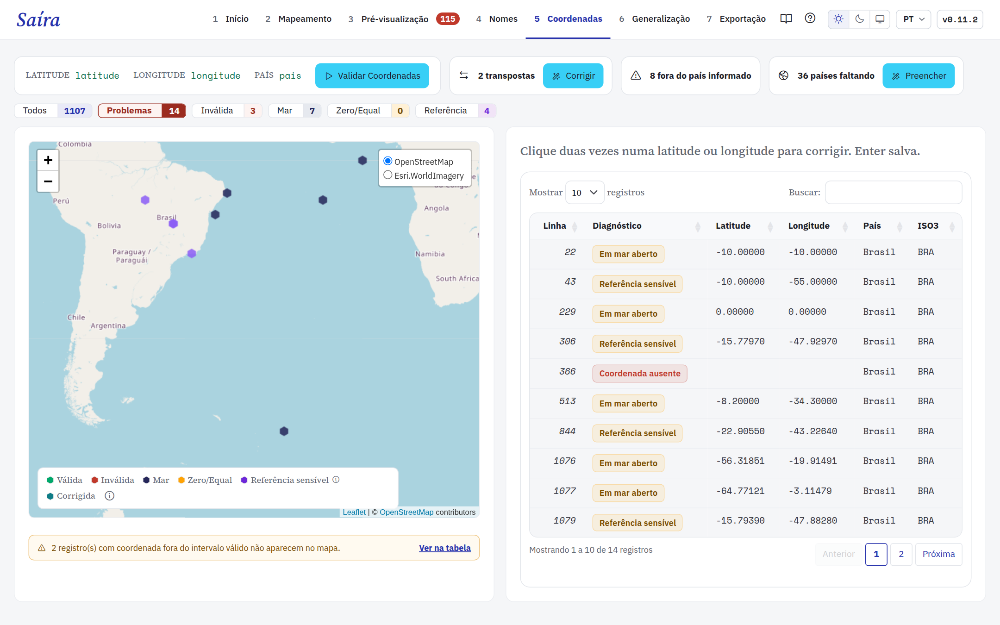

<a href="https://rogerio-onza.github.io/saira/">
  
</a>

<p align="center">
  <a href="https://github.com/rogerio-onza/saira/releases/latest"><strong>Baixar para Windows ou Linux</strong></a> ·
  <a href="https://rogerio-onza.github.io/saira/tutoriais/01-instalacao.html">Tutoriais</a> ·
  <a href="#in-english">English</a> ·
  <a href="https://github.com/rogerio-onza/saira/issues">Reportar um problema</a>
</p>

O Saíra converte planilhas de ocorrência para o padrão Darwin Core, o formato
que o SiBBr e o GBIF aceitam. O app confere nomes e coordenadas, reduz a
precisão das espécies ameaçadas e gera o pacote para o IPT. Você usa menus,
tabelas e mapas. Não é preciso programar.

## 7 etapas



| Etapa | O que faz |
| --- | --- |
| [1 · Início](https://rogerio-onza.github.io/saira/tutoriais/02-upload.html) | Lê CSV, TSV, TXT e XLSX, pacotes Camtrap DP e exportações do Wildlife Insights. |
| [2 · Mapeamento](https://rogerio-onza.github.io/saira/tutoriais/03-mapeamento-dwc.html) | Associa cada coluna a um termo Darwin Core, com sugestões automáticas. |
| [3 · Pré-visualização](https://rogerio-onza.github.io/saira/tutoriais/04-pre-visualizacao.html) | Mostra os registros mapeados e permite editar células. |
| [4 · Nomes](https://rogerio-onza.github.io/saira/tutoriais/05-validacao-nomes.html) | Confere grafia e sinônimos no Flora BR e no Fauna BR, sem internet, e no GBIF. |
| [5 · Coordenadas](https://rogerio-onza.github.io/saira/tutoriais/06-validacao-coordenadas.html) | Testa faixa, pontos no mar, país informado e inversão de latitude e longitude. |
| [6 · Generalização](https://rogerio-onza.github.io/saira/tutoriais/07-generalizacao.html) | Reduz a precisão das espécies ameaçadas, pela tabela de decisão de Chapman (2020). |
| [7 · Exportação](https://rogerio-onza.github.io/saira/tutoriais/08-exportacao.html) | Gera datas ISO, `occurrenceID` estáveis e o pacote final. |

O pacote final tem um Darwin Core Archive (`occurrence.txt`, `meta.xml`,
`eml.xml`), uma cópia em `.xlsx` e o guia de mapeamento, que serve para o
próximo conjunto. O `eml.xml` traz a área geográfica e o intervalo de datas dos
dados. Depois, você publica o arquivo no SiBBr ou no GBIF pelo IPT.

## Instalar

<table>
<tr>
<td width="33%" valign="top">
<h3>Windows</h3>
<p>Instalador <code>.exe</code> para x64. O R e as dependências vêm junto.</p>
<p><a href="https://github.com/rogerio-onza/saira/releases/latest"><strong>Baixar para Windows</strong></a></p>
</td>
<td width="33%" valign="top">
<h3>Linux</h3>
<p><code>.deb</code> para Ubuntu 24.04+ e Debian 13+, ou <code>.AppImage</code> com glibc 2.39+.</p>
<p><a href="https://github.com/rogerio-onza/saira/releases/latest"><strong>Baixar para Linux</strong></a></p>
</td>
<td width="33%" valign="top">
<h3>macOS ou R</h3>
<p>Pacote R para quem já usa R 4.1 ou mais recente.</p>
<p><a href="#pacote-r"><strong>Ver os comandos</strong></a></p>
</td>
</tr>
</table>

<sub>Passo a passo com capturas de tela: <a href="https://rogerio-onza.github.io/saira/tutoriais/01-instalacao.html">guia de instalação</a>.</sub>

### Pacote R

```r
options(repos = c(
  ropensci = "https://ropensci.r-universe.dev",
  CRAN     = "https://cloud.r-project.org"
))
install.packages("pak")
pak::pak("rogerio-onza/saira")
saira::run_app()
```

`florabr` e `faunabr` vêm do R-universe. No Linux, o pacote `sf` precisa de
GDAL, GEOS e PROJ. Instale antes:

```bash
sudo apt-get install -y libgdal-dev libgeos-dev libproj-dev libudunits2-dev
```

### Desenvolver

```r
# git clone https://github.com/rogerio-onza/saira.git
renv::restore()
pkgload::load_all()
run_app()
devtools::test()
```

Leia o [CONTRIBUTING.md](CONTRIBUTING.md) antes de abrir um pull request.

## In English

Saíra converts biodiversity occurrence spreadsheets to Darwin Core for
publication on GBIF and SiBBr. It runs as a desktop app (Windows, Linux) or as
an R package, with a PT, EN and ES interface. Read the
[English documentation](https://rogerio-onza.github.io/saira/en/) or the
[installation guide](https://rogerio-onza.github.io/saira/en/tutorials/01-installation.html).

---

<sub>
Foto do banner: Renato Bandeira, CC BY 4.0.
Fontes de dados e licenças: <a href="https://rogerio-onza.github.io/saira/tecnologias.html">Tecnologias e créditos</a>.
Código sob <a href="LICENSE.md">GPL-3.0</a> ·
<a href="CHANGELOG.md">Histórico de alterações</a>
</sub>
