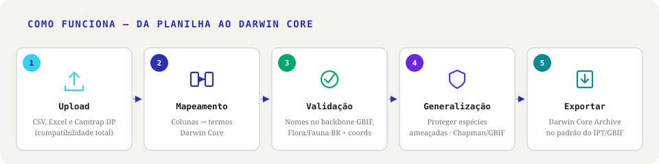
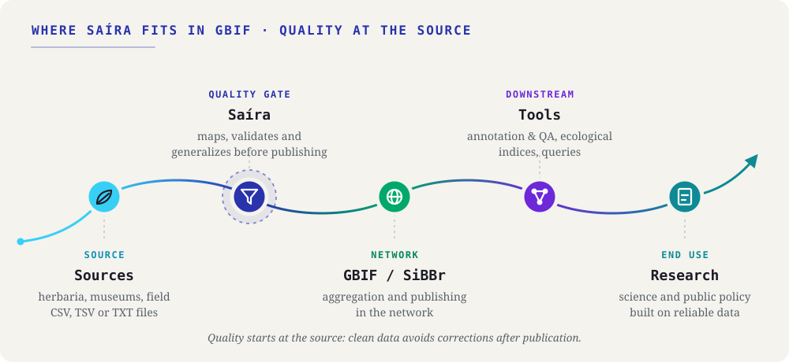
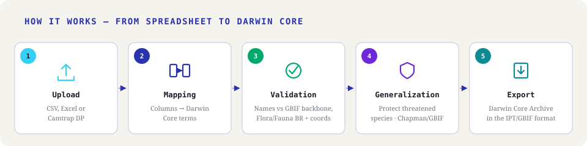

# Saíra 🐦

Saíra é um aplicativo em R/Shiny para padronizar planilhas de ocorrências de
biodiversidade no padrão Darwin Core (DwC) e publicá-las no GBIF e no SiBBr.
A interface é visual e trilíngue (PT-BR/EN-US/ES); não é preciso programar para usar.

[🇧🇷 Português](#português) · [🇺🇸 English](#english)

---

## Português

### 🔎 O que é

Você tem uma planilha (CSV/TSV) com registros de espécies e precisa
publicá-la no Darwin Core — o conjunto de nomes de colunas e formatos que o GBIF
e o SiBBr esperam. O Saíra carrega a planilha, ajuda a associar suas colunas aos
termos do Darwin Core, valida nomes e coordenadas e gera o arquivo final.

O app abre no navegador; você usa por menus, botões e tabelas. Código, só na
instalação.

📚 **Tutoriais completos e documentação** ficam no site do projeto:
<https://rogerio-onza.github.io/saira/>. Este README é só um resumo.


### 🔄 Como funciona



1. **Upload** — carregue seu CSV (`.csv`, `.tsv`, `.txt`) ou pacote de armadilha fotográfica.
2. **Mapeamento** — associe cada coluna a um termo do Darwin Core (com sugestões automáticas).
3. **Validação** — confira nomes científicos e coordenadas.
4. **Generalização** — proteja coordenadas de espécies ameaçadas (Lista MMA), seguindo a tabela de decisão de Chapman (2020).
5. **Exportar** — baixe o arquivo padronizado, pronto para o GBIF/IPT.

### ✨ Recursos

- Lê CSV (`.csv`, `.tsv`, `.txt`).
- Mapeamento de colunas com sugestões automáticas para os termos Darwin Core.
- Verificação de nomes científicos contra bases taxonômicas (grafia e sinônimos).
- Validação de coordenadas: faixas de lat/lon, pontos no mar, país e coordenadas
  trocadas, com correção em um clique.
- Generalização de espécies sensíveis: para táxons ameaçados (Lista Nacional do
  MMA), ajuda a reduzir a precisão das coordenadas espécie por espécie, seguindo
  a tabela de decisão de Chapman (2020).
- Status de conservação anexado na exportação (campo `dynamicProperties`):
  categoria MMA (`mmaThreatStatus`) das bases brasileiras e categoria IUCN global
  (`iucnRedListCategory`) do GBIF.
- Exporta um Darwin Core Archive (`occurrence.txt`, `meta.xml`, `eml.xml`) pronto
  para o GBIF/IPT, mais uma cópia em `.xlsx` e o guia de mapeamento. O `eml.xml`
  já traz a área geográfica e o intervalo de datas calculados dos seus dados.
- `occurrenceID` estável: preenche IDs faltantes de forma determinística (a mesma
  combinação gera sempre o mesmo ID), então republicar no GBIF conta como
  atualização, não como registro novo.
- Armadilhas fotográficas: importa pacotes Camtrap DP e exportações do
  Wildlife Insights.

### 📦 Instalação

**App (Windows e Linux).** Baixe o instalador em
[Releases](https://github.com/rogerio-onza/saira/releases/latest). O app traz o R
e as dependências. Windows x64 usa o `.exe`. Linux x64 usa o `.deb` (Ubuntu 24.04+,
Debian 13+) ou o AppImage (glibc 2.39+). Passo a passo:
[Instalação](https://rogerio-onza.github.io/saira/tutoriais/01-instalacao.html).

**Pacote R (macOS, ou quem já usa R).** Instale o R 4.1.0 ou mais recente e rode:

```r
options(repos = c(
  ropensci = "https://ropensci.r-universe.dev",
  CRAN     = "https://cloud.r-project.org"
))

install.packages("pak")
pak::pak("rogerio-onza/saira")
```

`florabr` e `faunabr` não estão no CRAN: o `options()` torna o R-universe visível.
A primeira instalação pode levar alguns minutos.

### ▶️ Como abrir

No app, abra o Saíra pelo menu do sistema. No pacote R, rode:

```r
library(saira)
run_app()
```

O app abre no navegador.

Notas:

- **Bases de nomes:** Flora BR e Fauna BR já vêm no Saíra e funcionam sem internet.
  O GBIF precisa de internet.
- **Linux (Debian/Ubuntu), pacote R:** a dependência `sf` precisa de GDAL, GEOS e PROJ.
  Instale antes: `sudo apt-get install -y libgdal-dev libgeos-dev libproj-dev libudunits2-dev`.
  No Windows e no macOS não há nada extra a fazer.

### 🛠️ Desenvolvimento

```bash
git clone https://github.com/rogerio-onza/saira.git
cd saira
```

```r
if (!requireNamespace("renv", quietly = TRUE)) install.packages("renv")
renv::restore()
pkgload::load_all()
run_app()
```

Testes:

```r
devtools::test()                            # tudo
devtools::test(filter = "rostrum-stage1")   # um arquivo
```

```bash
RUN_PERF=true Rscript -e "devtools::test(filter = 'performance')"  # performance
RUN_E2E=true  Rscript -e "devtools::test(filter = 'e2e')"          # ponta a ponta (shinytest2 + navegador)
```

Antes de abrir um pull request, leia [CONTRIBUTING.md](CONTRIBUTING.md).

### 🧩 Tecnologias e créditos

O Saíra usa pacotes R de código aberto (Shiny, `httr2`/`florabr`/`faunabr`,
`CoordinateCleaner`/`sf`/`terra`, entre outros) e embute dados de fontes públicas
(camada Natural Earth, termos Darwin Core do TDWG sob CC-BY, Lista Nacional de
Espécies Ameaçadas — Portarias MMA nº 148/2022, nº 1.704/2026 e GM/MMA
nº 1.667/2026). A lista completa, com links e
licenças, está em
[Tecnologias e créditos](https://rogerio-onza.github.io/saira/tecnologias.html).

### 📄 Licença

GNU General Public License v3.0 (GPL-3) — veja [LICENSE.md](LICENSE.md).

---

## English

### 🔎 What it is

You have a spreadsheet (CSV/TSV) with species records and need to publish it
in Darwin Core — the set of column names and formats that GBIF and SiBBr expect.
Saíra loads the spreadsheet, helps you map your columns to Darwin Core terms,
validates names and coordinates, and produces the final archive.

The app opens in your browser; you work through menus, buttons, and tables. Code,
only at install time.

📚 **Full tutorials and documentation** live on the project site:
<https://rogerio-onza.github.io/saira/en/>. This README is only a summary.



### 🔄 How it works



1. **Upload** — load your CSV (`.csv`, `.tsv`, `.txt`) or camera-trap package.
2. **Mapping** — match each column to a Darwin Core term (with automatic suggestions).
3. **Validation** — check scientific names and coordinates.
4. **Generalization** — protect coordinates of threatened species (MMA list), following Chapman's (2020) decision table.
5. **Export** — download the standardized file, ready for GBIF/IPT.

### ✨ Features

- Reads CSV (`.csv`, `.tsv`, `.txt`).
- Column mapping with automatic suggestions for Darwin Core terms.
- Scientific-name verification against taxonomic backbones (spelling and synonyms).
- Coordinate validation: lat/lon ranges, points at sea, country, and swapped
  coordinates, with one-click correction.
- Generalization of sensitive species: for threatened taxa (national MMA list),
  helps reduce coordinate precision species by species, following Chapman's
  (2020) decision table.
- Conservation status attached at export (`dynamicProperties` field): the MMA
  category (`mmaThreatStatus`) from the Brazilian databases and the global IUCN
  category (`iucnRedListCategory`) from GBIF.
- Exports a Darwin Core Archive (`occurrence.txt`, `meta.xml`, `eml.xml`) ready
  for GBIF/IPT, plus an `.xlsx` copy and the mapping guide. The `eml.xml` already
  carries the geographic bounding box and date range computed from your data.
- Stable `occurrenceID`: fills missing IDs deterministically (the same combination
  always yields the same ID), so republishing to GBIF counts as an update, not a
  new record.
- Camera-trap data: imports Camtrap DP packages and Wildlife Insights
  exports.

### 📦 Installation

**App (Windows and Linux).** Download the installer from
[Releases](https://github.com/rogerio-onza/saira/releases/latest). The app has its
own R and dependencies. Windows x64 uses the `.exe`. Linux x64 uses the `.deb`
(Ubuntu 24.04+, Debian 13+) or the AppImage (glibc 2.39+). Step by step:
[Installation](https://rogerio-onza.github.io/saira/en/tutorials/01-installation.html).

**R package (macOS, or people who already use R).** Install R 4.1.0 or newer and run:

```r
options(repos = c(
  ropensci = "https://ropensci.r-universe.dev",
  CRAN     = "https://cloud.r-project.org"
))

install.packages("pak")
pak::pak("rogerio-onza/saira")
```

`florabr` and `faunabr` are not on CRAN: the `options()` call makes the R-universe visible.
The first install may take a few minutes.

### ▶️ Running it

In the app, open Saíra from the system menu. In the R package, run:

```r
library(saira)
run_app()
```

The app opens in your browser.

Notes:

- **Name backbones:** Flora BR and Fauna BR come with Saíra and work offline.
  GBIF needs internet.
- **Linux (Debian/Ubuntu), R package:** the `sf` dependency needs GDAL, GEOS, and PROJ.
  Install them first: `sudo apt-get install -y libgdal-dev libgeos-dev libproj-dev libudunits2-dev`.
  On Windows and macOS there is nothing extra to do.

### 🛠️ Development

```bash
git clone https://github.com/rogerio-onza/saira.git
cd saira
```

```r
if (!requireNamespace("renv", quietly = TRUE)) install.packages("renv")
renv::restore()
pkgload::load_all()
run_app()
```

Tests:

```r
devtools::test()                            # everything
devtools::test(filter = "rostrum-stage1")   # a single file
```

```bash
RUN_PERF=true Rscript -e "devtools::test(filter = 'performance')"  # performance
RUN_E2E=true  Rscript -e "devtools::test(filter = 'e2e')"          # end-to-end (shinytest2 + browser)
```

Before opening a pull request, read [CONTRIBUTING.md](CONTRIBUTING.md).

### 🧩 Technologies and credits

Saíra uses open-source R packages (Shiny, `httr2`/`florabr`/`faunabr`,
`CoordinateCleaner`/`sf`/`terra`, among others) and bundles data from public
sources (Natural Earth layer, Darwin Core terms from TDWG under CC-BY, the
Brazilian Official List of Threatened Species — Portarias MMA nº 148/2022,
nº 1.704/2026 and GM/MMA nº 1.667/2026). The full list,
with links and licenses, is in [Technologies and credits](https://rogerio-onza.github.io/saira/en/technologies.html).

### 📄 License

GNU General Public License v3.0 (GPL-3) — see [LICENSE.md](LICENSE.md).
