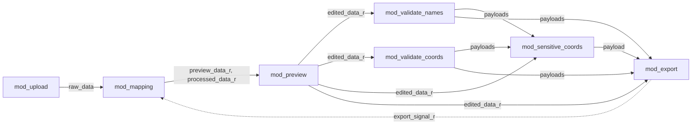

# Saíra: arquitetura

> Estado atual do app (rumo à v1.0.0). Revisado em 20/10/2026.
> Este documento descreve o que o código faz hoje. O motivo e o histórico de
> cada escolha estão em `docs/DECISIONS.md` (ADR-NNN).

---

## 1. Visão geral

Saíra padroniza planilhas de biodiversidade para Darwin Core (DwC) e gera um
DwC-A pronto para IPT, GBIF e SiBBr.

- **Framework**: Shiny com `bslib` (Bootstrap 5), pacote R no estilo `golem`.
- **Idiomas**: PT-BR, EN-US e ES (ADR-133), via `tr(key, lang)` e
  `inst/extdata/i18n.json`.
- **Testes**: `testthat` para funções puras e `testServer()`, `shinytest2` para
  E2E no navegador (seção 8).

Princípios:

- Sem `global.R`, sem `library()` e sem `source()` em `R/` (ADR-001).
  Dependências ficam no `DESCRIPTION` e o código usa `pkg::fun()` ou imports
  roxygen.
- Regra de negócio fica em funções puras `R/utils_*.R`. Os módulos `R/mod_*.R`
  só ligam UI e reatividade a essas funções.
- `R/app_server.R` só liga os módulos e repassa reactives.
- Nenhum texto de UI fixo no código: tudo passa por `tr()`.

---

## 2. Estrutura de arquivos

```text
saira/
├── DESCRIPTION               # Metadados e dependências
├── NAMESPACE, man/           # Gerados por roxygen2 (devtools::document())
├── app.R                     # pkgload::load_all(); run_app()
├── R/
│   ├── run_app.R, app_ui.R, app_server.R, saira-package.R
│   ├── mod_upload.R          # Início: CSV/TSV/TXT/XLSX, Camtrap DP e Wildlife Insights (.zip)
│   ├── mod_mapping*.R        # Mapeamento: cards, loading, assistentes basisOfRecord e establishmentMeans
│   ├── mod_preview.R         # Pré-visualização: tabela e modo Problemas com correção de célula
│   ├── mod_validate_names*.R # Nomes
│   ├── mod_validate_coords.R # Coordenadas
│   ├── mod_sensitive_coords.R  # Generalização de espécies sensíveis
│   ├── mod_export.R          # Exportação: resumo, alertas e bloqueios
│   ├── mod_export_download.R # Exportação: download do DwC-A e do arquivo privado
│   ├── mod_wiki.R, mod_help.R
│   ├── utils_*.R             # Funções puras (tabela abaixo)
│   └── data_dictionary.R     # Loader com cache do i18n.json
├── inst/
│   ├── extdata/              # Dados embarcados (seção 6)
│   └── app/www/              # CSS (fontes modulares + bundle custom.css), JS, imagens
├── data-raw/                 # Scripts que geram dados embarcados e o bundle CSS
├── scripts/release_gate.R    # Gate local antes de uma release (seção 8)
├── tests/testthat/           # Testes, fixtures e setup.R
└── website/                  # Site de ajuda em Quarto (PT, EN, ES)
```

| Área | Arquivos `R/utils_*.R` |
|---|---|
| Leitura | `utils_io.R`, `utils_camtrap.R` |
| DwC e vocabulário | `utils_dwc.R`, `utils_vocabulary.R` |
| Mapeamento (Rostrum) | `utils_mapping.R`, `utils_rostrum_engine.R`, `utils_rostrum_db.R`, `utils_rostrum_templates.R`, `utils_rostrum_contracts.R`, `utils_oceanic_islands.R` |
| Pré-visualização | `utils_preview.R`, `utils_preview_fix.R` |
| Nomes | `utils_taxadb.R`, `utils_brproviders.R`, `utils_threat_status.R`, `utils_invasive.R`, `utils_species_photos.R` |
| Coordenadas | `utils_coords.R`, `utils_coords_run.R`, `utils_coords_utm.R` |
| Generalização | `utils_sensitive.R` |
| Exportação | `utils_export.R`, `utils_export_summary.R` |
| Comum | `utils_common.R`, `utils_i18n.R`, `utils_icons.R`, `utils_credits.R`, `utils_version.R` |

O motor de mapeamento está descrito em `docs/rostrum_engine.md`.

---

## 3. Fluxo de dados



- `mod_mapping_server()` devolve uma lista nomeada de reactives (ADR-054):
  `processed_data_r` (quadro completo), `preview_data_r` (100 primeiras linhas),
  `validation_gate_r`, `validation_gate_coords_r`, `map_values_r`,
  `custom_values_r`, `reset_signal_r` e outros.
- A Pré-visualização aplica as correções de célula sobre o quadro mapeado.
  `attr(preview_r, "edited_data_r")` alimenta todas as abas seguintes.
- Nomes e Coordenadas são validações que o usuário dispara por botão. As
  decisões saem como atributos do retorno: `review_export_payload`,
  `sensitivity_payload`, `conservation_payload`, `coords_correction_payload`,
  `country_fill_payload`.
- A Generalização lê as marcações e correções acima e devolve a decisão de
  publicação. A Exportação aplica todos os payloads no arquivo.
- `reset_signal_r` muda num novo upload ou num reset confirmado do Mapeamento.
  As abas seguintes descartam então as decisões do conjunto anterior.
- O Rostrum só aprende aliases depois de uma exportação com sucesso
  (`export_signal_r`, ADR-115).
- Shiny suspende outputs de abas ocultas, mas não observers (ADR-114). Por
  isso as abas com observers pesados recebem `active_r` e pulam trabalho quando
  ocultas.

---

## 4. Abas

| # | Tab ID | Módulo | Responsabilidade |
|---|---|---|---|
| 1 | `upload` | `mod_upload` | Leitura com detecção de encoding e delimitador; Camtrap DP e Wildlife Insights |
| 2 | `mapping` | `mod_mapping` | Colunas para termos DwC, valores fixos, auto-map do Rostrum, guia de mapeamento |
| 3 | `preview` | `mod_preview` | Tabela DwC e modo Problemas com correção de célula (ADR-150) |
| 4 | `validate_names` | `mod_validate_names` | Nomes (Flora BR, Fauna BR, GBIF), ameaça MMA/IUCN, invasoras, marcação de sensíveis |
| 5 | `validate_coords` | `mod_validate_coords` | Coordenadas: CoordinateCleaner, troca lat/lon, país |
| 6 | `sensitive_coords` | `mod_sensitive_coords` | Generalização por espécie (Chapman 2020) com mapa (ADR-100) |
| 7 | `export` | `mod_export` | Resumo, alertas, bloqueios e download (ADR-103) |
| - | `wiki` | `mod_wiki` | Termos DwC |
| - | `help` | `mod_help` | Ajuda e créditos |

---

## 5. Exportação

O download fica na aba Exportação (ADR-103), não na Pré-visualização.
`mod_export_download.R` monta o arquivo a partir de `edited_data` e aplica os
payloads de nome, coordenada, país, generalização e status de conservação. O
bloqueio do download lê o mesmo arquivo que o download escreve (ADR-165).

O ZIP `<slug>-dwc-archive.zip` contém (nomes em `export_bundle_filenames()`):

| Arquivo | Gerador | Propósito |
|---|---|---|
| `occurrence.txt` | `process_for_export_with_unmapped()` | Core DwC-A, UTF-8 |
| `meta.xml` | `build_meta_xml()` | Descritor do arquivo |
| `eml.xml` | `build_eml_xml()` | Metadados: título, licença, cobertura, nota de sensibilidade |
| `<slug>-occurrences.xlsx` | `write_xlsx_text_only()` | Cópia para Excel, todas as células como texto; omitida acima do limite de linhas do Excel |
| `<slug>-mapping-guide.txt` | `build_mapping_guide_txt()` | Guia legível e reimportável (cabeçalho `# saira:mapping:v1`) |

**Arquivo privado (ADR-163)**: quando há registro sensível generalizado, o ZIP
só leva a coordenada generalizada (`mask_sensitive_coordinates()` em
`utils_sensitive.R`). As coordenadas reais saem em
`<slug>-sensitive-coords.xlsx`, num download separado, fora do ZIP.

**Guia de mapeamento**: o usuário pode reimportar o guia no Início ou no botão
Importar modelo do Mapeamento. O app restaura os cards e grava aliases
pessoais em `rostrum.sqlite` via `import_mapping_guide_to_aliases()`.

**Crítico**: o `downloadButton` oculto precisa de
`shiny::outputOptions(output, "download_real", suspendWhenHidden = FALSE)`.
Sem isso o `<a href>` fica vazio e o navegador baixa a página do app. Veja
`docs/LESSONS.md`.

---

## 6. Dados embarcados e estado local

| Arquivo em `inst/extdata/` | Conteúdo |
|---|---|
| `dwc_terms.rds`, `dwc_full_catalog.rds` | Termos DwC e catálogo completo |
| `dwc_synonyms_v1.rds` | Sinônimos de campo para o Rostrum |
| `vocabulary_values.csv` | Valores de vocabulário controlado |
| `country_aliases.rds`, `ne_land_10m_americas.rds` | Países e massa de terra para Coordenadas |
| `sensitive_species.rds` | Lista MMA de espécies ameaçadas, com categoria |
| `invasive_species.rds` | Espécies exóticas invasoras (Instituto Hórus 2023) |
| `brproviders/` | Snapshot da Flora e da Fauna do Brasil (ADR-153) |
| `camtrap-dp/` | Esquemas Camtrap DP 1.0, 1.0.1 e 1.0.2 |
| `i18n.json` | Dicionário de tradução |

- `create_rds_cache()` (ADR-014, `utils_common.R`) guarda cada dado em memória
  na primeira leitura. `.onLoad()` pré-carrega o i18n, os termos DwC, as
  invasoras e os aliases de país.
- As consultas de rede (IUCN via GBIF) ficam em cache só na memória do
  processo. Um cache em disco publicaria um status de ameaça velho.
- O único estado persistente do usuário é `rostrum.sqlite` (aliases e
  modelos), em `tools::R_user_dir("saira", "data")`. A variável
  `SAIRA_DATA_DIR` troca essa pasta.

---

## 7. Internacionalização (i18n)

- `inst/extdata/i18n.json` tem um objeto por chave, com `pt`, `en` e `es`.
  `load_i18n_dict()` (`data_dictionary.R`) valida as línguas e guarda o
  dicionário em cache.
- `tr(key, lang)`: chave ausente dá aviso e `[key]`; língua ausente dá aviso e
  o texto em inglês.
- `app_server.R` lê `input$lang_switch` com `debounce(150)`.
- Código em `R/` usa escapes `\uXXXX` para texto não ASCII.
  `test-ascii-source.R` protege essa regra.

---

## 8. Testes e verificação

| Camada | Onde | Como rodar |
|---|---|---|
| Funções puras | `test-utils-*.R` | `devtools::test()` |
| Servidor de módulo | `test-mod-*.R` (`testServer()`) | `devtools::test()` |
| Desempenho | `test-performance-regression.R` e testes marcados | `RUN_PERF=true` |
| Navegador (E2E) | `test-e2e-flows.R` (`shinytest2`) | `RUN_E2E=true` e `NOT_CRAN=true` |
| Gate local | `scripts/release_gate.R` | `Rscript scripts/release_gate.R` |

- `tests/testthat/setup.R` define `SAIRA_DATA_DIR` numa pasta temporária. Assim
  a suíte nunca escreve no `rostrum.sqlite` real.
- `testServer()` não simula unbind e rebind de inputs no navegador. Mudanças de
  idioma, cards e downloads precisam também do E2E.
- A CI (`.github/workflows/R-CMD-check.yml`) roda `R CMD check` em PRs para
  `main` e em pushes para `main`. Ela não roda `release_gate.R` nem o E2E:
  rode os dois localmente antes de uma release.

---

## 9. Guardrails de UI

As regras de caixas, navbar e seta de dropdown estão no ADR-040. Cores,
tipografia e estados visuais estão em `docs/design.md`. Edite o CSS nas fontes
modulares de `inst/app/www/css/` e gere o bundle com
`Rscript data-raw/build_css.R`.

---

## 10. Execução

```r
# Desenvolvimento, na raiz do repositório
pkgload::load_all(); run_app()

# Instalação como pacote
remotes::install_github("rogerio-onza/saira")
saira::run_app()
```
