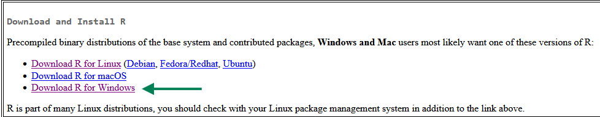
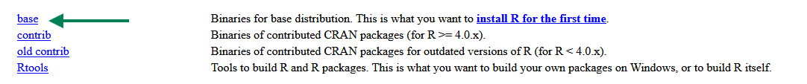
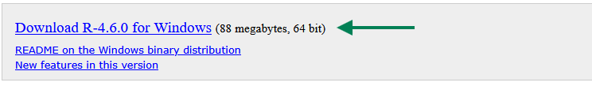
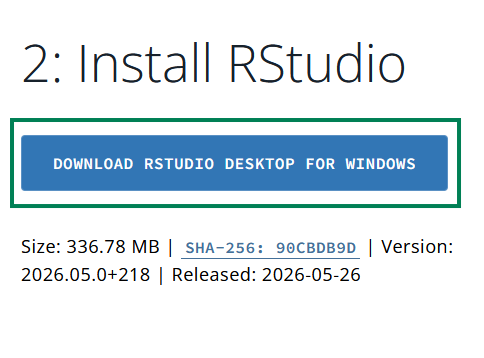
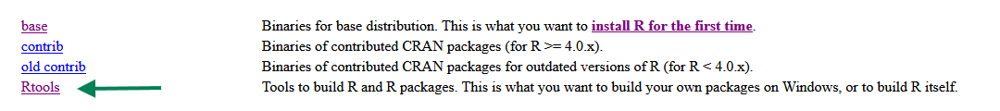
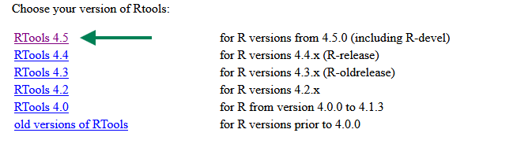
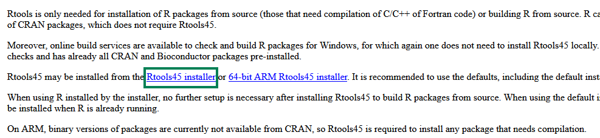

::: {.tut-standfirst}
Install the app for Windows or Linux, or the R package for macOS and for people who already use R. You do not need to know how to program.
:::

## Choose the path

| System | What to install | Requirement |
|---|---|---|
| Windows 64-bit | App, `.exe` file | Windows x64 |
| Ubuntu 24.04 or newer, Debian 13 or newer | App, `.deb` file | Linux x64 |
| Fedora 40 or newer, other Linux with glibc 2.39 or newer | App, AppImage file | Linux x64, permission to execute |
| macOS, or people who already use R | R package | R 4.1 or newer |

The app has its own R and dependencies. It does not use an R that is already on the computer.

## Install the app on Windows

1. Download the `.exe` file from the **[releases page](https://github.com/rogerio-onza/saira/releases/latest)**.
2. Run the file. If Windows warns that the publisher is unknown, click **More info** and **Run anyway**.
3. Open **Saíra** from the Start menu.

## Install the app on Linux

Download the file from the **[releases page](https://github.com/rogerio-onza/saira/releases/latest)**. For the `.deb`, run:

```bash
sudo apt install ./<downloaded-file>.deb
```

For the AppImage, give it permission to execute and open the file:

```bash
chmod +x <downloaded-file>.AppImage
./<downloaded-file>.AppImage
```

::: {.callout-warning}
## The AppImage showed a message and did not open?
Some systems block the AppImage sandbox, such as Ubuntu 24.04 with AppArmor. Install the `.deb`: it has the AppArmor profile of the app.
:::

## Use and close the app

The window has no menu bar. The shortcuts for edit, zoom, full screen and `Ctrl+Q` work. External links open in the browser. Each download asks for a folder.

Saíra does not save the session. If you close with data that you did not export, the app tells how many records lose the mapping and the corrections. It offers **Go to Export** or **Close without export**. After a download from Export, the app only asks if it can close.

## What stays between sessions

| Stays | Does not stay |
|---|---|
| Aliases learned at export | The loaded spreadsheet |
| Flora BR and Fauna BR backbones | The mapping |
| Theme and, in the app, window size and position | Name, coordinate and generalization decisions |
| Exported files, in the folder you chose | Preview corrections |

The `<dataset>-mapping-guide.txt` restores only the mapping in a next session. It is not a saved project. See [Reuse the mapping](03-dwc-mapping.qmd#reuse-the-mapping).

## Install the R package

Use this path on macOS or if you already work in R. R, compilation and Rtools apply only to this path.

### R

You need R 4.1 or later. Download it from **[CRAN](https://cran.r-project.org/)**. The steps below are for Windows. On macOS, choose **Download R for macOS**.

```{=html}
<figure class="shot"></figure>
<figure class="shot"></figure>
<figure class="shot"></figure>
```

1. Click **Download R for Windows**.
2. Click **base**.
3. Download the installer and run it with the default options.

### RStudio (optional)

**[RStudio Desktop](https://posit.co/download/rstudio-desktop)** makes the work more comfortable. Any R console also works.

```{=html}
<figure class="shot"></figure>
```

### Windows: Rtools

Saíra is not on CRAN. On Windows, the install from GitHub needs **Rtools** for the same version of R. On macOS and Linux, skip this step.

```{=html}
<figure class="shot"></figure>
<figure class="shot"></figure>
<figure class="shot"></figure>
```

1. On the R for Windows page, open **Rtools**.
2. Choose the version for your R, for example **RTools 4.5** for R 4.5.
3. Download the installer and run it with the default options.

### Linux: system libraries

The spatial packages need `GDAL`, `GEOS` and `PROJ`. On Debian and Ubuntu, run:

```bash
sudo apt-get install -y libgdal-dev libgeos-dev libproj-dev libudunits2-dev
```

### Saíra

In R or RStudio, run:

```r
options(repos = c(
  ropensci = "https://ropensci.r-universe.dev",
  CRAN     = "https://cloud.r-project.org"
))
install.packages("pak")
pak::pak("rogerio-onza/saira")
```

The `options()` call gives access to R-universe, because `florabr` and `faunabr` are not on CRAN. The first install downloads and compiles the dependencies. It can take a few minutes.

## Open the app from R

```r
saira::run_app()
```

The app opens in a browser tab. To stop it, close the tab and stop the R session (`Esc` in the console or the RStudio stop button).

::: {.callout-warning}
## The tab did not open?
`run_app()` prints an address such as `http://127.0.0.1:xxxx`. Open that address in your browser. That address opens only on this computer.
:::

::: {.callout-note}
## Serve other people
Saíra has no login. Keep the app on `127.0.0.1` and put a reverse proxy with HTTPS and authentication in front of it. With `SAIRA_PUBLIC=true`, sessions do not write aliases to the Rostrum of the server.

```r
Sys.setenv(SAIRA_PUBLIC = "true")
options(shiny.port = 3838)
saira::run_app()
```
:::

## Language and theme

The selector in the top corner changes the language between PT, EN and ES at any time, without losing work. The theme selector has **Light theme**, **Dark theme** and **Follow the system**. The app accepts files of up to 500 MB.

## Update

The navigation bar of the app shows the version in use.

### App

The app does not update itself. Download the new version from the **[releases page](https://github.com/rogerio-onza/saira/releases/latest)**. On Windows, run the new `.exe`. On Linux, run `sudo apt install` again with the new `.deb`, or replace the old AppImage with the new one and give it permission to execute.

### R package

Close the app, run the same `options()` call of the install and then:

```r
pak::pak("rogerio-onza/saira")
```

Restart R before you open the app. This command updates only the R package, not the app. To see the installed version, run `packageVersion("saira")`.
