::: {.tut-standfirst}
Match each spreadsheet column to a Darwin Core term in the **Mapping** step.
:::

## Review the automatic mapping

```{=html}
<figure class="shot">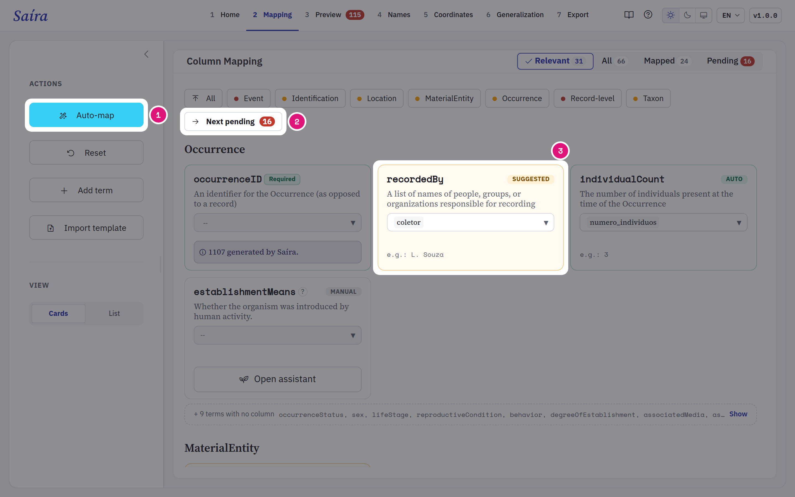</figure>
```

::: {.marks}
1. Saíra maps once, right after the upload. **Auto-map** runs it again.
2. **Next pending** jumps to the next card that needs review. The number tells how many are left. In the class filters, a red dot is an empty required term, orange is review.
3. A yellow card is **SUGGESTED**: confirm or change it.
:::

## Filter the terms

```{=html}
<figure class="shot">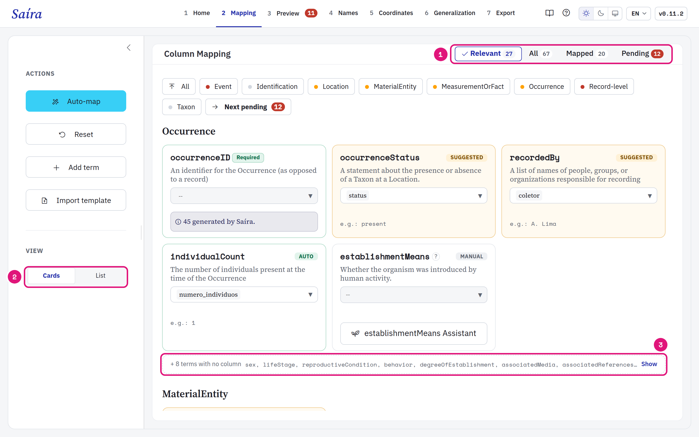</figure>
```

::: {.marks}
1. **Show terms** filters the cards. Each filter shows the count.
2. **Cards** and **List** change the screen layout.
3. The **terms with no column** block groups the optional terms with no column. **Show** opens the block, and the button of each row opens the card.
:::

| Filter | Shows |
|---|---|
| Relevant | The terms that are not collapsed. |
| All | All the terms, also the collapsed ones. |
| Mapped | The terms with a column or a fixed value. |
| Pending | The same queue as **Next pending**: empty required terms and suggestions to review. An optional term with no column is not pending. |

## Map the required terms

Six terms are required: <span class="term">scientificName</span> <span class="term">eventDate</span> <span class="term">decimalLatitude</span> <span class="term">decimalLongitude</span> <span class="term">basisOfRecord</span> <span class="term">license</span>. Without one of them, the export blocks.

::: {.callout-warning}
## Map the occurrenceID
<span class="term">occurrenceID</span> shows as **Required** on the card, but it does not block the export. Without it, Saíra makes a UUID from the content of the row. The UUID stays the same at each export, but it changes if the content of the row changes. Map the column with your identifiers. Saíra fills only the empty rows.
:::

## Review each card

```{=html}
<figure class="shot">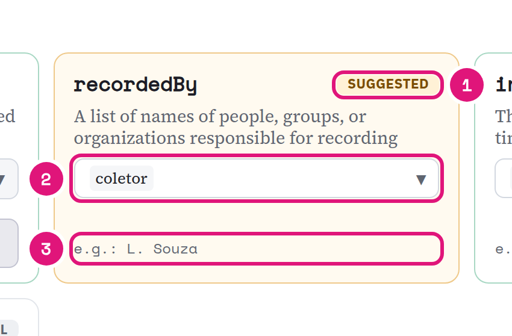</figure>
```

::: {.marks}
1. The badge tells where the term came from.
2. Wrong column? Change it in the selector.
3. `e.g.:` shows the first value read from the column.
:::

| Badge | Meaning |
|---|---|
| AUTO | High confidence. Already filled in. |
| SUGGESTED | Likely. Confirm it. |
| AMBIGUOUS | Two terms tie. You choose. |
| EDITED | You changed it. Your choice wins. |
| ALIAS | Came from an earlier mapping. |
| TEMPLATE | Came from an imported template. |
| MANUAL | No automatic suggestion. |

If the same column goes to more than one term, Saíra warns you. Check that this is intentional.

## Check the standard values

Saíra translates known values to the Darwin Core vocabulary:

| Term | In the spreadsheet | Goes out as |
|---|---|---|
| <span class="term">occurrenceStatus</span> | `visto` | `present` |
| <span class="term">sex</span> | `M`, `macho` | `male` |
| <span class="term">sex</span> | `F`, `fêmea` | `female` |
| <span class="term">lifeStage</span> | `adulto` | `adult` |
| <span class="term">lifeStage</span> | `jovem`, `juvenil` | `juvenile` |

A value that Saíra does not know stays as it is and goes to **Problems** in [Preview](04-preview.qmd#correct-a-value). `filhote` only gets a suggestion, because it fits `juvenile` and `nestling`.

## Set basisOfRecord

```{=html}
<figure class="shot">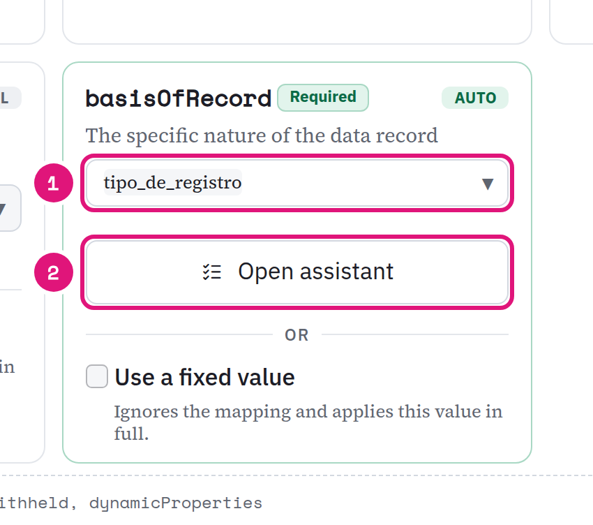</figure>
```

::: {.marks}
1. Choose the column with the record type, such as <span class="term">tipo_de_registro</span>.
2. Open the **basisOfRecord Assistant**.
:::

```{=html}
<figure class="shot">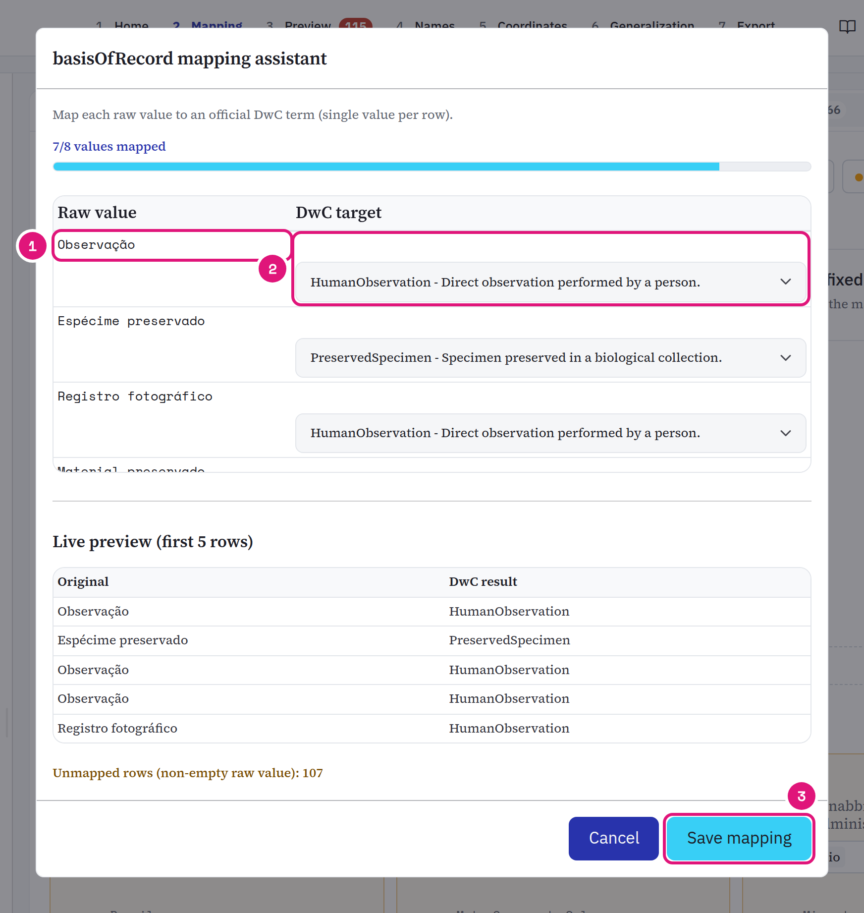</figure>
```

::: {.marks}
1. Each distinct value of the column shows once.
2. Choose the Darwin Core term. The preview below shows the result.
3. **Save mapping**.
:::

## Answer establishmentMeans per species

Optional. The assistant is on the <span class="term">establishmentMeans</span> card and needs <span class="term">scientificName</span> mapped.

```{=html}
<figure class="shot">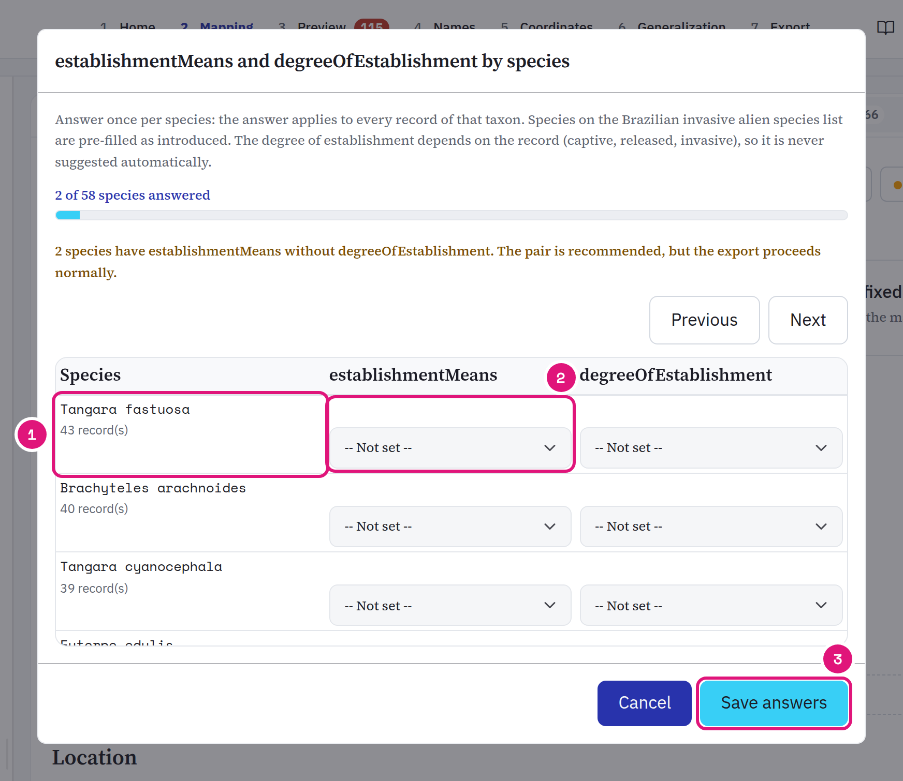</figure>
```

::: {.marks}
1. One row per species, with the number of records the answer covers.
2. Choose <span class="term">establishmentMeans</span>. Next to it, the <span class="term">degreeOfEstablishment</span>.
3. **Save answers**.
:::

Invasive species already arrive as `introduced`. A translocated native with records on an oceanic island splits into two rows: **On the mainland** and **On an oceanic island**. The island row suggests `introduced` and only you apply it, with **Apply**. The islands are Fernando de Noronha, Atol das Rocas, Trindade e Martim Vaz and São Pedro e São Paulo.

The degree is never suggested: only you know if the animal is captive or free. If a spreadsheet column also fills the term, the column wins.

## Use a fixed value for the dataset

```{=html}
<figure class="shot">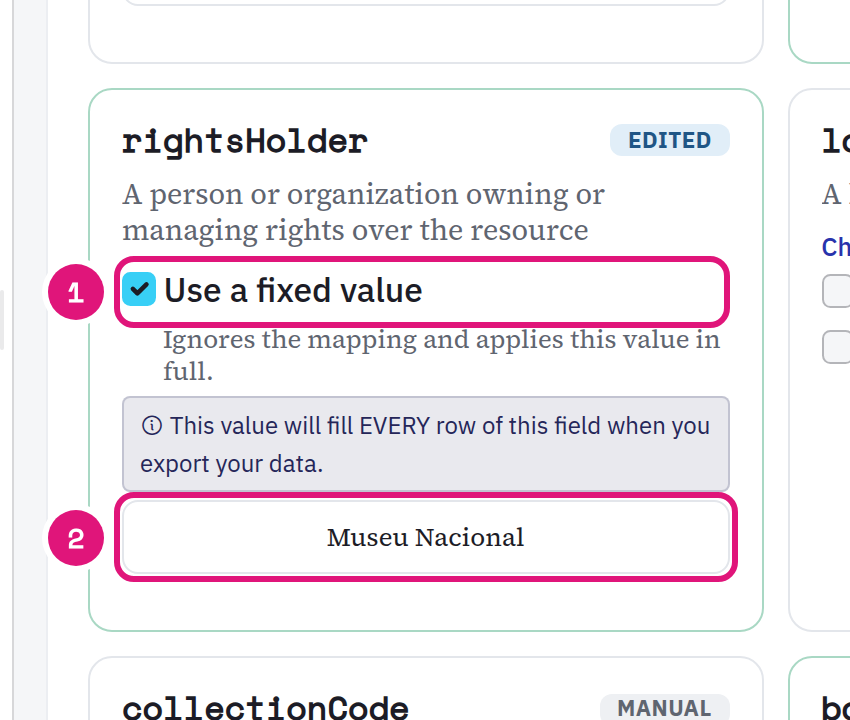</figure>
```

::: {.marks}
1. Check **Use a fixed value**.
2. Type the value once. It goes to all rows.
:::

These terms accept a fixed value: <span class="term">rightsHolder</span> <span class="term">institutionCode</span> <span class="term">collectionCode</span> <span class="term">country</span> <span class="term">references</span> <span class="term">bibliographicCitation</span> <span class="term">geodeticDatum</span> <span class="term">basisOfRecord</span>. Use the fixed value in <span class="term">basisOfRecord</span> when the spreadsheet has no column with the record type.

## Choose the license and the dataset name

The <span class="term">license</span> card is required. Choose `CC0`, `CC BY 4.0` or `CC BY-NC 4.0`, the three licenses GBIF accepts. Without a license, the export blocks.

In <span class="term">datasetName</span>, choose a column or type the name. It gives the title of `eml.xml` and the start of the file names.

## Add a term that is not shown

```{=html}
<figure class="shot">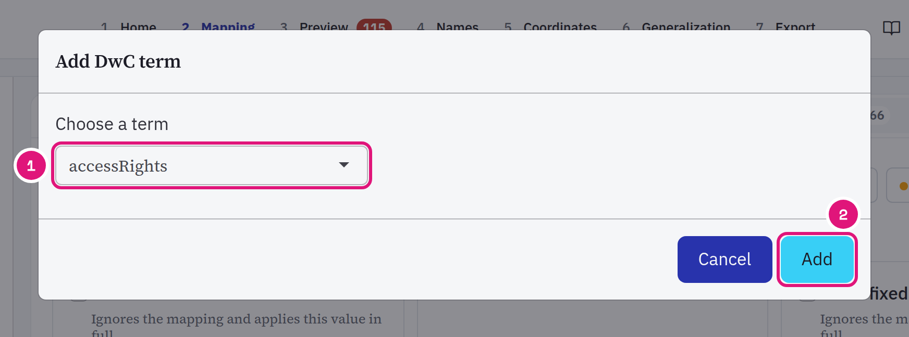</figure>
```

::: {.marks}
1. Search for the term.
2. **Add**. The term becomes a new card.
:::

## Put extra columns in dynamicProperties

```{=html}
<figure class="shot">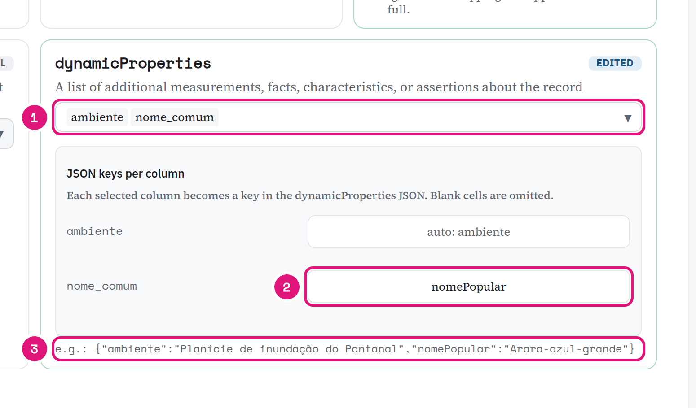</figure>
```

::: {.marks}
1. Choose the columns.
2. Rename the key, if you want.
3. Check the JSON of the first row.
:::

The conservation status goes into the same field, from [name validation](05-name-validation.qmd).

## Record measurements

```{=html}
<figure class="shot">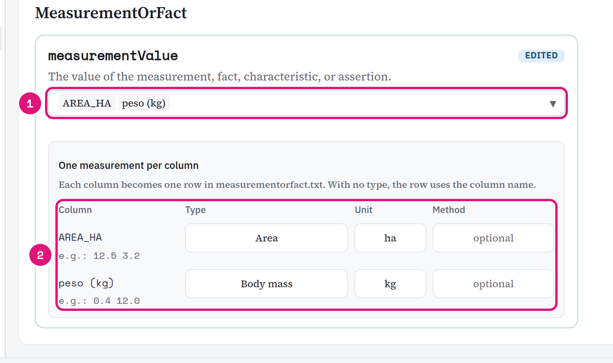</figure>
```

::: {.marks}
1. On the <span class="term">measurementValue</span> card, choose one or more columns. Saíra suggests columns of numbers with the unit in the name, such as `AREA_HA` or `peso (kg)`.
2. In each column, fill in **Type**, **Unit** and, if you want, **Method**. Without a type, the row uses the column name.
:::

Each column becomes a row in `measurementorfact.txt`, linked to the occurrence, and leaves `occurrence.txt`. [Preview](04-preview.qmd) shows each measurement apart, such as `measurementValue [AREA_HA]`.

## Reuse the mapping

The exported `.zip` has the `<dataset>-mapping-guide.txt`. On the next spreadsheet, click **Import template**:

```{=html}
<figure class="shot">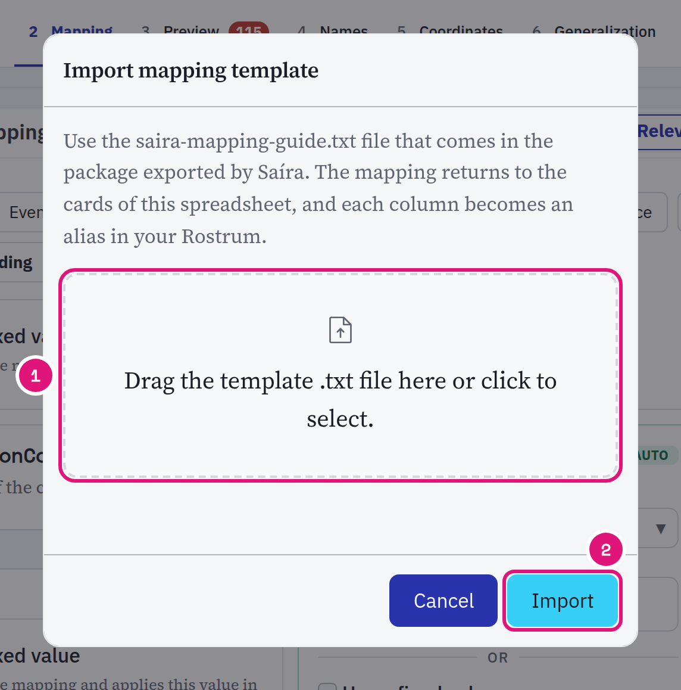</figure>
```

::: {.marks}
1. Send the file.
2. **Import**. Columns with the same name map automatically.
:::

The guide restores the mapped terms, <span class="term">datasetName</span>, the license, the language and the fixed values. Each column becomes an alias. If a template column is not in the spreadsheet, Saíra warns you and lists up to five. The guide does not restore names, coordinates, generalization or preview corrections.

Saíra learns aliases only at export. See [Check what Rostrum learned](08-export.qmd#check-what-rostrum-learned).

Columns with data that you do not map go at the end of the file, with the original name, outside `meta.xml`. GBIF ignores these columns. Empty unmapped columns leave the file.
