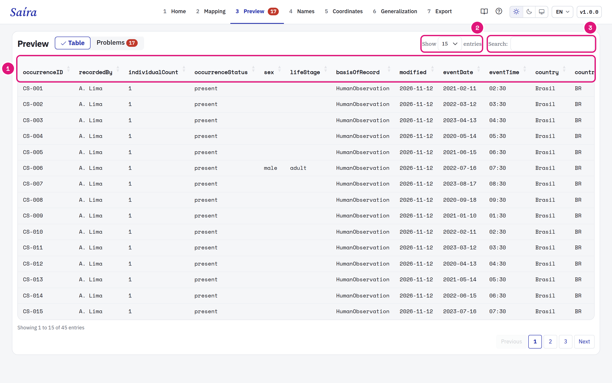
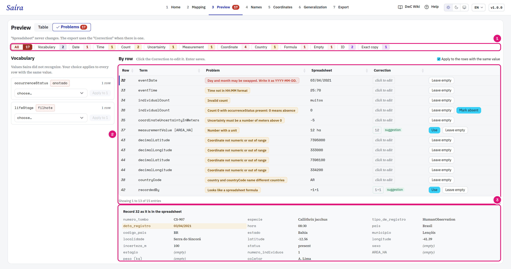
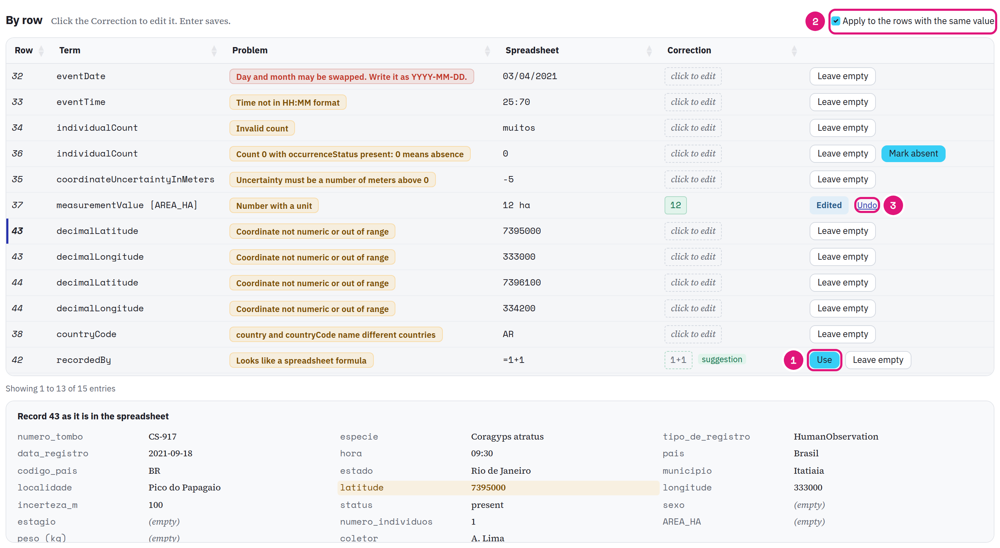
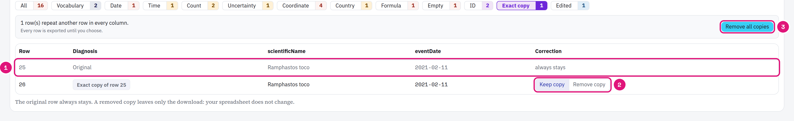

::: {.tut-standfirst}
Check the data in Darwin Core and correct values in the **Preview** step. Your spreadsheet does not change.
:::

## Choose the mode

```{=html}
<figure class="shot"></figure>
```

::: {.marks}
1. **Table** shows the first 100 records. The columns already have the Darwin Core names.
2. Choose how many rows to see.
3. Search for a value in any column.
:::

**Problems** checks all the records, not only the 100 in the table. The step opens in **Problems** when a problem is open. The number on the step, in the menu, tells how many problems are left to fix.

## Find the problems

```{=html}
<figure class="shot"></figure>
```

::: {.marks}
1. The filters split the problems by type, with the count. **Edited** shows what you already corrected.
2. Each row has the term, the diagnosis, the value **In the spreadsheet** and the **Correction**.
3. The record of the selected row, as it is in the spreadsheet. The column of the problem is marked.
:::

**In the spreadsheet** never changes. The export uses the **Correction** when there is one. The list opens on the first problem. Click another row to see its record. In a narrow window, the record shows below the list.

## Correct a value

```{=html}
<figure class="shot"></figure>
```

::: {.marks}
1. Click the **Correction** and type. Enter saves. **Use** accepts the suggestion from Saíra.
2. **Apply to the rows with the same value** starts on. **+N alike** tells how many more rows the correction covers.
3. **Undo** goes back to the spreadsheet value.
:::

For vocabulary values, choose a value from **Suggested** or from the **GBIF vocabulary**. The choice applies to all the rows with the same value. **Leave empty** clears the value in the export. Required terms do not have this option.

## Go back to Mapping when the error is in the column

When one type of problem in a term covers 20% of the records or more, and at least 20 records, Saíra shows **Back to Mapping**. The cause is usually a column in the wrong term or a format. Check the column in [Mapping](03-dwc-mapping.qmd) before you correct row by row.

## Common cases

| Filter | Example | What to do |
|---|---|---|
| Vocabulary | `anotado` in <span class="term">occurrenceStatus</span> | Choose a suggested value or one from the GBIF vocabulary. |
| Date | `03/04/2021` | Day and month may be swapped. Write it as `YYYY-MM-DD`. |
| Date | `2021-13-40` | Saíra did not read the date. Write it as `YYYY-MM-DD`. Saíra already reads month names, roman months, compact dates and intervals. |
| Time | `25:70` | Write it as `HH:MM`. |
| Count | `muitos` | Write a number. |
| Count | `0` with <span class="term">occurrenceStatus</span> `present` | `0` means absence. Click **Mark absent** or correct the count. |
| Uncertainty | `-5` | Write the meters, a number greater than 0. |
| Measurement | `12 ha` | Write only the number. The unit goes in the **Unit** field of the <span class="term">measurementValue</span> card. |
| Country | <span class="term">country</span> `Brasil` with <span class="term">countryCode</span> `AR` | Check which one is correct. Saíra has no bulk fix for this. |
| Empty | Empty <span class="term">scientificName</span> | Write the most specific taxon you know. |
| ID | Two different records with the same <span class="term">occurrenceID</span> | Write the correct identifier of each one. |
| Formula | `=1+1` | Write the value. This cell blocks the export. |

## Decide the exact copies

```{=html}
<figure class="shot"></figure>
```

::: {.marks}
1. The **Exact copy** filter lists the rows that repeat another row in all the columns of the spreadsheet. The original row always stays.
2. **Remove copy** and **Keep copy** decide one row.
3. **Remove all copies** decides all of them at once.
:::

All rows are exported until you choose. A removed copy leaves only the download. The repeated ID of a copy shows under **Exact copy**. Two different records with one ID stay under **ID**: both are exported.

::: {.callout-warning}
## What happens to a repeated ID
If you do not fix it, Saíra replaces each repeated ID with a persistent UUID. The UUID comes from the content of the row: it stays the same at each export, but it changes if the content of the row changes. Fix the ID when you have the correct identifier. See [Map the occurrenceID](03-dwc-mapping.qmd#map-the-required-terms).
:::
