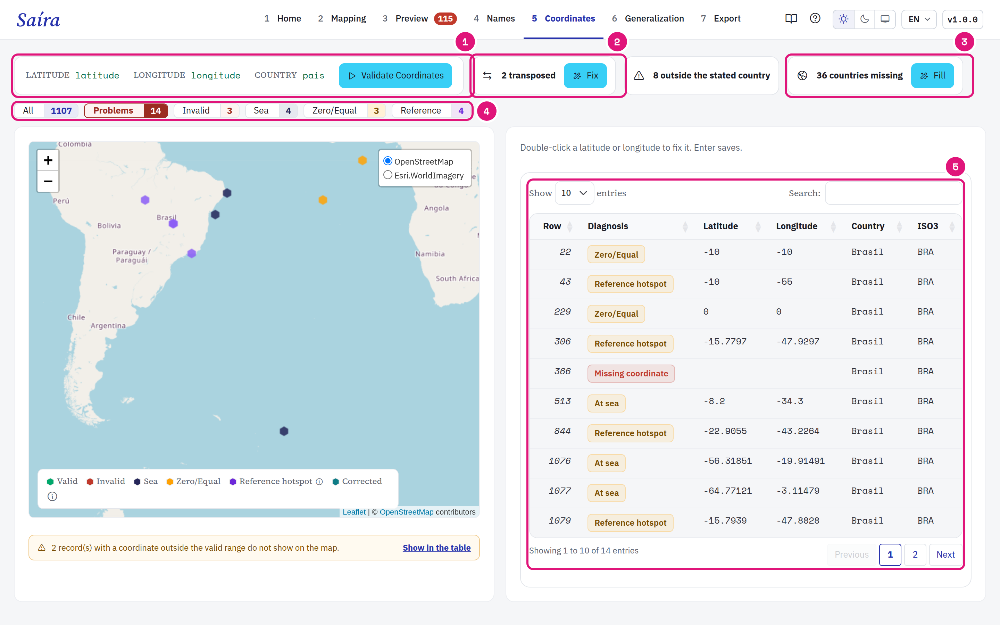
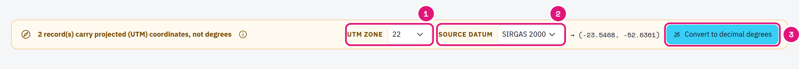
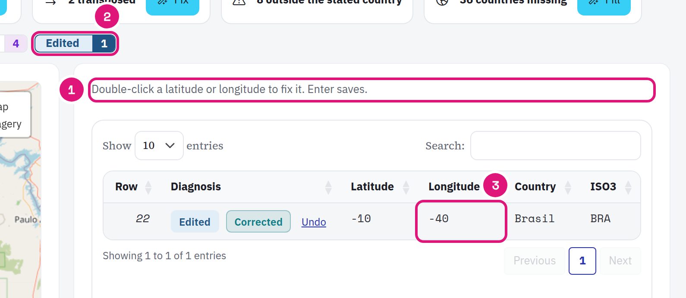

::: {.tut-standfirst}
Find coordinates that are swapped, at sea or outside the country in the **Coordinates** step. Saíra proposes fixes. You decide which ones to apply.
:::

## Run the validation

The validation needs <span class="term">decimalLatitude</span>, <span class="term">decimalLongitude</span> and <span class="term">country</span> mapped. If one is missing, the **Validate Coordinates** button stays disabled.

```{=html}
<figure class="shot"></figure>
```

::: {.marks}
1. The mapped columns and the **Validate Coordinates** button.
2. Transposed coordinates. **Fix** applies the swap.
3. Missing countries. **Fill** uses the country where the point falls.
4. The filters change the map and the table together.
5. The table lists each record with its diagnosis.
:::

| Diagnosis | Meaning |
|---|---|
| Missing coordinate | Latitude or longitude is empty or not a number. |
| Invalid | Latitude beyond ±90 or longitude beyond ±180. |
| Possible swap | Latitude and longitude look swapped. |
| At sea | The point falls in water. |
| Zero/Equal | Point at (0, 0) or latitude equal to longitude. |
| Reference hotspot | Point near a capital, a country centroid, the GBIF headquarters or a biological institution. |
| Outside the stated country | The point falls outside the country of the row. Saíra lists the rows, with no automatic fix. |

The tests run offline, with the Natural Earth country layer embedded in Saíra. Only the background map needs internet.

During the validation, the panel shows the running test and how many records it checks. On the map, each hexagon is a point and the color gives the status: Valid, Invalid, Sea, Sea not checked, Zero/Equal, Reference hotspot or Corrected.

Click a point and use **Show in table** to open the record. If many records fall at one place, the point says **N records at this point**. A coordinate outside the valid range does not show on the map: the note above the map has **Show in the table**.

::: {.callout-warning}
## The sea test is approximate
The coastline is simplified. A point very near the coast can show as **At sea**. Check it on the map before you discard the record.
:::

## Coordinates in other formats

Saíra reads degrees, minutes and seconds (`23°33'1.872"S`) and decimal minutes (`46°37.999' W`). The hemisphere letter can come at the start or at the end: N, S, E, W, O (oeste) or L (leste). Comma and decimal point both work. Saíra rejects a letter that contradicts the sign (`-23.5 N`) and minutes or seconds of 60 or more.

## Convert UTM coordinates

```{=html}
<figure class="shot"></figure>
```

::: {.marks}
1. Choose the **UTM zone**. The zone does not come from the numbers: the same pair is valid in all zones.
2. Choose the **Source datum**.
3. Check the points on the map and click **Convert to decimal degrees**.
:::

If more than one zone puts the points in the stated country, Saíra tells how many. Check on the map which one is correct. The original values and the reference system stay in <span class="term">verbatimLatitude</span>, <span class="term">verbatimLongitude</span>, <span class="term">verbatimCoordinateSystem</span> and <span class="term">verbatimSRS</span>.

| Datum | Zones | Hemisphere |
|---|---|---|
| SIRGAS 2000 (default) | 17 to 25 | North and south |
| WGS 84 | 1 to 60 | North and south |
| SAD69 | 18 to 25 | South |
| Corrego Alegre | 21 to 25 | South |

## Apply the proposed fixes

The panels show only when there are candidates:

| Panel | What Saíra does |
|---|---|
| **Fix** transposed | Tries swaps of latitude and longitude and of sign. Accepts the first that falls in the given country (~22 km margin). |
| **Fill** countries | Fills an empty <span class="term">country</span> with the country where the point falls. Does not replace a country already given. |
| **Swap** at sea without country | Swaps latitude and longitude and fills the country, if the new point falls in only one country. |

The fixes apply on export. The original data does not change. If <span class="term">verbatimLatitude</span> and <span class="term">verbatimLongitude</span> are empty, the original value goes to them.

## Fix a point in the table

```{=html}
<figure class="shot"></figure>
```

::: {.marks}
1. Double-click the latitude or the longitude. Type the value in decimal degrees, with a comma or a period. Enter saves.
2. The **Edited** filter shows only the rows you fixed.
3. The new value. Saíra validates the point again. **Undo** restores the original value.
:::

Validating again does not remove the manual fixes. A fix keeps the source point: if the point changed after the fix or the record left the data, Saíra discards the fix and warns you. A row without a unique <span class="term">occurrenceID</span> does not accept edits.

Saíra does not make a coordinate from the locality text. A record without coordinates stays as it is, unless you type both coordinates in the table.

::: {.callout-tip}
## Sign of coordinates in Brazil
Almost all of Brazil has negative latitude and longitude. `-34.87, -8.04` (lat, lon) instead of `-8.04, -34.87` puts a point from Pernambuco in the middle of the Atlantic.
:::

Also record the <span class="term">geodeticDatum</span> (for example, `WGS84`) and, if you know it, <span class="term">coordinateUncertaintyInMeters</span>. Many analyses filter records by this field.
