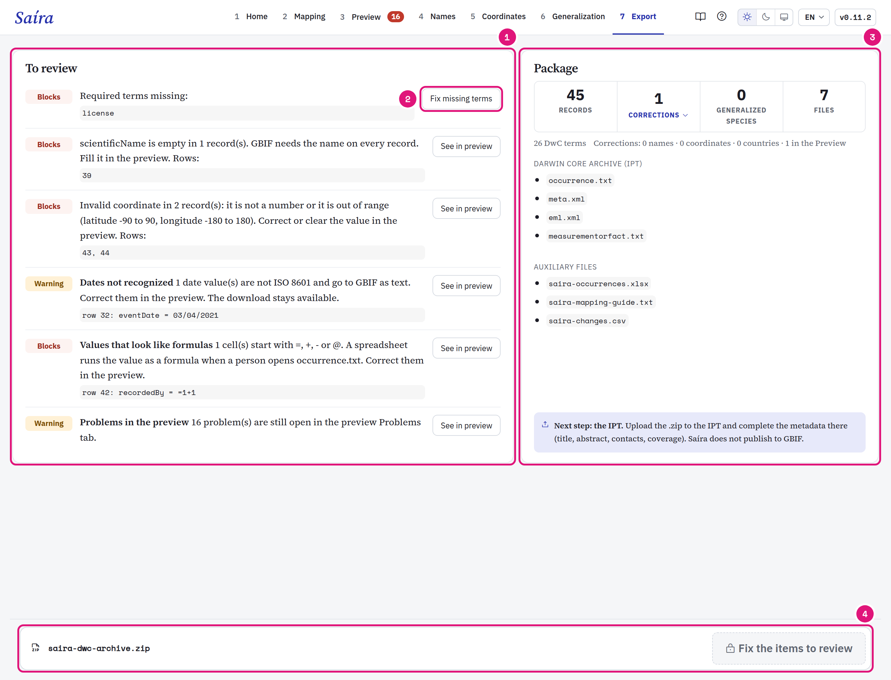
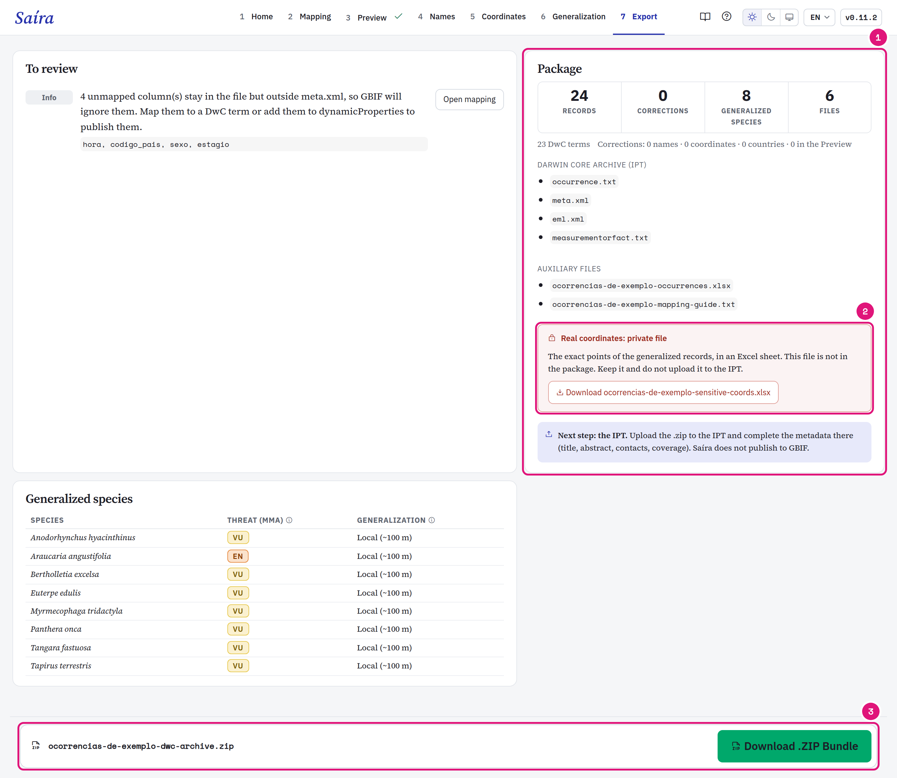

::: {.tut-standfirst}
Resolve the pending items and download the Darwin Core Archive in the **Export** step. The data check is in [Preview](04-preview.qmd).
:::

## Resolve the pending items

```{=html}
<figure class="shot"></figure>
```

::: {.marks}
1. **Blocks** stops the download. **Warning** lets you download. **Info** only informs.
2. Each pending item has a button that goes to the step that resolves it.
3. The package: records, corrections, generalized species and files.
4. The download stays disabled while a blocking item is left.
:::

| Pending item | Type | Where to resolve |
|---|---|---|
| Required term missing, such as <span class="term">eventDate</span> or <span class="term">license</span> | Blocks | [Mapping](03-dwc-mapping.qmd#map-the-required-terms) |
| <span class="term">basisOfRecord</span> empty or without a DwC term | Blocks | [basisOfRecord Assistant](03-dwc-mapping.qmd#set-basisofrecord) |
| Empty <span class="term">scientificName</span> | Blocks | [Preview](04-preview.qmd#common-cases) |
| Cell that looks like a spreadsheet formula, mapped or not | Blocks | [Preview](04-preview.qmd#common-cases) |
| Invalid coordinate | Blocks | [Coordinates](06-coordinate-validation.qmd) |
| Generalization without justification | Blocks | [Generalization](07-generalization.qmd#handle-one-species-separately) |
| Decision of a step that Saíra could not read | Blocks | Open the steps in the message again and check them. |
| Date not read, year out of range, zero count without status | Warning | [Preview](04-preview.qmd#common-cases) |
| Coordinates flag, open problem in Preview | Warning | The button of the item goes to the step. |
| Unmapped column | Info | GBIF ignores the column. Map it to a term or include it in <span class="term">dynamicProperties</span>. |

## Check the package

```{=html}
<figure class="shot"></figure>
```

::: {.marks}
1. The files that go in the `.zip`.
2. The private file, downloaded apart.
3. **Download .ZIP Bundle** opens when nothing blocks.
:::

Click **Corrections** to see one example per type: Names, Coordinates, Countries and In the Preview. Each type has a link to the step. The full list goes in `<dataset>-changes.csv`. Values of generalized records stay hidden.

## What Saíra adjusts

- **Dates** in ISO 8601: `YYYY-MM-DD`, `YYYY-MM` without a day, `YYYY-MM-DDThh:mm` with time. A year before 1600 or after the current year gives a warning, without blocking.
- **Coordinates** with a decimal point.
- **License** with the chosen name (`CC BY 4.0`) in `occurrence.txt` and the URL in `eml.xml`.
- **Title** of `eml.xml` from <span class="term">datasetName</span>. With a mapped column, the most frequent value applies.
- **Columns** in Darwin Core order. Unmapped columns with data go at the end, with the original name. Empty unmapped columns leave the file.

### Conservation status in `dynamicProperties`

Saíra writes the conservation status from the backbones of [name validation](05-name-validation.qmd):

- Flora BR or Fauna BR → `mmaThreatStatus` and `mmaSource`;
- GBIF → `iucnRedListCategory`, queried at export.

```json
{"mmaThreatStatus":"CR","mmaSource":"Portaria 1.704/2026","iucnRedListCategory":"NT"}
```

Without internet, the IUCN key is left out and the export continues. The MMA keys go into records from Brazil, by <span class="term">country</span> or <span class="term">countryCode</span>, and into records that Saíra generalized. Other records have no MMA keys.

## Package files

The `.zip` (`<dataset>-dwc-archive.zip`) has the Darwin Core Archive and the auxiliary files. `<dataset>` comes from <span class="term">datasetName</span>. Without this term, the name is `saira`.

| File | Use |
|---|---|
| `occurrence.txt` | The data. Goes to the IPT. |
| `meta.xml` | Gives the term of each column. Goes to the IPT. |
| `eml.xml` | Metadata: title, geographic extent, period and license. Goes to the IPT. |
| `measurementorfact.txt` | The [measurements](03-dwc-mapping.qmd#record-measurements), one per row, linked to the occurrence. Exists only if you mapped measurements. Goes to the IPT. |
| `<dataset>-occurrences.xlsx` | Excel copy, with all cells as text. Left out above 1,048,575 records, the Excel limit. |
| `<dataset>-mapping-guide.txt` | The mapping, to [reuse](03-dwc-mapping.qmd#reuse-the-mapping). |
| `<dataset>-changes.csv` | All corrections, row by row. Exists only if there are corrections. |

## Download the private file

If you generalized records, the **Package** card shows a button of its own for `<dataset>-sensitive-coords.xlsx`. This sheet has the original coordinates and stays outside the `.zip`. Keep it, do not publish it.

## Check what Rostrum learned

At export, Saíra keeps each pair of column and term as an alias. In a next sheet with the same columns, Rostrum suggests the same terms. The **Rostrum memory** card has **Show the aliases** and **Undo learning**. Undo does not change the `.zip` that you downloaded.

## Publish through the IPT

Saíra does not publish to GBIF. Send the `.zip` to the IPT of your institution or of SiBBr. In the IPT, complete the metadata (abstract, contacts, coverage) and publish.

## Check the publication from R

`check_publication()` is a function of the R package. The app has no button for it. The function compares the `.zip` with the published dataset and needs internet.

```r
saira::check_publication("neotropical-carnivores.zip", "dr1451")
```

The second argument is the dataset key on GBIF (UUID) or the SiBBr uid (`dr` and a number). The function returns `portal`, `dataset`, `sent`, `published`, `missing` and `unexpected`.
