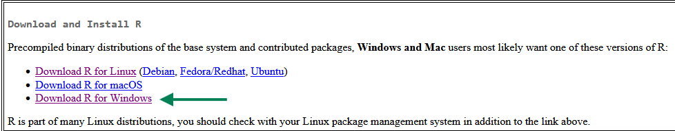
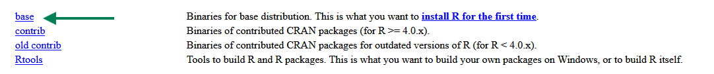
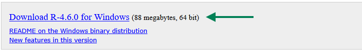
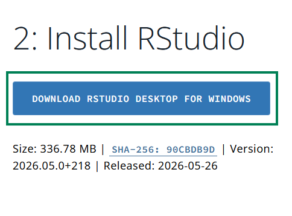
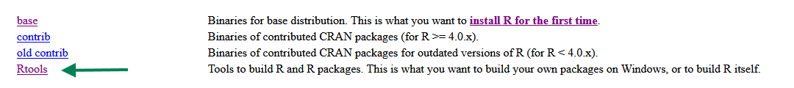
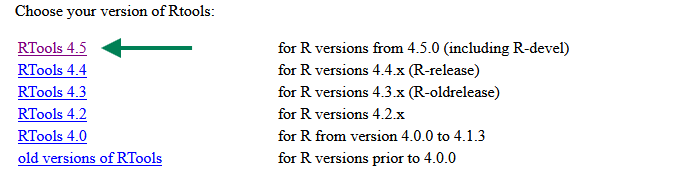
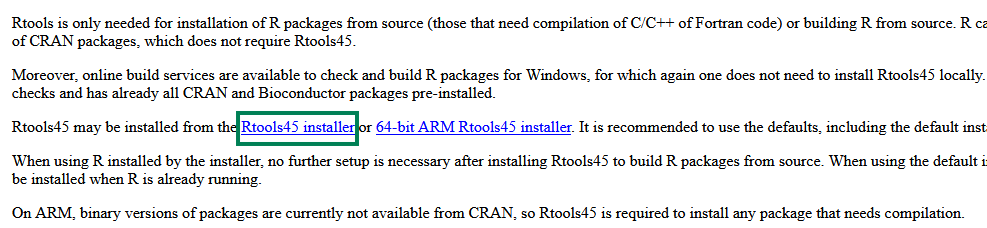

::: {.tut-standfirst}
Instale la aplicación para Windows o Linux, o el paquete R para macOS y para quienes ya usan R. No necesita saber programar.
:::

## Elija el camino

| Sistema | Qué instalar | Requisito |
|---|---|---|
| Windows de 64 bits | Aplicación, archivo `.exe` | Windows x64 |
| Ubuntu 24.04 o más reciente, Debian 13 o más reciente | Aplicación, archivo `.deb` | Linux x64 |
| Fedora 40 o más reciente, otro Linux con glibc 2.39 o más reciente | Aplicación, archivo AppImage | Linux x64, permiso de ejecución |
| macOS, o quienes ya usan R | Paquete R | R 4.1 o más reciente |

La aplicación trae R y las dependencias. No usa el R que ya esté en la computadora.

## Instale la aplicación en Windows

1. Descargue el archivo `.exe` en la **[página de versiones](https://github.com/rogerio-onza/saira/releases/latest)**.
2. Ejecute el archivo. Si Windows avisa que el editor es desconocido, haga clic en **Más información** y en **Ejecutar de todas formas**.
3. Abra **Saíra** desde el menú Inicio.

## Instale la aplicación en Linux

Descargue el archivo en la **[página de versiones](https://github.com/rogerio-onza/saira/releases/latest)**. Para el `.deb`, ejecute:

```bash
sudo apt install ./<archivo-descargado>.deb
```

Para el AppImage, dé permiso de ejecución y abra el archivo:

```bash
chmod +x <archivo-descargado>.AppImage
./<archivo-descargado>.AppImage
```

::: {.callout-warning}
## ¿El AppImage mostró un mensaje y no se abrió?
Algunos sistemas bloquean el sandbox del AppImage, como Ubuntu 24.04 con AppArmor. Instale el `.deb`: trae el perfil de AppArmor de la aplicación.
:::

## Use y cierre la aplicación

La ventana no tiene barra de menú. Los atajos de edición, zoom, pantalla completa y `Ctrl+Q` funcionan. Los enlaces externos se abren en el navegador. Cada descarga pregunta en qué carpeta guardar.

Saíra no guarda la sesión. Si cierra con datos sin exportar, la aplicación indica cuántos registros pierden el mapeo y las correcciones. Ofrece **Ir a Exportación** o **Cerrar sin exportar**. Después de una descarga en Exportación, la aplicación solo pregunta si puede cerrar.

## Qué queda guardado entre sesiones

| Queda guardado | No queda guardado |
|---|---|
| Alias aprendidos en la exportación | La hoja de cálculo cargada |
| Bases Flora BR y Fauna BR | El mapeo |
| Tema y, en la aplicación, tamaño y posición de la ventana | Decisiones de nombres, coordenadas y generalización |
| Archivos exportados, en la carpeta que usted eligió | Correcciones de la vista previa |

El `<dataset>-mapping-guide.txt` restaura solo el mapeo en una próxima sesión. No es un proyecto guardado. Vea [Reutilice el mapeo](03-mapeo-dwc.qmd#reutilice-el-mapeo).

## Instale el paquete R

Use este camino en macOS o si ya trabaja en R. R, la compilación y Rtools valen solo para este camino.

### R

Necesita R 4.1 o superior. Descárguelo de **[CRAN](https://cran.r-project.org/)**. Los pasos siguientes son para Windows. En macOS, elija **Download R for macOS**.

```{=html}
<figure class="shot"></figure>
<figure class="shot"></figure>
<figure class="shot"></figure>
```

1. Haga clic en **Download R for Windows**.
2. Haga clic en **base**.
3. Descargue el instalador y ejecútelo con las opciones predeterminadas.

### RStudio (opcional)

**[RStudio Desktop](https://posit.co/download/rstudio-desktop)** hace más cómodo el uso. Cualquier consola de R también sirve.

```{=html}
<figure class="shot"></figure>
```

### Windows: Rtools

Saíra no está en CRAN. En Windows, la instalación desde GitHub necesita **Rtools** de la misma versión de R. En macOS y Linux, omita este paso.

```{=html}
<figure class="shot"></figure>
<figure class="shot"></figure>
<figure class="shot"></figure>
```

1. En la página R for Windows, abra **Rtools**.
2. Elija la versión de su R, por ejemplo **RTools 4.5** para R 4.5.
3. Descargue el instalador y ejecútelo con las opciones predeterminadas.

### Linux: bibliotecas de sistema

Los paquetes espaciales necesitan `GDAL`, `GEOS` y `PROJ`. En Debian y Ubuntu, ejecute:

```bash
sudo apt-get install -y libgdal-dev libgeos-dev libproj-dev libudunits2-dev
```

### Saíra

En R o RStudio, ejecute:

```r
options(repos = c(
  ropensci = "https://ropensci.r-universe.dev",
  CRAN     = "https://cloud.r-project.org"
))
install.packages("pak")
pak::pak("rogerio-onza/saira")
```

`options()` da acceso a R-universe, porque `florabr` y `faunabr` no están en CRAN. La primera instalación descarga y compila las dependencias. Puede tardar algunos minutos.

## Abra la aplicación desde R

```r
saira::run_app()
```

La aplicación se abre en una pestaña del navegador. Para cerrarla, cierre la pestaña y detenga la sesión de R (`Esc` en la consola o el botón de detener de RStudio).

::: {.callout-warning}
## ¿No se abrió la pestaña?
`run_app()` muestra una dirección como `http://127.0.0.1:xxxx`. Abra esa dirección en el navegador. Esa dirección solo abre en esta computadora.
:::

::: {.callout-note}
## Servir a otras personas
Saíra no tiene inicio de sesión. Deje la aplicación en `127.0.0.1` y ponga delante un proxy inverso con HTTPS y autenticación. Con `SAIRA_PUBLIC=true`, las sesiones no guardan alias en el Rostrum del servidor.

```r
Sys.setenv(SAIRA_PUBLIC = "true")
options(shiny.port = 3838)
saira::run_app()
```
:::

## Idioma y tema

El selector de la esquina superior cambia el idioma entre PT, EN y ES en cualquier momento, sin perder el trabajo. El selector de tema ofrece **Tema claro**, **Tema oscuro** y **Seguir el sistema**. La aplicación acepta archivos de hasta 500 MB.

## Actualice

La barra de navegación de la aplicación muestra la versión en uso.

### Aplicación

La aplicación no se actualiza sola. Descargue la versión nueva en la **[página de versiones](https://github.com/rogerio-onza/saira/releases/latest)**. En Windows, ejecute el `.exe` nuevo. En Linux, ejecute de nuevo `sudo apt install` con el `.deb` nuevo, o reemplace el AppImage antiguo por el nuevo y dé el permiso de ejecución.

### Paquete R

Cierre la aplicación, ejecute el mismo `options()` de la instalación y después:

```r
pak::pak("rogerio-onza/saira")
```

Reinicie R antes de abrir la aplicación. Este comando actualiza solo el paquete R, no la aplicación. Para ver la versión instalada, ejecute `packageVersion("saira")`.
