::: {.tut-standfirst}
Relacione cada columna de la hoja de cálculo con un término Darwin Core en la etapa **Mapeo**.
:::

## Revise el mapeo automático

```{=html}
<figure class="shot">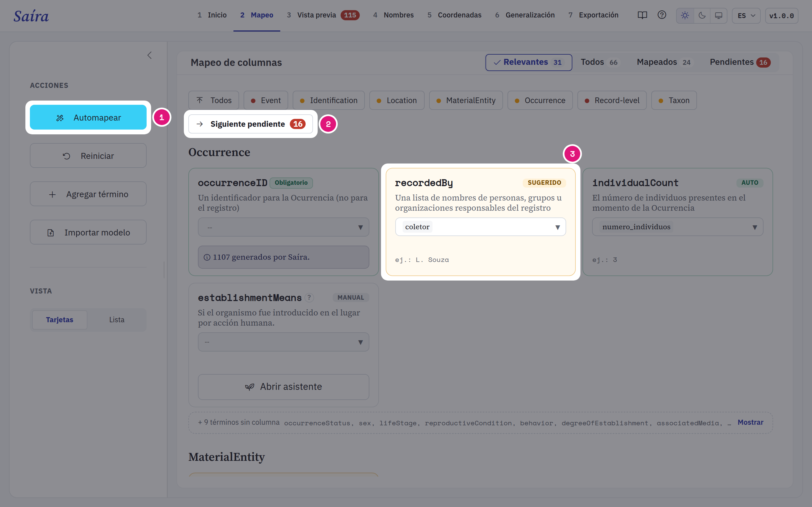</figure>
```

::: {.marks}
1. Saíra mapea una vez, justo después de la carga. **Automapear** lo ejecuta de nuevo.
2. **Siguiente pendiente** salta a la próxima tarjeta que pide revisión. El número indica cuántas faltan. En los filtros de clase, el punto rojo es un obligatorio vacío, el naranja es revisar.
3. La tarjeta amarilla es **SUGERIDO**: confírmela o cámbiela.
:::

## Filtre los términos

```{=html}
<figure class="shot">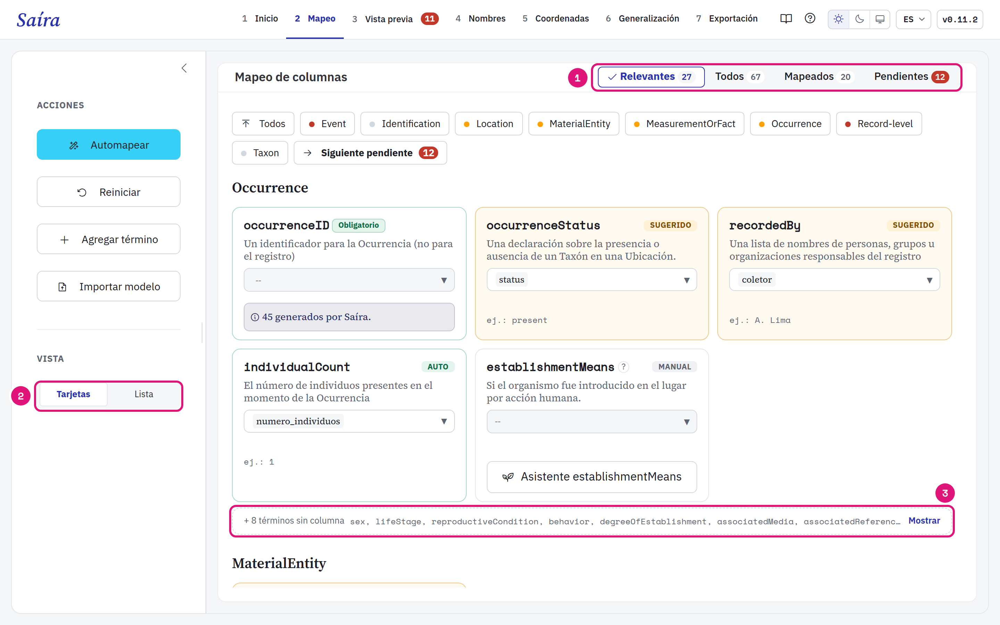</figure>
```

::: {.marks}
1. **Mostrar términos** filtra las tarjetas. Cada filtro muestra el conteo.
2. **Tarjetas** y **Lista** cambian la forma de la pantalla.
3. El bloque **términos sin columna** agrupa los términos opcionales sin columna. **Mostrar** abre el bloque, y el botón de cada línea abre la tarjeta.
:::

| Filtro | Muestra |
|---|---|
| Relevantes | Los términos que no están contraídos. |
| Todos | Todos los términos, también los contraídos. |
| Mapeados | Los términos con columna o valor fijo. |
| Pendientes | La misma cola de **Siguiente pendiente**: obligatorios vacíos y sugerencias para revisar. Un término opcional sin columna no es pendiente. |

## Mapee los términos obligatorios

Seis términos son obligatorios: <span class="term">scientificName</span> <span class="term">eventDate</span> <span class="term">decimalLatitude</span> <span class="term">decimalLongitude</span> <span class="term">basisOfRecord</span> <span class="term">license</span>. Sin uno de ellos, la exportación se bloquea.

::: {.callout-warning}
## Mapee el occurrenceID
<span class="term">occurrenceID</span> aparece como **Obligatorio** en la tarjeta, pero no bloquea la exportación. Sin él, Saíra crea un UUID a partir del contenido de la fila. El UUID queda igual en cada exportación, pero cambia si cambia el contenido de la fila. Mapee la columna con sus identificadores. Saíra solo completa las filas vacías.
:::

## Revise cada tarjeta

```{=html}
<figure class="shot">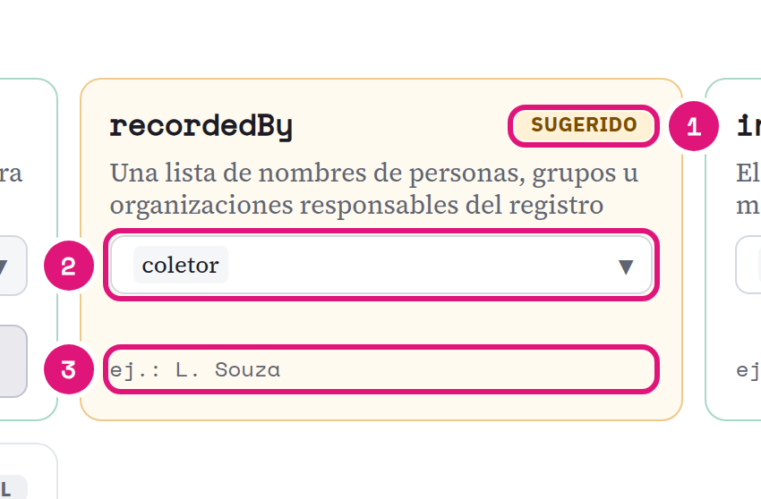</figure>
```

::: {.marks}
1. El sello indica de dónde vino el término.
2. ¿Columna equivocada? Cámbiela en el selector.
3. `ej.:` muestra el primer valor leído de la columna.
:::

| Sello | Significado |
|---|---|
| AUTO | Alta confianza. Ya viene completado. |
| SUGERIDO | Probable. Confírmelo. |
| AMBIGUO | Dos términos empatados. Usted elige. |
| EDITADO | Usted lo cambió. Su elección vale. |
| ALIAS | Vino de un mapeo anterior. |
| PLANTILLA | Vino de un modelo importado. |
| MANUAL | Sin sugerencia automática. |

Si la misma columna va a más de un término, Saíra le avisa. Verifique que sea intencional.

## Revise los valores estándar

Saíra traduce valores conocidos al vocabulario Darwin Core:

| Término | En la planilla | Sale como |
|---|---|---|
| <span class="term">occurrenceStatus</span> | `visto` | `present` |
| <span class="term">sex</span> | `M`, `macho` | `male` |
| <span class="term">sex</span> | `F`, `fêmea` | `female` |
| <span class="term">lifeStage</span> | `adulto` | `adult` |
| <span class="term">lifeStage</span> | `jovem`, `juvenil` | `juvenile` |

Un valor que Saíra no reconoce queda como está y va a **Problemas** en la [Vista previa](04-vista-previa.qmd#corrija-un-valor). `filhote` solo recibe una sugerencia, porque sirve para `juvenile` y `nestling`.

## Defina el basisOfRecord

```{=html}
<figure class="shot">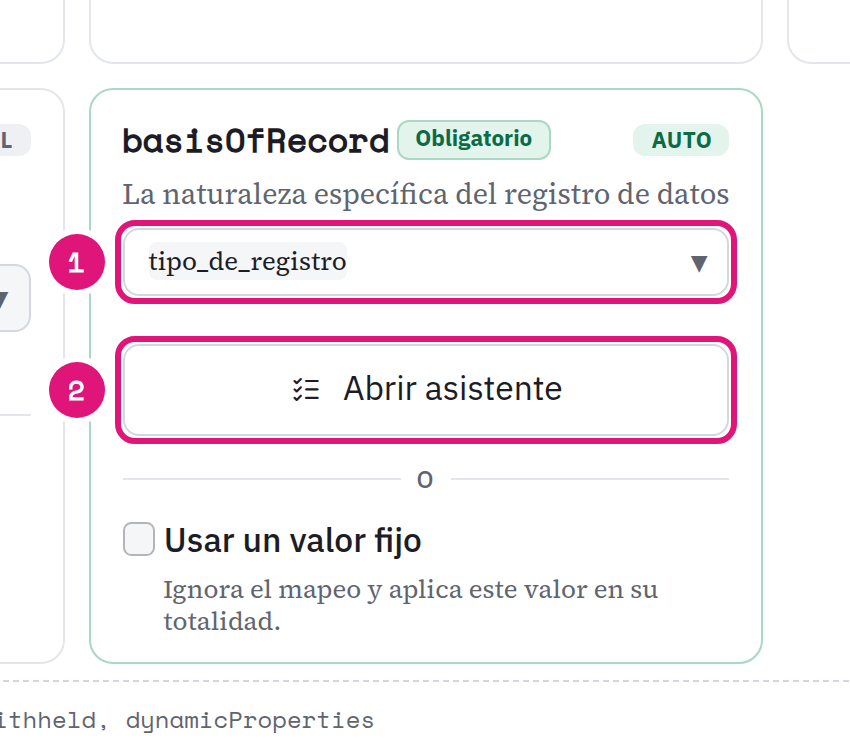</figure>
```

::: {.marks}
1. Elija la columna con el tipo de registro, como <span class="term">tipo_de_registro</span>.
2. Abra el **Asistente basisOfRecord**.
:::

```{=html}
<figure class="shot">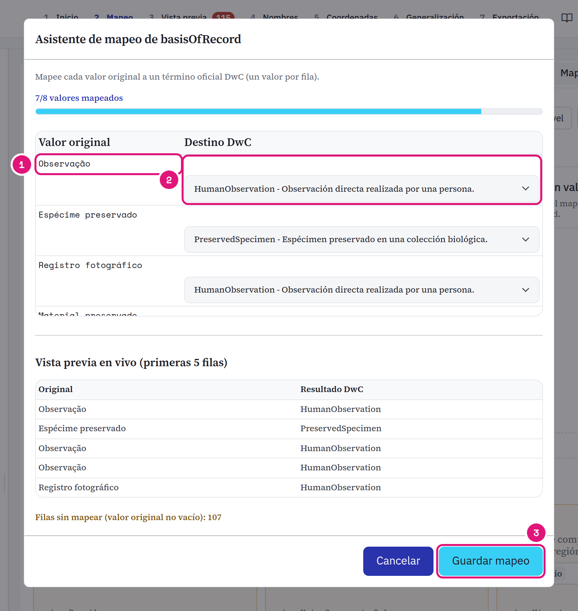</figure>
```

::: {.marks}
1. Cada valor distinto de la columna aparece una vez.
2. Elija el término Darwin Core. La vista previa de abajo muestra el resultado.
3. **Guardar mapeo**.
:::

## Responda establishmentMeans por especie

Opcional. El asistente está en la tarjeta <span class="term">establishmentMeans</span> y necesita <span class="term">scientificName</span> mapeado.

```{=html}
<figure class="shot">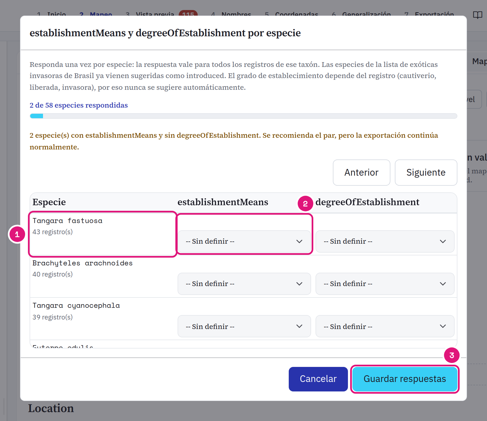</figure>
```

::: {.marks}
1. Una fila por especie, con el número de registros que cubre la respuesta.
2. Elija <span class="term">establishmentMeans</span>. Al lado, el <span class="term">degreeOfEstablishment</span>.
3. **Guardar respuestas**.
:::

Las especies invasoras ya llegan como `introduced`. Una nativa translocada con registros en isla oceánica se divide en dos filas: **En el continente** y **En isla oceánica**. La fila de la isla sugiere `introduced` y solo usted la aplica, con **Aplicar**. Las islas son Fernando de Noronha, Atol das Rocas, Trindade e Martim Vaz y São Pedro e São Paulo.

El grado nunca se sugiere: solo usted sabe si el animal está en cautiverio o libre. Si una columna de la hoja también completa el término, la columna gana.

## Use un valor fijo para el conjunto

```{=html}
<figure class="shot">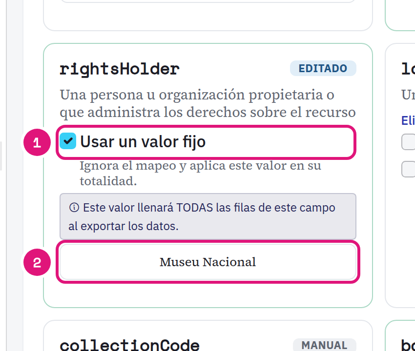</figure>
```

::: {.marks}
1. Marque **Usar un valor fijo**.
2. Escriba el valor una vez. Va a todas las filas.
:::

Aceptan valor fijo: <span class="term">rightsHolder</span> <span class="term">institutionCode</span> <span class="term">collectionCode</span> <span class="term">country</span> <span class="term">references</span> <span class="term">bibliographicCitation</span> <span class="term">geodeticDatum</span> <span class="term">basisOfRecord</span>. Use el valor fijo en <span class="term">basisOfRecord</span> cuando la hoja no tiene una columna con el tipo de registro.

## Elija la licencia y el nombre del conjunto

La tarjeta <span class="term">license</span> es obligatoria. Elija `CC0`, `CC BY 4.0` o `CC BY-NC 4.0`, las tres licencias que GBIF acepta. Sin licencia, la exportación se bloquea.

En <span class="term">datasetName</span>, elija una columna o escriba el nombre. Da el título del `eml.xml` y el inicio del nombre de los archivos.

## Agregue un término que no aparece

```{=html}
<figure class="shot">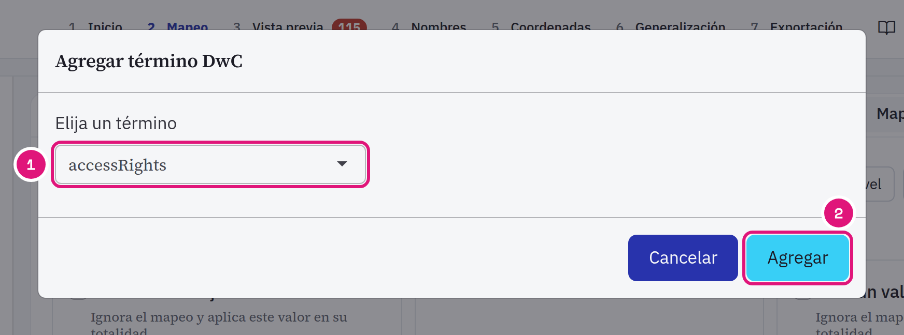</figure>
```

::: {.marks}
1. Busque el término.
2. **Agregar**. El término se convierte en una tarjeta nueva.
:::

## Junte columnas extra en dynamicProperties

```{=html}
<figure class="shot">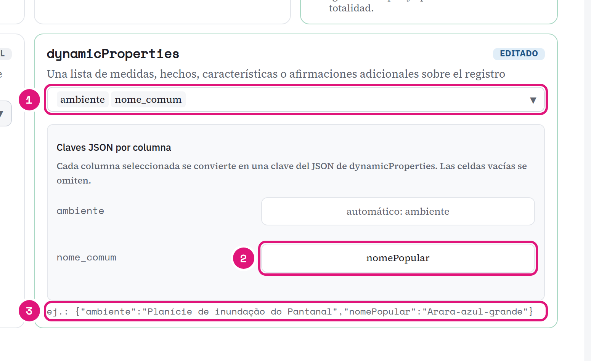</figure>
```

::: {.marks}
1. Elija las columnas.
2. Renombre la clave, si quiere.
3. Revise el JSON de la primera fila.
:::

El estado de conservación entra en el mismo campo, a partir de la [validación de nombres](05-validacion-nombres.qmd).

## Registre medidas

```{=html}
<figure class="shot">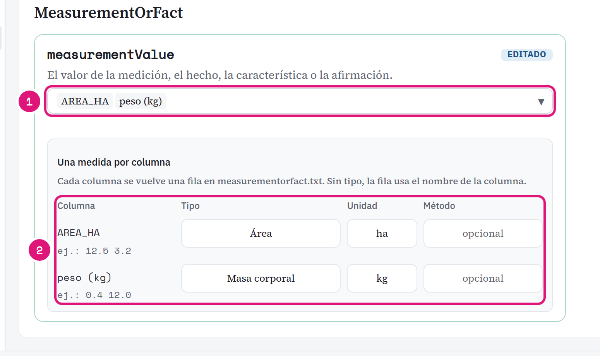</figure>
```

::: {.marks}
1. En la tarjeta <span class="term">measurementValue</span>, elija una o más columnas. Saíra sugiere columnas de números con la unidad en el nombre, como `AREA_HA` o `peso (kg)`.
2. En cada columna, complete **Tipo**, **Unidad** y, si quiere, **Método**. Sin tipo, la fila usa el nombre de la columna.
:::

Cada columna se convierte en una fila de `measurementorfact.txt`, vinculada a la ocurrencia, y sale del `occurrence.txt`. La [Vista previa](04-vista-previa.qmd) muestra cada medida por separado, como `measurementValue [AREA_HA]`.

## Reutilice el mapeo

El `.zip` exportado trae el `<dataset>-mapping-guide.txt`. En la próxima hoja de cálculo, haga clic en **Importar modelo**:

```{=html}
<figure class="shot">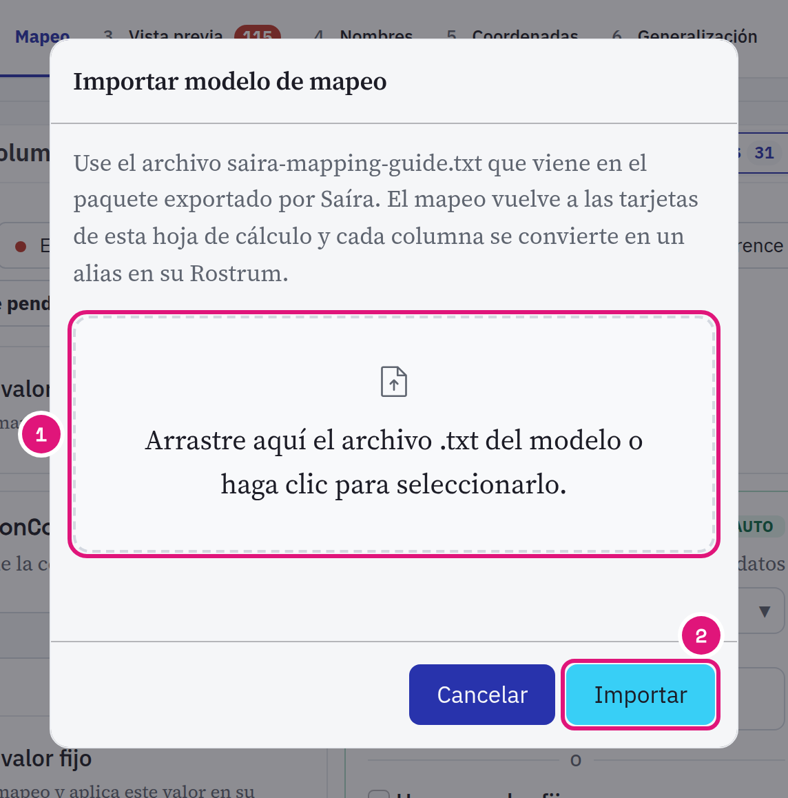</figure>
```

::: {.marks}
1. Envíe el archivo.
2. **Importar**. Las columnas con el mismo nombre se mapean solas.
:::

La guía restaura los términos mapeados, <span class="term">datasetName</span>, la licencia, el idioma y los valores fijos. Cada columna se convierte en un alias. Si una columna del modelo no existe en la hoja, Saíra avisa y lista hasta cinco. La guía no restaura nombres, coordenadas, generalización ni correcciones de la vista previa.

Saíra aprende alias solo en la exportación. Vea [Revise lo que aprendió Rostrum](08-exportacion.qmd#revise-lo-que-aprendió-rostrum).

Las columnas con datos que usted no mapee salen al final del archivo, con el nombre original, fuera del `meta.xml`. GBIF ignora esas columnas. Las columnas vacías sin mapear salen del archivo.
