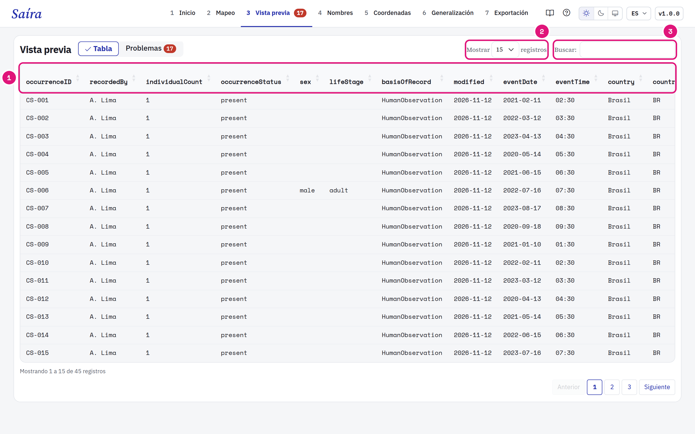
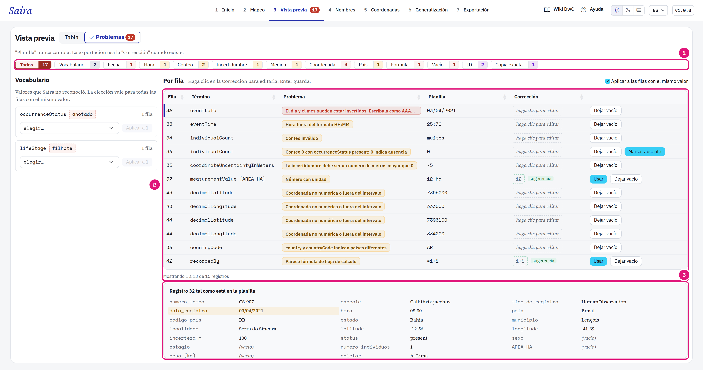
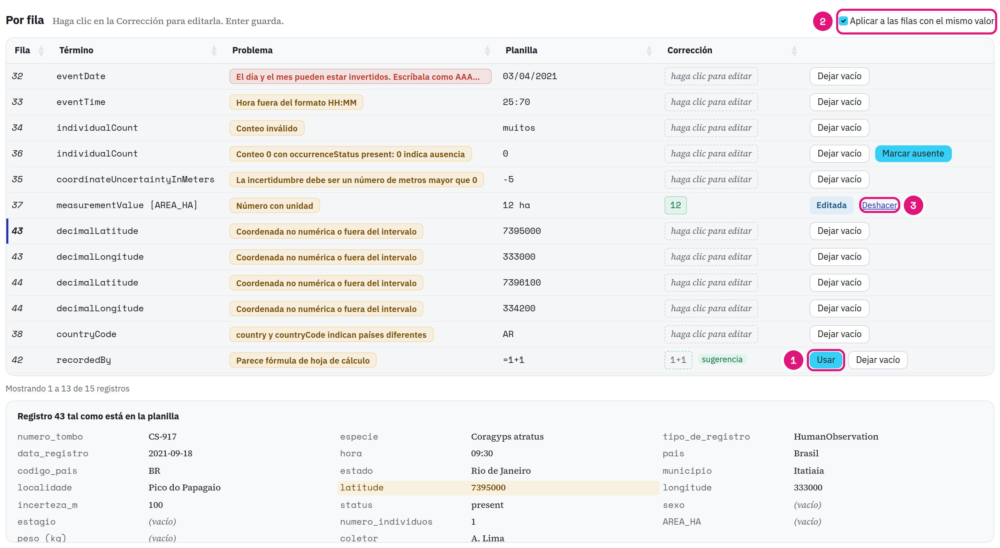
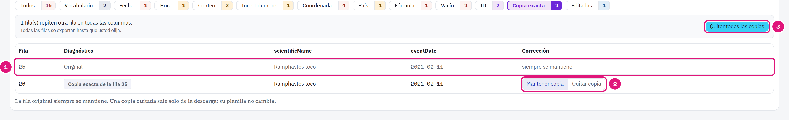

::: {.tut-standfirst}
Revise los datos en Darwin Core y corrija valores en la etapa **Vista previa**. Su hoja de cálculo no cambia.
:::

## Elija el modo

```{=html}
<figure class="shot"></figure>
```

::: {.marks}
1. **Tabla** muestra los primeros 100 registros. Las columnas ya tienen los nombres Darwin Core.
2. Elija cuántas filas ver.
3. Busque un valor en cualquier columna.
:::

**Problemas** revisa todos los registros, no solo los 100 de la tabla. La etapa abre en **Problemas** cuando hay un problema abierto. El número en la etapa, en el menú, indica cuántos problemas faltan corregir.

## Encuentre los problemas

```{=html}
<figure class="shot"></figure>
```

::: {.marks}
1. Los filtros separan los problemas por tipo, con el conteo. **Editadas** muestra lo que usted ya corrigió.
2. Cada fila trae el término, el diagnóstico, el valor **En la planilla** y la **Corrección**.
3. El registro de la fila elegida, tal como está en la planilla. La columna del problema queda marcada.
:::

**En la planilla** nunca cambia. La exportación usa la **Corrección** cuando existe. La lista abre en el primer problema. Haga clic en otra fila para ver su registro. En una ventana estrecha, el registro aparece debajo de la lista.

## Corrija un valor

```{=html}
<figure class="shot"></figure>
```

::: {.marks}
1. Haga clic en la **Corrección** y escriba. Enter guarda. **Usar** acepta la sugerencia de Saíra.
2. **Aplicar a las filas con el mismo valor** viene activado. **+N iguales** indica cuántas filas más cubre la corrección.
3. **Deshacer** vuelve al valor de la planilla.
:::

En valores de vocabulario, elija un valor de **Sugeridos** o del **Vocabulario GBIF**. La elección vale para todas las filas con el mismo valor. **Dejar vacío** borra el valor en la exportación. Los términos obligatorios no tienen esta opción.

## Vuelva al Mapeo cuando el error es de la columna

Cuando un tipo de problema en un término cubre el 20% de los registros o más, y al menos 20 registros, Saíra muestra **Volver al Mapeo**. La causa suele ser una columna en el término equivocado o un formato. Revise la columna en el [Mapeo](03-mapeo-dwc.qmd) antes de corregir fila por fila.

## Casos comunes

| Filtro | Ejemplo | Qué hacer |
|---|---|---|
| Vocabulario | `anotado` en <span class="term">occurrenceStatus</span> | Elija un valor sugerido o del vocabulario GBIF. |
| Fecha | `03/04/2021` | El día y el mes pueden estar invertidos. Escríbala como `AAAA-MM-DD`. |
| Fecha | `2021-13-40` | Saíra no leyó la fecha. Escríbala como `AAAA-MM-DD`. Saíra ya lee nombres de mes, meses en romano, fechas compactas e intervalos. |
| Hora | `25:70` | Escríbala como `HH:MM`. |
| Conteo | `muitos` | Escriba un número. |
| Conteo | `0` con <span class="term">occurrenceStatus</span> `present` | `0` indica ausencia. Haga clic en **Marcar ausente** o corrija el conteo. |
| Incertidumbre | `-5` | Escriba los metros, un número mayor que 0. |
| Medida | `12 ha` | Escriba solo el número. La unidad va en el campo **Unidad** de la tarjeta <span class="term">measurementValue</span>. |
| País | <span class="term">country</span> `Brasil` con <span class="term">countryCode</span> `AR` | Revise cuál es correcto. Saíra no lo corrige en lote. |
| Vacío | <span class="term">scientificName</span> vacío | Escriba el taxón más específico que conozca. |
| ID | Dos registros diferentes con el mismo <span class="term">occurrenceID</span> | Escriba el identificador correcto de cada uno. |
| Fórmula | `=1+1` | Escriba el valor. Esta celda bloquea la exportación. |

## Decida las copias exactas

```{=html}
<figure class="shot"></figure>
```

::: {.marks}
1. El filtro **Copia exacta** lista las filas que repiten otra fila en todas las columnas de la planilla. La fila original siempre se mantiene.
2. **Quitar copia** y **Mantener copia** deciden una fila.
3. **Quitar todas las copias** decide todas a la vez.
:::

Todas las filas se exportan hasta que usted elija. Una copia quitada sale solo de la descarga. El ID repetido de una copia aparece en **Copia exacta**. Dos registros diferentes con un solo ID quedan en **ID**: los dos se exportan.

::: {.callout-warning}
## Qué ocurre con un ID repetido
Si no lo corrige, Saíra reemplaza cada ID repetido por un UUID persistente. El UUID viene del contenido de la fila: queda igual en cada exportación, pero cambia si cambia el contenido de la fila. Corrija el ID cuando tenga el identificador correcto. Vea [Mapee el occurrenceID](03-mapeo-dwc.qmd#mapee-los-términos-obligatorios).
:::
