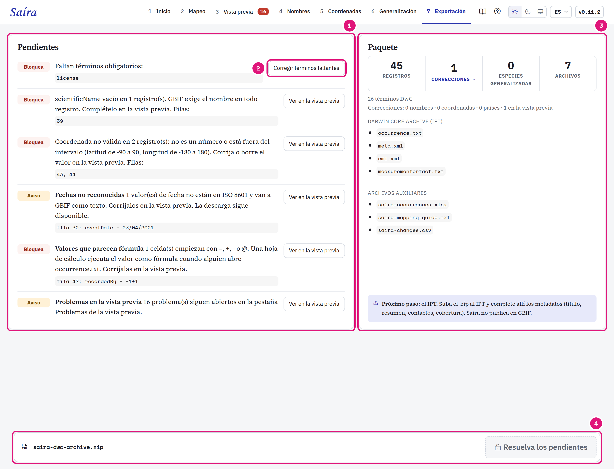
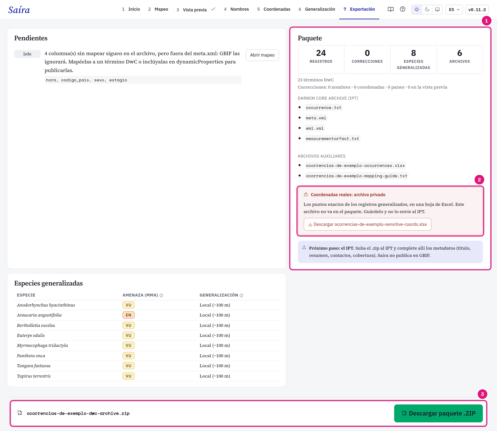

::: {.tut-standfirst}
Resuelva los pendientes y descargue el Darwin Core Archive en la etapa **Exportación**. La revisión de los datos está en la [Vista previa](04-vista-previa.qmd).
:::

## Resuelva los pendientes

```{=html}
<figure class="shot"></figure>
```

::: {.marks}
1. **Bloquea** impide la descarga. **Aviso** deja descargar. **Info** solo informa.
2. Cada pendiente tiene un botón que lleva a la etapa que lo resuelve.
3. El paquete: registros, correcciones, especies generalizadas y archivos.
4. La descarga queda desactivada mientras haya un pendiente que bloquea.
:::

| Pendiente | Tipo | Dónde resolverlo |
|---|---|---|
| Término obligatorio faltante, como <span class="term">eventDate</span> o <span class="term">license</span> | Bloquea | [Mapeo](03-mapeo-dwc.qmd#mapee-los-términos-obligatorios) |
| <span class="term">basisOfRecord</span> vacío o sin término DwC | Bloquea | [Asistente basisOfRecord](03-mapeo-dwc.qmd#defina-el-basisofrecord) |
| <span class="term">scientificName</span> vacío | Bloquea | [Vista previa](04-vista-previa.qmd#casos-comunes) |
| Celda que parece fórmula de hoja de cálculo, mapeada o no | Bloquea | [Vista previa](04-vista-previa.qmd#casos-comunes) |
| Coordenada inválida | Bloquea | [Coordenadas](06-validacion-coordenadas.qmd) |
| Generalización sin justificación | Bloquea | [Generalización](07-generalizacion.qmd#trate-una-especie-aparte) |
| Decisión de una etapa que Saíra no pudo leer | Bloquea | Abra de nuevo las etapas que cita el mensaje y revíselas. |
| Fecha no leída, año fuera del intervalo, conteo cero sin estado | Aviso | [Vista previa](04-vista-previa.qmd#casos-comunes) |
| Marca de Coordenadas, problema abierto en la Vista previa | Aviso | El botón del pendiente lleva a la etapa. |
| Columna sin mapear | Info | GBIF ignora la columna. Mapéela a un término o inclúyala en <span class="term">dynamicProperties</span>. |

## Revise el paquete

```{=html}
<figure class="shot"></figure>
```

::: {.marks}
1. Los archivos que van en el `.zip`.
2. El archivo privado, que se descarga aparte.
3. **Descargar paquete .ZIP** se libera cuando nada bloquea.
:::

Haga clic en **Correcciones** para ver un ejemplo por tipo: Nombres, Coordenadas, Países y En la vista previa. Cada tipo tiene un enlace a la etapa. La lista completa va en `<dataset>-changes.csv`. Los valores de registros generalizados quedan ocultos.

## Qué ajusta Saíra

- **Fechas** en ISO 8601: `AAAA-MM-DD`, `AAAA-MM` sin día, `AAAA-MM-DDThh:mm` con hora. Un año antes de 1600 o después del año actual genera un aviso, sin bloquear.
- **Coordenadas** con punto decimal.
- **Licencia** con el nombre elegido (`CC BY 4.0`) en el `occurrence.txt` y la URL en el `eml.xml`.
- **Título** del `eml.xml` a partir de <span class="term">datasetName</span>. Con una columna mapeada, vale el valor más frecuente.
- **Columnas** en el orden de Darwin Core. Las columnas sin mapear con datos quedan al final, con el nombre original. Las columnas sin mapear vacías salen del archivo.

### Estado de conservación en `dynamicProperties`

Saíra graba el estado de conservación según las bases de la [validación de nombres](05-validacion-nombres.qmd):

- Flora BR o Fauna BR → `mmaThreatStatus` y `mmaSource`;
- GBIF → `iucnRedListCategory`, consultado en la exportación.

```json
{"mmaThreatStatus":"CR","mmaSource":"Portaria 1.704/2026","iucnRedListCategory":"NT"}
```

Sin internet, la clave UICN queda fuera y la exportación continúa. Las claves MMA entran en registros de Brasil, por <span class="term">country</span> o <span class="term">countryCode</span>, y en registros que Saíra generalizó. Los demás registros quedan sin las claves MMA.

## Archivos del paquete

El `.zip` (`<dataset>-dwc-archive.zip`) tiene el Darwin Core Archive y los archivos auxiliares. `<dataset>` viene de <span class="term">datasetName</span>. Sin este término, el nombre es `saira`.

| Archivo | Uso |
|---|---|
| `occurrence.txt` | Los datos. Va al IPT. |
| `meta.xml` | Indica el término de cada columna. Va al IPT. |
| `eml.xml` | Metadatos: título, extensión geográfica, período y licencia. Va al IPT. |
| `measurementorfact.txt` | Las [medidas](03-mapeo-dwc.qmd#registre-medidas), una por fila, vinculadas a la ocurrencia. Solo existe si mapeó medidas. Va al IPT. |
| `<dataset>-occurrences.xlsx` | Copia en Excel, con todas las celdas como texto. Queda fuera por encima de 1.048.575 registros, el límite de Excel. |
| `<dataset>-mapping-guide.txt` | El mapeo, para [reutilizar](03-mapeo-dwc.qmd#reutilice-el-mapeo). |
| `<dataset>-changes.csv` | Todas las correcciones, fila por fila. Solo existe si hay correcciones. |

## Descargue el archivo privado

Si generalizó registros, la tarjeta **Paquete** muestra un botón propio para `<dataset>-sensitive-coords.xlsx`. Esta hoja tiene las coordenadas originales y queda fuera del `.zip`. Guárdela, no la publique.

## Revise lo que aprendió Rostrum

Al exportar, Saíra guarda cada par de columna y término como alias. En una próxima hoja de cálculo con las mismas columnas, Rostrum sugiere los mismos términos. La tarjeta **Memoria de Rostrum** tiene **Ver los alias** y **Deshacer aprendizaje**. Deshacer no cambia el `.zip` que descargó.

## Publique por el IPT

Saíra no publica en GBIF. Envíe el `.zip` al IPT de su institución o del SiBBr. En el IPT, complete los metadatos (resumen, contactos, cobertura) y publique.

## Revise la publicación desde R

`check_publication()` es una función del paquete R. La aplicación no tiene un botón para ella. La función compara el `.zip` con el conjunto publicado y necesita internet.

```r
saira::check_publication("neotropical-carnivores.zip", "dr1451")
```

El segundo argumento es la clave del conjunto en GBIF (UUID) o el uid de SiBBr (`dr` y un número). La función devuelve `portal`, `dataset`, `sent`, `published`, `missing` y `unexpected`.
