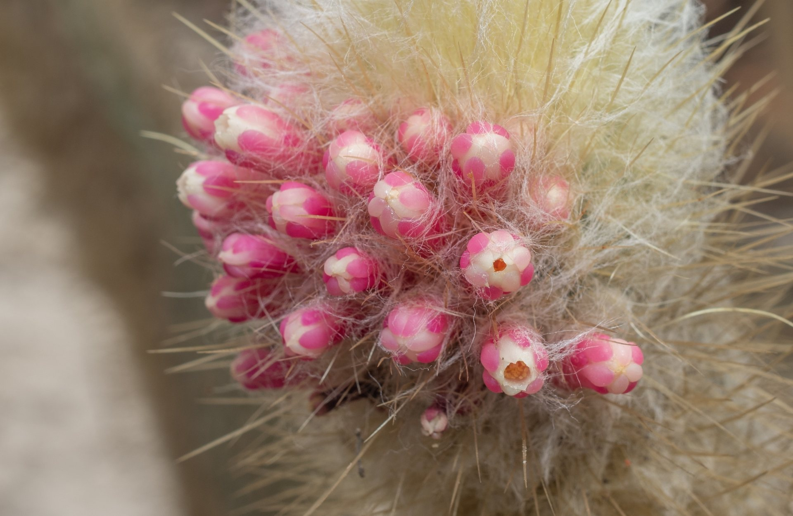
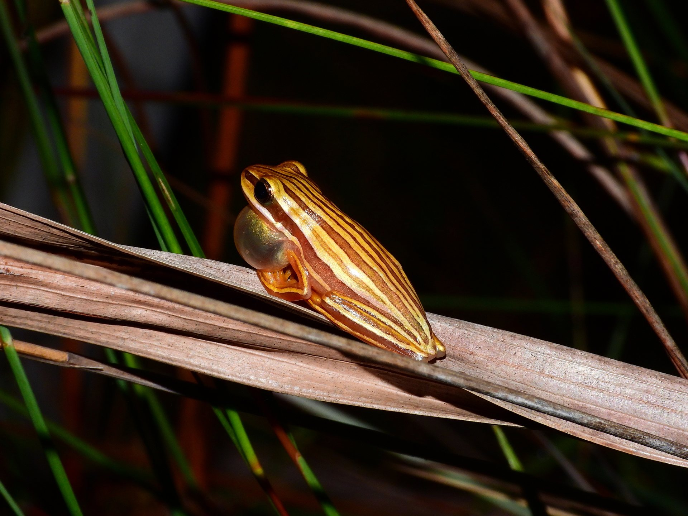
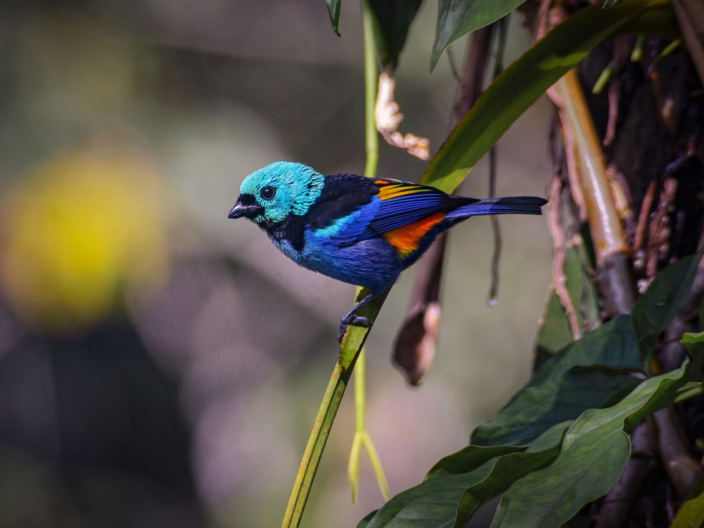
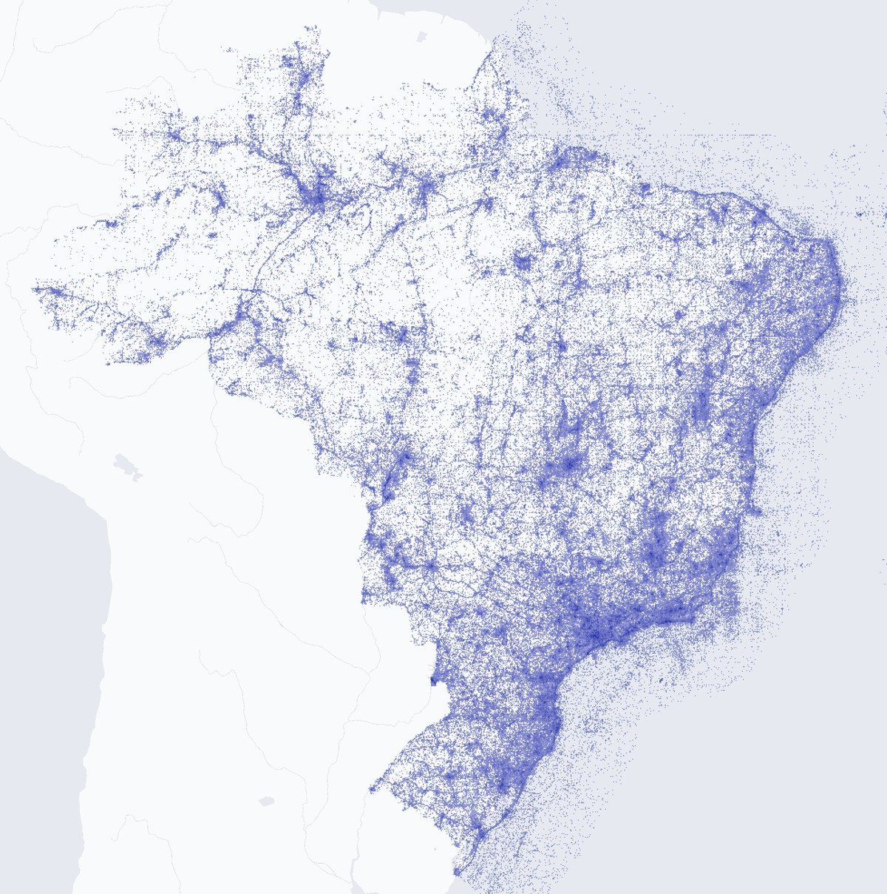
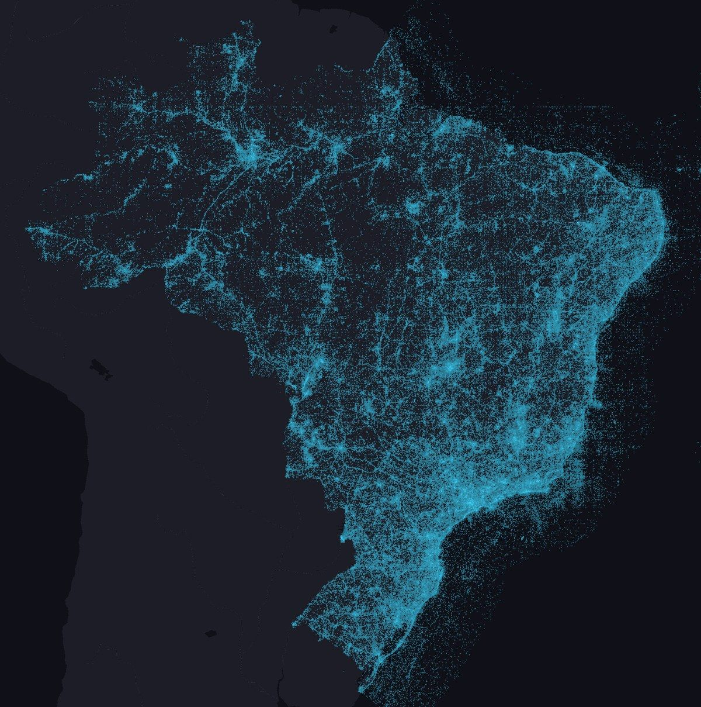

```{=html}
<div class="lp">

<!-- ===================== HERO: one MMA-threatened species per biome ===================== -->
<section class="lp-hero" aria-label="Espécies ameaçadas dos seis biomas" data-seconds="7">
  
  
  
  
  
  
  <div class="lp-scrim" aria-hidden="true"></div>
  <div class="lp-hero-text">
    <h1 class="lp-rise">Saíra</h1>
    <p class="lp-sub lp-rise" style="--d: .15s">Darwin Core para a biodiversidade brasileira.</p>
    <div class="lp-actions lp-rise" style="--d: .3s">
      <a class="lp-btn lp-btn-primary" href="#instalar">Instalar</a>
      <a class="lp-btn" href="tutoriais/01-instalacao.html">Ver os tutoriais</a>
    </div>
  </div>
  <div class="lp-rec lp-rise" style="--d: .45s">
    <div class="lp-rec-name">Tangara fastuosa</div>
    <div class="lp-rec-line">Thraupidae · Paraíba</div>
    <span class="lp-rec-cat" data-code="VU">Vulnerável · MMA</span>
    <div class="lp-rec-credit">Foto: <span>Renato Bandeira · CC BY 4.0</span></div>
  </div>
  <nav class="lp-biomes lp-rise" style="--d: .6s" aria-label="Biomas">
    <button type="button" class="lp-biome" data-sp="podocnemis-sextuberculata" aria-pressed="false" data-sci="Podocnemis sextuberculata" data-fam="Podocnemididae" data-uf="Amazonas" data-code="EN" data-cat="Em perigo · MMA" data-credit="Rafael Bernhard · CC BY 4.0"><span class="lp-prog"></span><span class="lp-biome-name">Amazônia</span><span class="lp-biome-sp">iaçá</span></button>
    <button type="button" class="lp-biome" data-sp="micranthocereus-polyanthus" aria-pressed="false" data-sci="Micranthocereus polyanthus" data-fam="Cactaceae" data-uf="Bahia" data-code="EN" data-cat="Em perigo · MMA" data-credit="Brian Williams · CC BY 4.0"><span class="lp-prog"></span><span class="lp-biome-name">Caatinga</span><span class="lp-biome-sp"><em>Micranthocereus polyanthus</em></span></button>
    <button type="button" class="lp-biome" data-sp="boana-buriti" aria-pressed="false" data-sci="Boana buriti" data-fam="Hylidae" data-uf="Goiás" data-code="VU" data-cat="Vulnerável · MMA" data-credit="Reuber Brandão · CC BY 4.0"><span class="lp-prog"></span><span class="lp-biome-name">Cerrado</span><span class="lp-biome-sp">perereca-do-buriti</span></button>
    <button type="button" class="lp-biome" data-sp="tangara-fastuosa" aria-pressed="true" data-sci="Tangara fastuosa" data-fam="Thraupidae" data-uf="Paraíba" data-code="VU" data-cat="Vulnerável · MMA" data-credit="Renato Bandeira · CC BY 4.0"><span class="lp-prog"></span><span class="lp-biome-name">Mata Atlântica</span><span class="lp-biome-sp">saíra-pintor</span></button>
    <button type="button" class="lp-biome" data-sp="acanthochelys-macrocephala" aria-pressed="false" data-sci="Acanthochelys macrocephala" data-fam="Chelidae" data-uf="Mato Grosso" data-code="VU" data-cat="Vulnerável · MMA" data-credit="Thomas Galewski · CC BY 4.0"><span class="lp-prog"></span><span class="lp-biome-name">Pantanal</span><span class="lp-biome-sp">cágado-do-pantanal</span></button>
    <button type="button" class="lp-biome" data-sp="leopardus-munoai" aria-pressed="false" data-sci="Leopardus munoai" data-fam="Felidae" data-uf="Rio Grande do Sul" data-code="CR" data-cat="Criticamente em perigo · MMA" data-credit="Felipe Peters · CC BY-NC 4.0"><span class="lp-prog"></span><span class="lp-biome-name">Pampa</span><span class="lp-biome-sp">gato-palheiro-pampeano</span></button>
  </nav>
</section>

<!-- ===================== DATA: the demo sheet fixed tab by tab, then the network map ===================== -->
<section class="lp-section lp-data" id="dados" aria-labelledby="dados-titulo">
  <div class="lp-head">
    <div>
      <span class="lp-eyebrow">Do Saíra ao SiBBr e ao GBIF</span>
      <h2 id="dados-titulo">Da planilha ao dado integrado.</h2>
      <p class="lp-lede">O Saíra converte a planilha para Darwin Core. O arquivo exportado pode ser publicado no SiBBr e no GBIF.</p>
    </div>
  </div>
  <div class="lp-mod">
    <span class="lp-step"><b>01</b>No Saíra</span>
    <h3>Cada etapa traduz sua planilha para Darwin Core.</h3>
    <div class="lp-panel lp-flow" data-step="Etapa {n} de {total} · {tab}" data-raw="Planilha como chegou" data-done="Pronto. 6 linhas no occurrence.txt, 6 com coordenadas generalizadas.">
      <div class="lp-bar">
        <span class="lp-file">seis_biomas.csv<small>6 registros · uma espécie ameaçada por bioma</small></span>
        <button type="button" class="lp-toggle" data-pause="Pausar" data-play="Continuar">Pausar</button>
      </div>
      <ol class="lp-tabs" aria-label="Abas do Saíra">
        <li data-verb="lê o arquivo e a codificação"><b>1</b>Início</li>
        <li data-verb="associa colunas a termos"><b>2</b>Mapeamento</li>
        <li data-verb="mostra os registros mapeados"><b>3</b>Pré-visualização</li>
        <li data-verb="confere os nomes nas bases"><b>4</b>Nomes</li>
        <li data-verb="testa faixa, mar, país e inversão"><b>5</b>Coordenadas</li>
        <li data-verb="protege espécies ameaçadas"><b>6</b>Generalização</li>
        <li data-verb="gera datas ISO e IDs estáveis"><b>7</b>Exportação</li>
      </ol>
      <div class="lp-stage">
        <span class="lp-cap">Sua planilha</span>
        <div class="lp-scroll"><div class="lp-grid" role="table" aria-label="Planilha de demonstração" data-cols="Espécie|Lat|Long|Data|Estado"></div></div>
        <p class="lp-verb"></p>
      </div>
      <div class="lp-foot"><span class="lp-status">Planilha como chegou</span></div>
    </div>
    <p class="lp-note">Registros reais do GBIF, com erros inseridos para a demonstração. As seis espécies estão na lista do MMA, então as coordenadas saem numa grade de 0,1°.</p>
  </div>
  <div class="lp-mod lp-map">
    <div class="lp-map-text">
      <span class="lp-step"><b>02</b>Na rede</span>
      <h3>Ocorrências no SiBBr.</h3>
      <p class="lp-big"><strong>45.020.973</strong><span>ocorrências de espécies no SiBBr</span></p>
      <p>O SiBBr é o nó brasileiro do GBIF.</p>
      <p class="lp-src">Fontes: <a href="https://sibbr.gov.br/">SiBBr</a> e <a href="https://www.gbif.org/country/BR/summary">GBIF.org</a>, 9 out. 2026. Mapa base: <a href="https://openmaptiles.org/">© OpenMapTiles</a> <a href="https://www.openstreetmap.org/copyright">© colaboradores do OpenStreetMap</a>.</p>
    </div>
    <figure class="lp-mapfig">
      
      
      <span class="lp-pin" data-sp="podocnemis-sextuberculata" style="--x: 24.72%; --y: 21.59%" aria-hidden="true"></span>
      <span class="lp-pin" data-sp="micranthocereus-polyanthus" style="--x: 76.57%; --y: 48.49%" aria-hidden="true"></span>
      <span class="lp-pin" data-sp="boana-buriti" style="--x: 64.51%; --y: 54.4%" aria-hidden="true"></span>
      <span class="lp-pin" data-sp="tangara-fastuosa" style="--x: 92.56%; --y: 31.11%" aria-hidden="true"></span>
      <span class="lp-pin" data-sp="acanthochelys-macrocephala" style="--x: 43.5%; --y: 55.06%" aria-hidden="true"></span>
      <span class="lp-pin" data-sp="leopardus-munoai" style="--x: 49.24%; --y: 88.34%" aria-hidden="true"></span>
      <span class="lp-card" data-sp="podocnemis-sextuberculata" style="--x: 24.72%; --y: 21.59%" aria-hidden="true"><span><em>Podocnemis sextuberculata</em><span>iaçá</span><span class="lp-card-xy"></span><span class="lp-card-cat" data-code="EN">Em perigo · MMA</span></span></span>
      <span class="lp-card is-left" data-sp="micranthocereus-polyanthus" style="--x: 76.57%; --y: 48.49%" aria-hidden="true"><span><em>Micranthocereus polyanthus</em><span class="lp-card-xy"></span><span class="lp-card-cat" data-code="EN">Em perigo · MMA</span></span></span>
      <span class="lp-card is-left" data-sp="boana-buriti" style="--x: 64.51%; --y: 54.4%" aria-hidden="true"><span><em>Boana buriti</em><span>perereca-do-buriti</span><span class="lp-card-xy"></span><span class="lp-card-cat" data-code="VU">Vulnerável · MMA</span></span></span>
      <span class="lp-card is-left" data-sp="tangara-fastuosa" style="--x: 92.56%; --y: 31.11%" aria-hidden="true"><span><em>Tangara fastuosa</em><span>saíra-pintor</span><span class="lp-card-xy"></span><span class="lp-card-cat" data-code="VU">Vulnerável · MMA</span></span></span>
      <span class="lp-card" data-sp="acanthochelys-macrocephala" style="--x: 43.5%; --y: 55.06%" aria-hidden="true"><span><em>Acanthochelys macrocephala</em><span>cágado-do-pantanal</span><span class="lp-card-xy"></span><span class="lp-card-cat" data-code="VU">Vulnerável · MMA</span></span></span>
      <span class="lp-card" data-sp="leopardus-munoai" style="--x: 49.24%; --y: 88.34%" aria-hidden="true"><span><em>Leopardus munoai</em><span>gato-palheiro-pampeano</span><span class="lp-card-xy"></span><span class="lp-card-cat" data-code="CR">Criticamente em perigo · MMA</span></span></span>
    </figure>
  </div>
</section>

<!-- ===================== INSTALL: tabs for the app (Windows, Linux) and the R package; the R tab keeps the console replay ===================== -->
<section class="lp-section lp-install" id="instalar" aria-labelledby="instalar-titulo">
  <div class="lp-install-text">
    <div>
      <span class="lp-eyebrow">Instalação</span>
      <h2 id="instalar-titulo">Baixe o app ou instale pelo R</h2>
    </div>
    <div>
      <p>Escolha o app para o seu sistema. Ele já traz o R. Se você já usa R, instale o pacote pelo console, no Windows ou no Linux.</p>
      <p class="lp-small">Dúvidas? Veja o <a href="tutoriais/01-instalacao.html">tutorial de instalação</a>. Achou um erro? <a href="https://github.com/rogerio-onza/saira/issues">Abra uma issue</a>.</p>
    </div>
  </div>
  <div class="lp-get">
    <article class="lp-os" data-os="windows">
      <svg class="lp-os-logo" viewBox="0 0 16 16" fill="currentColor" aria-hidden="true"><path d="M6.555 1.375 0 2.237v5.45h6.555zM0 13.795l6.555.933V8.313H0zm7.278-5.4.026 6.378L16 16V8.395zM16 0 7.33 1.244v6.414H16z"/></svg>
      <h3>Windows <span class="lp-os-you" hidden>Seu sistema</span></h3>
      <span class="lp-os-meta">App · 64 bits</span>
      <p>Já traz o R e todas as dependências. Abre numa janela própria, sem navegador.</p>
      <div class="lp-os-acts">
        <a class="lp-btn" href="https://github.com/rogerio-onza/saira/releases/latest"><svg viewBox="0 0 24 24" fill="none" stroke="currentColor" stroke-width="2" stroke-linecap="round" stroke-linejoin="round" aria-hidden="true"><path d="M12 3v12"/><path d="m7 10 5 5 5-5"/><path d="M5 21h14"/></svg>Baixar para Windows</a>
        <span class="lp-os-alt">Instalador <code>.exe</code></span>
      </div>
    </article>
    <article class="lp-os" data-os="linux">
      <svg class="lp-os-logo" viewBox="0 0 16 16" fill="currentColor" aria-hidden="true"><path d="M8.996 4.497c.104-.076.1-.168.186-.158s.022.102-.098.207c-.12.104-.308.243-.46.323-.291.152-.631.336-.993.336s-.647-.167-.853-.33c-.102-.082-.186-.162-.248-.221-.11-.086-.096-.207-.052-.204.075.01.087.109.134.153.064.06.144.137.241.214.195.154.454.304.778.304s.702-.19.932-.32c.13-.073.297-.204.433-.304M7.34 3.781c.055-.02.123-.031.174-.003.011.006.024.021.02.034-.012.038-.074.032-.11.05-.032.017-.057.052-.093.054-.034 0-.086-.012-.09-.046-.007-.044.058-.072.1-.089m.581-.003c.05-.028.119-.018.173.003.041.017.106.045.1.09-.004.033-.057.046-.09.045-.036-.002-.062-.037-.093-.053-.036-.019-.098-.013-.11-.051-.004-.013.008-.028.02-.034"/><path fill-rule="evenodd" d="M8.446.019c2.521.003 2.38 2.66 2.364 4.093-.01.939.509 1.574 1.04 2.244.474.56 1.095 1.38 1.45 2.32.29.765.402 1.613.115 2.465a.8.8 0 0 1 .254.152l.001.002c.207.175.271.447.329.698.058.252.112.488.224.615.344.382.494.667.48.922-.015.254-.203.43-.435.57-.465.28-1.164.491-1.586 1.002-.443.527-.99.83-1.505.871a1.25 1.25 0 0 1-1.256-.716v-.001a1 1 0 0 1-.078-.21c-.67.038-1.252-.165-1.718-.128-.687.038-1.116.204-1.506.206-.151.331-.445.547-.808.63-.5.114-1.126 0-1.743-.324-.577-.306-1.31-.278-1.85-.39-.27-.057-.51-.157-.626-.384-.116-.226-.095-.538.07-.988.051-.16.012-.398-.026-.648a2.5 2.5 0 0 1-.037-.369c0-.133.022-.265.087-.386v-.002c.14-.266.368-.377.577-.451s.397-.125.53-.258c.143-.15.27-.374.443-.56q.036-.037.073-.07c-.081-.538.007-1.105.192-1.662.393-1.18 1.223-2.314 1.811-3.014.502-.713.65-1.287.701-2.016.042-.997-.705-3.974 2.112-4.2q.168-.015.321-.013m2.596 10.866-.03.016c-.223.121-.348.337-.427.656-.08.32-.107.733-.13 1.206v.001c-.023.37-.192.824-.31 1.267s-.176.862-.036 1.128v.002c.226.452.608.636 1.051.601s.947-.304 1.36-.795c.474-.576 1.218-.796 1.638-1.05.21-.126.324-.242.333-.4.009-.157-.097-.403-.425-.767-.17-.192-.217-.462-.274-.71-.056-.247-.122-.468-.26-.585l-.001-.001c-.18-.157-.356-.17-.565-.164q-.069.001-.14.005c-.239.275-.805.612-1.197.508-.359-.09-.562-.508-.587-.918m-7.204.03H3.83c-.189.002-.314.09-.44.225-.149.158-.276.382-.445.56v.002h-.002c-.183.184-.414.239-.61.31-.195.069-.353.143-.46.35v.002c-.085.155-.066.378-.029.624.038.245.096.507.018.746v.002l-.001.002c-.157.427-.155.678-.082.822.074.143.235.22.48.272.493.103 1.26.069 1.906.41.583.305 1.168.404 1.598.305.431-.098.712-.369.75-.867v-.002c.029-.292-.195-.673-.485-1.052-.29-.38-.633-.752-.795-1.09v-.002l-.61-1.11c-.21-.286-.43-.462-.68-.5a1 1 0 0 0-.106-.008M9.584 4.85c-.14.2-.386.37-.695.467-.147.048-.302.17-.495.28a1.3 1.3 0 0 1-.74.19.97.97 0 0 1-.582-.227c-.14-.113-.25-.237-.394-.322a3 3 0 0 1-.192-.126c-.063 1.179-.85 2.658-1.226 3.511a5.4 5.4 0 0 0-.43 1.917c-.68-.906-.184-2.066.081-2.568.297-.55.343-.701.27-.649-.266.436-.685 1.13-.848 1.844-.085.372-.1.749.01 1.097.11.349.345.67.766.931.573.351.963.703 1.193 1.015s.302.584.23.777a.4.4 0 0 1-.212.22.7.7 0 0 1-.307.056l.184.235c.094.124.186.249.266.375 1.179.805 2.567.496 3.568-.218.1-.342.197-.664.212-.903.024-.474.05-.896.136-1.245s.244-.634.53-.791a1 1 0 0 1 .138-.061q.005-.045.013-.087c.082-.546.569-.572 1.18-.303.588.266.81.499.71.814h.13c.122-.398-.133-.69-.822-1.025l-.137-.06a2.35 2.35 0 0 0-.012-1.113c-.188-.79-.704-1.49-1.098-1.838-.072-.003-.065.06.081.203.363.333 1.156 1.532.727 2.644a1.2 1.2 0 0 0-.342-.043c-.164-.907-.543-1.66-.735-2.014-.359-.668-.918-2.036-1.158-2.983M7.72 3.503a1 1 0 0 0-.312.053c-.268.093-.447.286-.559.391-.022.021-.05.04-.119.091s-.172.126-.321.238q-.198.151-.13.38c.046.15.192.325.459.476.166.098.28.23.41.334a1 1 0 0 0 .215.133.9.9 0 0 0 .298.066c.282.017.49-.068.673-.173s.34-.233.518-.29c.365-.115.627-.345.709-.564a.37.37 0 0 0-.01-.309c-.048-.096-.148-.187-.318-.257h-.001c-.354-.151-.507-.162-.705-.29-.321-.207-.587-.28-.807-.279m-.89-1.122h-.025a.4.4 0 0 0-.278.135.76.76 0 0 0-.191.334 1.2 1.2 0 0 0-.051.445v.001c.01.162.041.299.102.436.05.116.109.204.183.274l.089-.065.117-.09-.023-.018a.4.4 0 0 1-.11-.161.7.7 0 0 1-.054-.22v-.01a.7.7 0 0 1 .014-.234.4.4 0 0 1 .08-.179q.056-.069.126-.073h.013a.18.18 0 0 1 .123.05c.045.04.08.09.11.162a.7.7 0 0 1 .054.22v.01a.7.7 0 0 1-.002.17 1.1 1.1 0 0 1 .317-.143 1.3 1.3 0 0 0 .002-.194V3.23a1.2 1.2 0 0 0-.102-.437.8.8 0 0 0-.227-.31.4.4 0 0 0-.268-.102m1.95-.155a.63.63 0 0 0-.394.14.9.9 0 0 0-.287.376 1.2 1.2 0 0 0-.1.51v.015q0 .079.01.152c.114.027.278.074.406.138a1 1 0 0 1-.011-.172.8.8 0 0 1 .058-.278.5.5 0 0 1 .139-.2.26.26 0 0 1 .182-.069.26.26 0 0 1 .178.081c.055.054.094.12.124.21.029.086.042.17.04.27l-.002.012a.8.8 0 0 1-.057.277c-.024.059-.089.106-.122.145.046.016.09.03.146.052a5 5 0 0 1 .248.102 1.2 1.2 0 0 0 .244-.763 1.2 1.2 0 0 0-.11-.495.9.9 0 0 0-.294-.37.64.64 0 0 0-.39-.133z"/></svg>
      <h3>Linux <span class="lp-os-you" hidden>Seu sistema</span></h3>
      <span class="lp-os-meta">App · 64 bits</span>
      <p>Já traz o R e todas as dependências. No Ubuntu 24.04 ou mais novo, use o <code>.deb</code>.</p>
      <div class="lp-os-acts">
        <a class="lp-btn" href="https://github.com/rogerio-onza/saira/releases/latest"><svg viewBox="0 0 24 24" fill="none" stroke="currentColor" stroke-width="2" stroke-linecap="round" stroke-linejoin="round" aria-hidden="true"><path d="M12 3v12"/><path d="m7 10 5 5 5-5"/><path d="M5 21h14"/></svg>Baixar .deb</a>
        <span class="lp-os-alt">Ou baixe o <a href="https://github.com/rogerio-onza/saira/releases/latest">AppImage</a></span>
      </div>
    </article>
    <article class="lp-os" data-os="r">
      <svg class="lp-os-logo" viewBox="0 0 724 561" aria-hidden="true"><path fill="currentColor" fill-opacity=".4" fill-rule="evenodd" d="M361.453,485.937 C162.329,485.937 0.906,377.828 0.906,244.469 C0.906,111.109 162.329,3.000 361.453,3.000 C560.578,3.000 722.000,111.109 722.000,244.469 C722.000,377.828 560.578,485.937 361.453,485.937 ZM416.641,97.406 C265.289,97.406 142.594,171.314 142.594,262.484 C142.594,353.654 265.289,427.562 416.641,427.562 C567.992,427.562 679.687,377.033 679.687,262.484 C679.687,147.971 567.992,97.406 416.641,97.406 Z"/><path fill="currentColor" fill-rule="evenodd" d="M550.000,377.000 C550.000,377.000 571.822,383.585 584.500,390.000 C588.899,392.226 596.510,396.668 602.000,402.500 C607.378,408.212 610.000,414.000 610.000,414.000 L696.000,559.000 L557.000,559.062 L492.000,437.000 C492.000,437.000 478.690,414.131 470.500,407.500 C463.668,401.969 460.755,400.000 454.000,400.000 C449.298,400.000 420.974,400.000 420.974,400.000 L421.000,558.974 L298.000,559.026 L298.000,152.938 L545.000,152.938 C545.000,152.938 657.500,154.967 657.500,262.000 C657.500,369.033 550.000,377.000 550.000,377.000 ZM496.500,241.024 L422.037,240.976 L422.000,310.026 L496.500,310.002 C496.500,310.002 531.000,309.895 531.000,274.877 C531.000,239.155 496.500,241.024 496.500,241.024 Z"/></svg>
      <h3>Pacote R</h3>
      <span class="lp-os-meta">R 4.1 ou superior</span>
      <p>No Windows ou no Linux. Cole os comandos no console. Depois, <code>saira::run_app()</code> abre o app no navegador.</p>
      <div class="lp-os-acts">
        <button type="button" class="lp-btn lp-copy" data-copied="Copiado" data-copy='options(repos = c(&#10;  ropensci = "https://ropensci.r-universe.dev",&#10;  CRAN     = "https://cloud.r-project.org"&#10;))&#10;install.packages("pak")&#10;pak::pak("rogerio-onza/saira")&#10;saira::run_app()'><svg viewBox="0 0 24 24" fill="none" stroke="currentColor" stroke-width="2" aria-hidden="true"><rect x="9" y="9" width="12" height="12" rx="2"/><path d="M5 15V5a2 2 0 012-2h10"/></svg><span aria-live="polite">Copiar comandos</span></button>
        <span class="lp-os-alt"><a href="tutoriais/01-instalacao.html">Passo a passo</a></span>
      </div>
    </article>
  </div>
</section>

</div>
<script src="assets/js/landing.js" defer></script>
```
