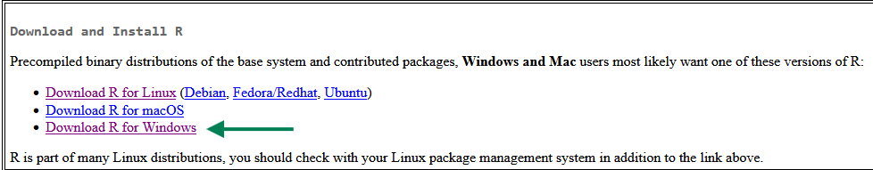
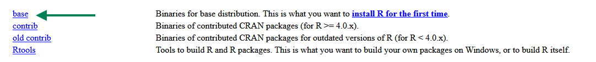
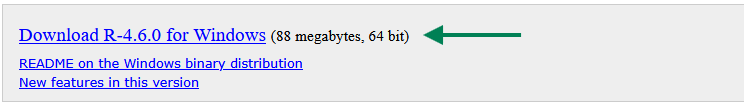
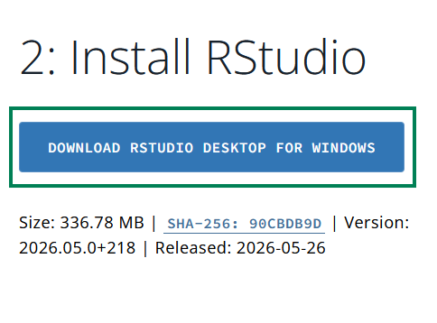
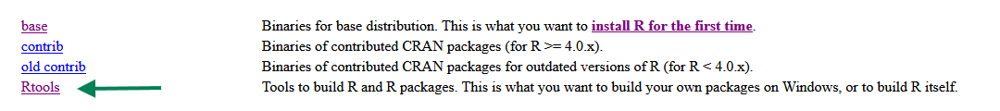
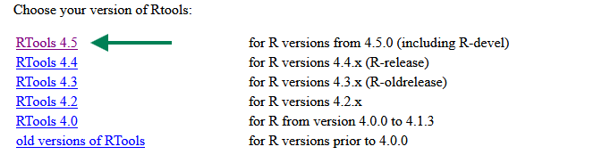
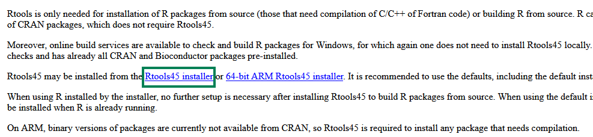

::: {.tut-standfirst}
Instale o app para Windows ou Linux, ou o pacote R para macOS e para quem já usa R. Você não precisa saber programar.
:::

## Escolha o caminho

| Sistema | O que instalar | Requisito |
|---|---|---|
| Windows 64 bits | App, arquivo `.exe` | Windows x64 |
| Ubuntu 24.04 ou mais novo, Debian 13 ou mais novo | App, arquivo `.deb` | Linux x64 |
| Fedora 40 ou mais novo, outro Linux com glibc 2.39 ou mais nova | App, arquivo AppImage | Linux x64, permissão de execução |
| macOS, ou quem já usa R | Pacote R | R 4.1 ou mais novo |

O app traz o R e as dependências. Ele não usa o R que já estiver no computador.

## Instale o app no Windows

1. Baixe o arquivo `.exe` na **[página de versões](https://github.com/rogerio-onza/saira/releases/latest)**.
2. Execute o arquivo. Se o Windows avisar que o editor é desconhecido, clique em **Mais informações** e em **Executar assim mesmo**.
3. Abra o **Saíra** pelo menu Iniciar.

## Instale o app no Linux

Baixe o arquivo na **[página de versões](https://github.com/rogerio-onza/saira/releases/latest)**. Para o `.deb`, rode:

```bash
sudo apt install ./<arquivo-baixado>.deb
```

Para o AppImage, dê permissão de execução e abra o arquivo:

```bash
chmod +x <arquivo-baixado>.AppImage
./<arquivo-baixado>.AppImage
```

::: {.callout-warning}
## O AppImage mostrou uma mensagem e não abriu?
Alguns sistemas bloqueiam o sandbox do AppImage, como o Ubuntu 24.04 com AppArmor. Instale o `.deb`: ele traz o perfil de AppArmor do app.
:::

## Use e feche o app

A janela não tem barra de menu. Os atalhos de edição, zoom, tela cheia e `Ctrl+Q` funcionam. Links externos abrem no navegador. Cada download pergunta em que pasta salvar.

O Saíra não salva a sessão. Se você fechar com dados não exportados, o app diz quantos registros perdem o mapeamento e as correções. Ele oferece **Ir para Exportação** ou **Fechar sem exportar**. Depois de um download na Exportação, o app só pergunta se pode fechar.

## O que fica salvo entre sessões

| Fica salvo | Não fica salvo |
|---|---|
| Aliases aprendidos na exportação | A planilha carregada |
| Bases Flora BR e Fauna BR | O mapeamento |
| Tema e, no app, tamanho e posição da janela | Decisões de nomes, coordenadas e generalização |
| Arquivos exportados, na pasta que você escolheu | Correções da pré-visualização |

O `<dataset>-mapping-guide.txt` restaura só o mapeamento numa próxima sessão. Ele não é um projeto salvo. Veja [Reaproveite o mapeamento](03-mapeamento-dwc.qmd#reaproveite-o-mapeamento).

## Instale o pacote R

Use este caminho no macOS ou se você já trabalha em R. O R, a compilação e o Rtools valem só para este caminho.

### R

Precisa do R 4.1 ou superior. Baixe no **[CRAN](https://cran.r-project.org/)**. Os passos abaixo são para Windows. No macOS, escolha **Download R for macOS**.

```{=html}
<figure class="shot"></figure>
<figure class="shot"></figure>
<figure class="shot"></figure>
```

1. Clique em **Download R for Windows**.
2. Clique em **base**.
3. Baixe o instalador e execute com as opções padrão.

### RStudio (opcional)

O **[RStudio Desktop](https://posit.co/download/rstudio-desktop)** deixa o uso mais confortável. Qualquer console R também serve.

```{=html}
<figure class="shot"></figure>
```

### Windows: Rtools

O Saíra não está no CRAN. No Windows, a instalação a partir do GitHub precisa do **Rtools** da mesma versão do R. No macOS e no Linux, pule este passo.

```{=html}
<figure class="shot"></figure>
<figure class="shot"></figure>
<figure class="shot"></figure>
```

1. Na página do R para Windows, abra **Rtools**.
2. Escolha a versão do seu R, por exemplo **RTools 4.5** para R 4.5.
3. Baixe o instalador e execute com as opções padrão.

### Linux: bibliotecas de sistema

Os pacotes espaciais precisam de `GDAL`, `GEOS` e `PROJ`. No Debian e no Ubuntu, rode:

```bash
sudo apt-get install -y libgdal-dev libgeos-dev libproj-dev libudunits2-dev
```

### Saíra

No R ou no RStudio, rode:

```r
options(repos = c(
  ropensci = "https://ropensci.r-universe.dev",
  CRAN     = "https://cloud.r-project.org"
))
install.packages("pak")
pak::pak("rogerio-onza/saira")
```

O `options()` dá acesso ao R-universe, porque `florabr` e `faunabr` não estão no CRAN. A primeira instalação baixa e compila as dependências. Ela pode levar alguns minutos.

## Abra o app pelo R

```r
saira::run_app()
```

O app abre numa aba do navegador. Para encerrar, feche a aba e pare a sessão R (`Esc` no console ou o botão de parada do RStudio).

::: {.callout-warning}
## A aba não abriu?
O `run_app()` mostra um endereço como `http://127.0.0.1:xxxx`. Abra esse endereço no navegador. Esse endereço só abre neste computador.
:::

::: {.callout-note}
## Servir a outras pessoas
O Saíra não tem login. Deixe o app em `127.0.0.1` e ponha na frente um proxy reverso com HTTPS e autenticação. Com `SAIRA_PUBLIC=true`, as sessões não gravam aliases no Rostrum do servidor.

```r
Sys.setenv(SAIRA_PUBLIC = "true")
options(shiny.port = 3838)
saira::run_app()
```
:::

## Idioma e tema

O seletor no canto superior troca o idioma entre PT, EN e ES a qualquer momento, sem perder o trabalho. O seletor de tema oferece **Tema claro**, **Tema escuro** e **Seguir o sistema**. O app aceita arquivos de até 500 MB.

## Atualize

A barra de navegação do app mostra a versão em uso.

### App

O app não se atualiza sozinho. Baixe a versão nova na **[página de versões](https://github.com/rogerio-onza/saira/releases/latest)**. No Windows, execute o `.exe` novo. No Linux, rode de novo o `sudo apt install` com o `.deb` novo, ou troque o AppImage antigo pelo novo e dê a permissão de execução.

### Pacote R

Feche o app, rode o mesmo `options()` da instalação e depois:

```r
pak::pak("rogerio-onza/saira")
```

Reinicie o R antes de abrir o app. Esse comando atualiza só o pacote R, não o app. Para ver a versão instalada, rode `packageVersion("saira")`.
