::: {.tut-standfirst}
Associe cada coluna da planilha a um termo Darwin Core na etapa **Mapeamento**.
:::

## Revise o mapeamento automático

```{=html}
<figure class="shot">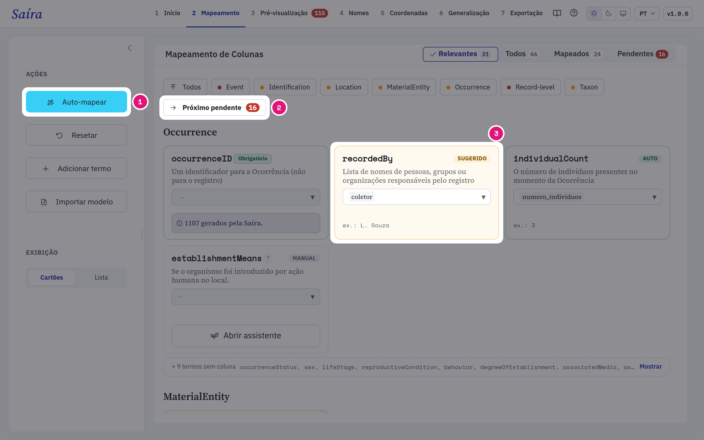</figure>
```

::: {.marks}
1. O Saíra mapeia uma vez, logo depois do envio. **Auto-mapear** roda de novo.
2. **Próximo pendente** pula para o próximo card que pede revisão. O número diz quantos faltam. Nos filtros de classe, ponto vermelho é obrigatório vazio, laranja é revisar.
3. Card amarelo é **SUGERIDO**: confirme ou troque.
:::

## Filtre os termos

```{=html}
<figure class="shot">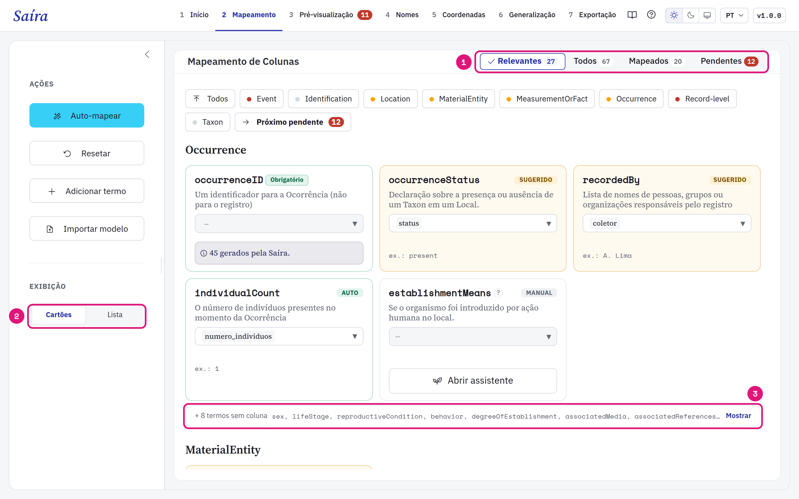</figure>
```

::: {.marks}
1. **Mostrar termos** filtra os cards. Cada filtro mostra a contagem.
2. **Cartões** e **Lista** mudam a forma da tela.
3. O bloco **termos sem coluna** agrupa os termos opcionais sem coluna. **Mostrar** abre o bloco, e o botão de cada linha abre o card.
:::

| Filtro | Mostra |
|---|---|
| Relevantes | Os termos que não estão recolhidos. |
| Todos | Todos os termos, também os recolhidos. |
| Mapeados | Os termos com coluna ou valor fixo. |
| Pendentes | A mesma fila do **Próximo pendente**: obrigatórios vazios e sugestões para revisar. Um termo opcional sem coluna não é pendente. |

## Mapeie os termos obrigatórios

Seis termos são obrigatórios: <span class="term">scientificName</span> <span class="term">eventDate</span> <span class="term">decimalLatitude</span> <span class="term">decimalLongitude</span> <span class="term">basisOfRecord</span> <span class="term">license</span>. Sem um deles, a exportação bloqueia.

::: {.callout-warning}
## Mapeie o occurrenceID
<span class="term">occurrenceID</span> aparece como **Obrigatório** no card, mas não bloqueia a exportação. Sem ele, o Saíra cria um UUID a partir do conteúdo da linha. O UUID fica igual a cada exportação, mas muda se o conteúdo da linha mudar. Mapeie a coluna com os seus identificadores. O Saíra só preenche as linhas vazias.
:::

## Revise cada card

```{=html}
<figure class="shot">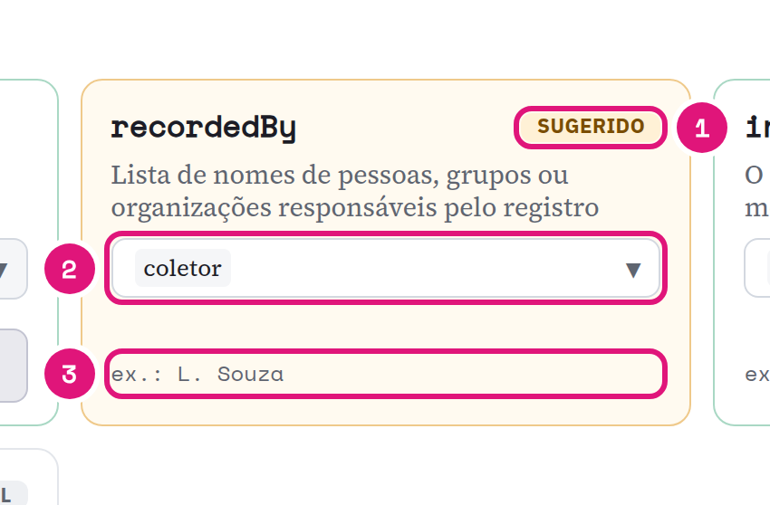</figure>
```

::: {.marks}
1. O selo diz de onde veio o termo.
2. Coluna errada? Troque no seletor.
3. `ex.:` mostra o primeiro valor lido da coluna.
:::

| Selo | Significado |
|---|---|
| AUTO | Alta confiança. Já vem preenchido. |
| SUGERIDO | Provável. Confirme. |
| AMBÍGUO | Dois termos empatados. Você escolhe. |
| EDITADO | Você mudou. Sua escolha vale. |
| ALIAS | Veio de um mapeamento anterior. |
| TEMPLATE | Veio de um modelo importado. |
| MANUAL | Sem sugestão automática. |

Se a mesma coluna vai para mais de um termo, o Saíra avisa. Confira se é intencional.

Uma coluna com latitude e longitude em cada célula, como `23°33'S 46°38'W` ou `-23.55, -46.63`, vai para os dois cartões de coordenada. O Saíra divide cada célula entre os dois termos, sem o aviso.

## Confira os valores padronizados

O Saíra traduz valores conhecidos para o vocabulário Darwin Core:

| Termo | Na planilha | Sai como |
|---|---|---|
| <span class="term">occurrenceStatus</span> | `visto` | `present` |
| <span class="term">sex</span> | `M`, `macho` | `male` |
| <span class="term">sex</span> | `F`, `fêmea` | `female` |
| <span class="term">lifeStage</span> | `adulto` | `adult` |
| <span class="term">lifeStage</span> | `jovem`, `juvenil` | `juvenile` |

Um valor que o Saíra não reconhece fica como está e vai para **Problemas** na [Pré-visualização](04-pre-visualizacao.qmd#corrija-um-valor). `filhote` só recebe sugestão, porque serve para `juvenile` e `nestling`.

## Defina o basisOfRecord

```{=html}
<figure class="shot">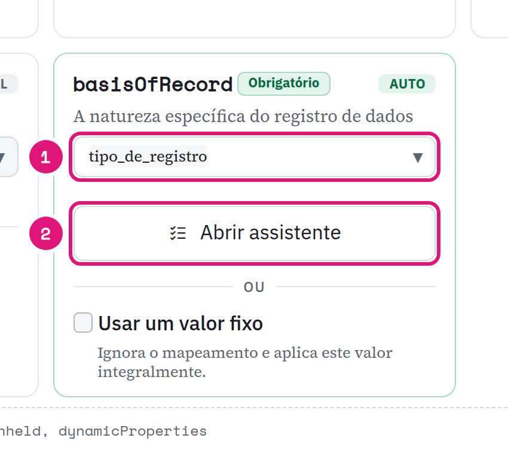</figure>
```

::: {.marks}
1. Escolha a coluna com o tipo de registro, como <span class="term">tipo_de_registro</span>.
2. Abra o **Assistente basisOfRecord**.
:::

```{=html}
<figure class="shot">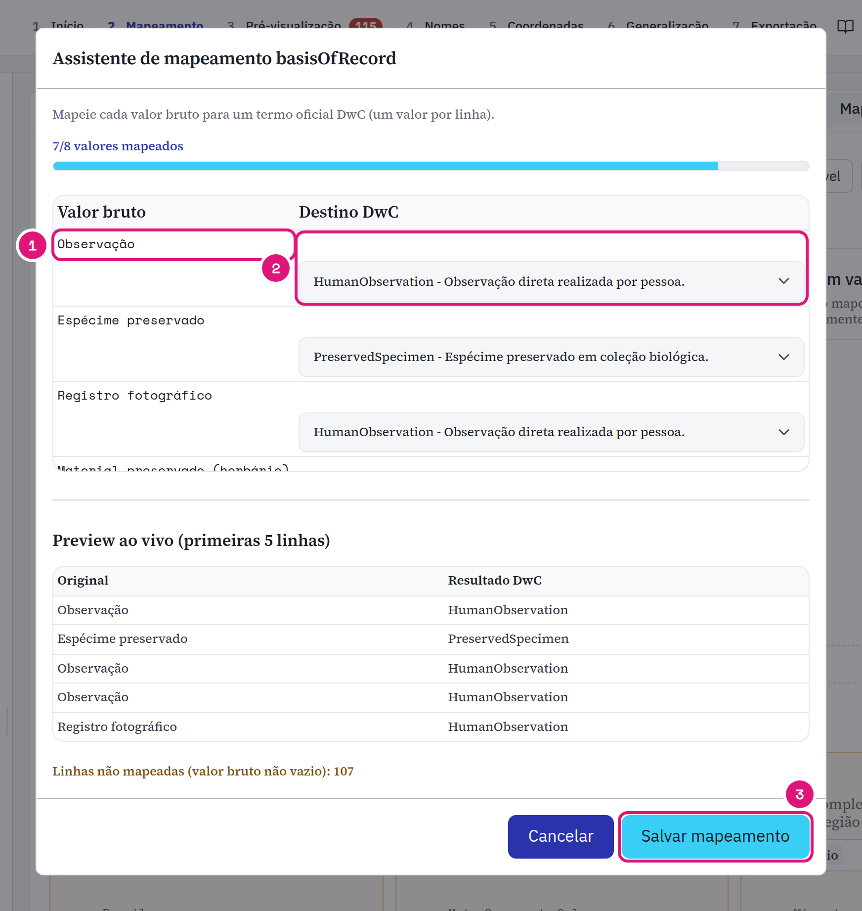</figure>
```

::: {.marks}
1. Cada valor diferente da coluna aparece uma vez.
2. Escolha o termo Darwin Core. A prévia embaixo mostra o resultado.
3. **Salvar mapeamento**.
:::

## Responda establishmentMeans por espécie

Opcional. O assistente fica no card <span class="term">establishmentMeans</span> e precisa de <span class="term">scientificName</span> mapeado.

```{=html}
<figure class="shot">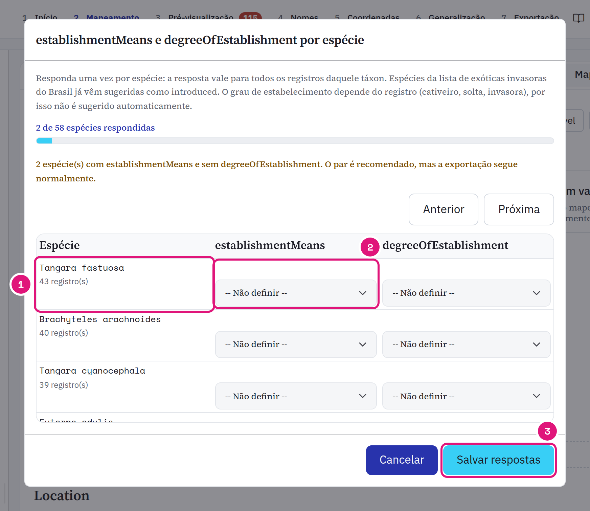</figure>
```

::: {.marks}
1. Uma linha por espécie, com o número de registros que a resposta cobre.
2. Escolha <span class="term">establishmentMeans</span>. Ao lado, o <span class="term">degreeOfEstablishment</span>.
3. **Salvar respostas**.
:::

Espécies invasoras já chegam como `introduced`. Uma nativa translocada com registros em ilha oceânica se divide em duas linhas: **No continente** e **Em ilha oceânica**. A linha da ilha sugere `introduced` e só você aplica, com **Aplicar**. As ilhas são Fernando de Noronha, Atol das Rocas, Trindade e Martim Vaz e São Pedro e São Paulo.

O grau nunca é sugerido: só você sabe se o animal está em cativeiro ou solto. Se uma coluna da planilha também preenche o termo, a coluna vence.

## Use um valor fixo para o conjunto

```{=html}
<figure class="shot">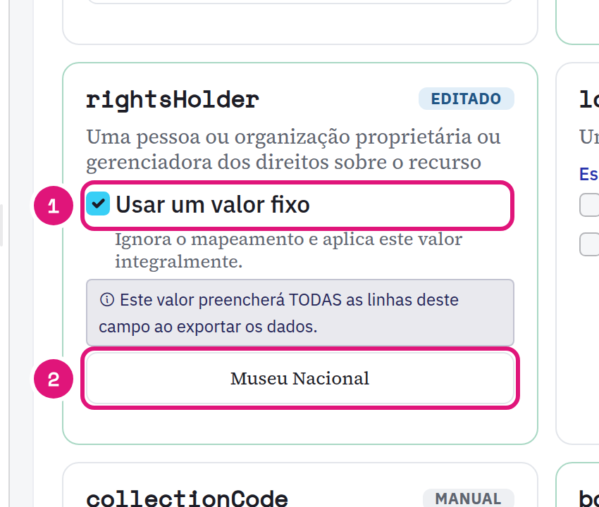</figure>
```

::: {.marks}
1. Marque **Usar um valor fixo**.
2. Digite o valor uma vez. Ele vai para todas as linhas.
:::

Aceitam valor fixo: <span class="term">rightsHolder</span> <span class="term">institutionCode</span> <span class="term">collectionCode</span> <span class="term">country</span> <span class="term">references</span> <span class="term">bibliographicCitation</span> <span class="term">geodeticDatum</span> <span class="term">basisOfRecord</span>. Use o valor fixo em <span class="term">basisOfRecord</span> quando a planilha não tem coluna com o tipo de registro.

## Escolha a licença e o nome do conjunto

O card <span class="term">license</span> é obrigatório. Escolha `CC0`, `CC BY 4.0` ou `CC BY-NC 4.0`, as três licenças que o GBIF aceita. Sem licença, a exportação bloqueia.

Em <span class="term">datasetName</span>, escolha uma coluna ou digite o nome. Ele dá o título do `eml.xml` e o início do nome dos arquivos.

## Adicione um termo que não aparece

```{=html}
<figure class="shot">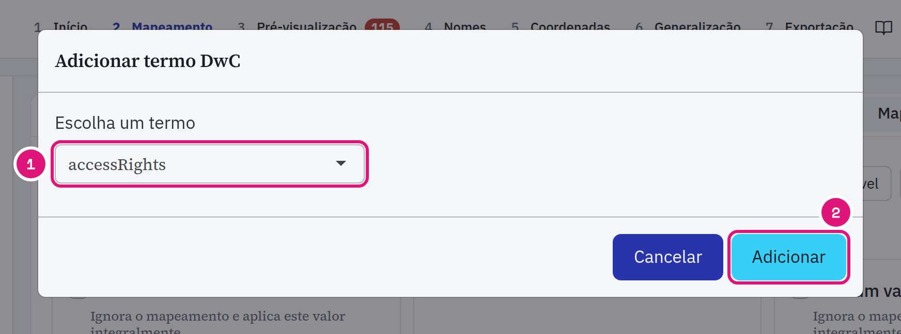</figure>
```

::: {.marks}
1. Busque o termo.
2. **Adicionar**. O termo vira um card novo.
:::

## Junte colunas extras em dynamicProperties

```{=html}
<figure class="shot">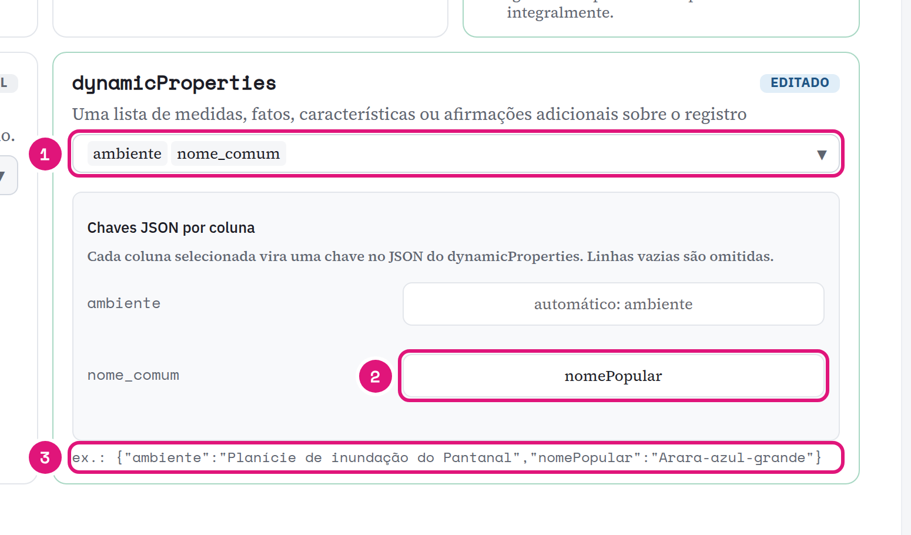</figure>
```

::: {.marks}
1. Escolha as colunas.
2. Renomeie a chave, se quiser.
3. Confira o JSON da primeira linha.
:::

O status de conservação entra no mesmo campo, a partir da [validação de nomes](05-validacao-nomes.qmd).

## Registre medidas

```{=html}
<figure class="shot">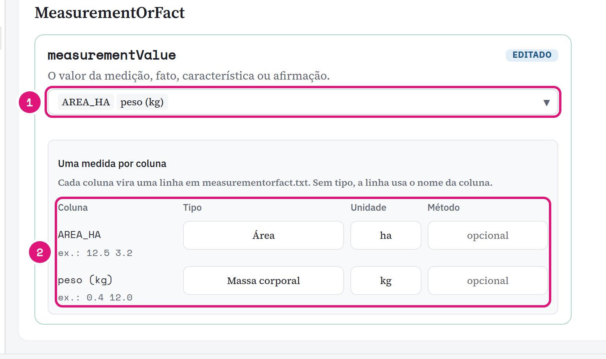</figure>
```

::: {.marks}
1. No card <span class="term">measurementValue</span>, escolha uma ou mais colunas. O Saíra sugere colunas de números com a unidade no nome, como `AREA_HA` ou `peso (kg)`.
2. Em cada coluna, preencha **Tipo**, **Unidade** e, se quiser, **Método**. Sem tipo, a linha usa o nome da coluna.
:::

Cada coluna vira uma linha em `measurementorfact.txt`, ligada à ocorrência, e sai do `occurrence.txt`. A [Pré-visualização](04-pre-visualizacao.qmd) mostra cada medida separada, como `measurementValue [AREA_HA]`.

## Reaproveite o mapeamento

O `.zip` exportado traz o `<dataset>-mapping-guide.txt`. Na próxima planilha, clique em **Importar modelo**:

```{=html}
<figure class="shot">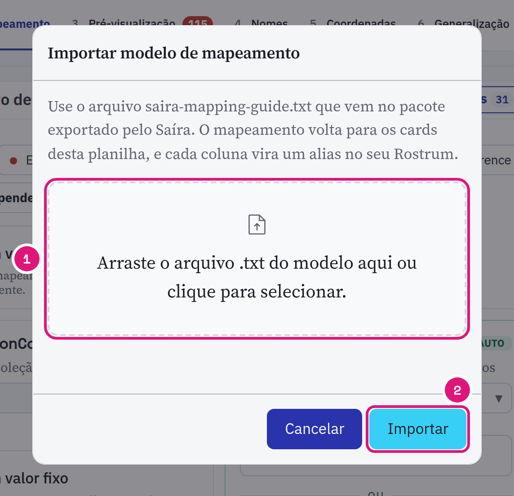</figure>
```

::: {.marks}
1. Envie o arquivo.
2. **Importar**. Colunas com o mesmo nome são mapeadas sozinhas.
:::

O guia restaura os termos mapeados, <span class="term">datasetName</span>, a licença, o idioma e os valores fixos. Cada coluna vira um alias. Se uma coluna do modelo não existe na planilha, o Saíra avisa e lista até cinco. O guia não restaura nomes, coordenadas, generalização nem correções da pré-visualização.

O Saíra aprende aliases só na exportação. Veja [Confira o que o Rostrum aprendeu](08-exportacao.qmd#confira-o-que-o-rostrum-aprendeu).

Colunas com dados que você não mapear saem no fim do arquivo, com o nome original, fora do `meta.xml`. O GBIF ignora essas colunas. Colunas vazias sem mapeamento saem do arquivo.
