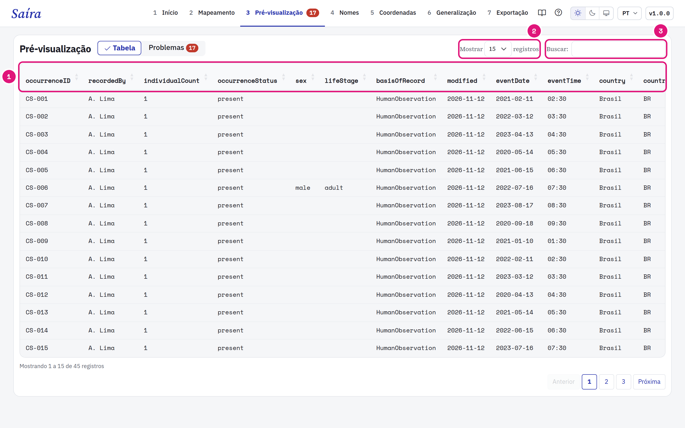
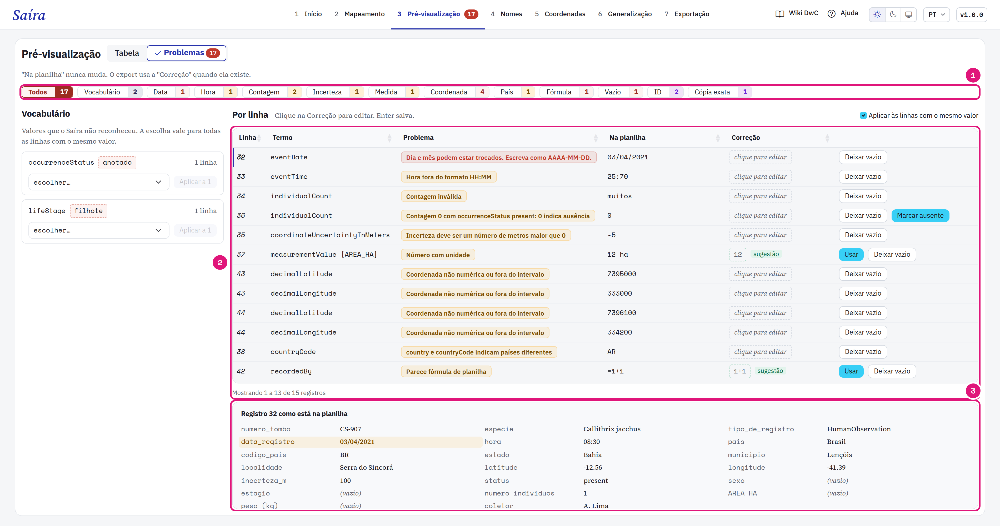
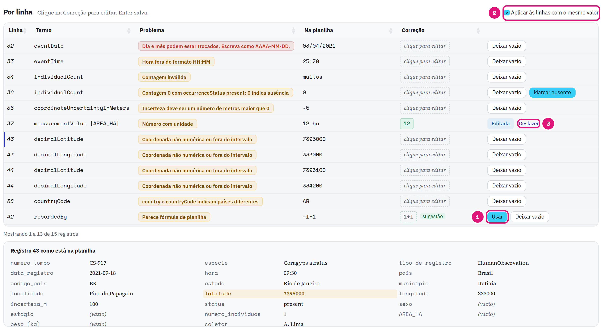
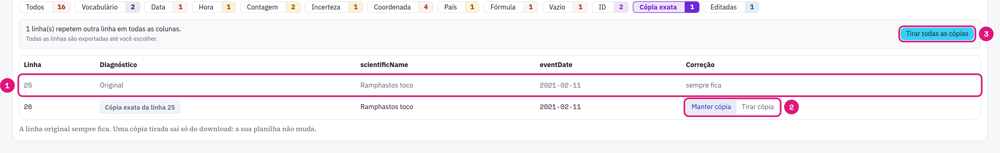

::: {.tut-standfirst}
Confira os dados em Darwin Core e corrija valores na etapa **Pré-visualização**. A sua planilha não muda.
:::

## Escolha o modo

```{=html}
<figure class="shot"></figure>
```

::: {.marks}
1. **Tabela** mostra os primeiros 100 registros. As colunas já têm os nomes Darwin Core.
2. Escolha quantas linhas ver.
3. Busque um valor em qualquer coluna.
:::

**Problemas** confere todos os registros, não só os 100 da tabela. A etapa abre em **Problemas** quando há problema aberto. O número na etapa, no menu, diz quantos problemas faltam corrigir.

## Encontre os problemas

```{=html}
<figure class="shot"></figure>
```

::: {.marks}
1. Os filtros separam os problemas por tipo, com a contagem. **Editadas** mostra o que você já corrigiu.
2. Cada linha traz o termo, o diagnóstico, o valor **Na planilha** e a **Correção**.
3. O registro da linha escolhida, como está na planilha. A coluna do problema fica marcada.
:::

**Na planilha** nunca muda. A exportação usa a **Correção** quando ela existe. A lista abre no primeiro problema. Clique em outra linha para ver o registro dela. Numa janela estreita, o registro aparece abaixo da lista.

## Corrija um valor

```{=html}
<figure class="shot"></figure>
```

::: {.marks}
1. Clique na **Correção** e digite. Enter salva. **Usar** aceita a sugestão do Saíra.
2. **Aplicar às linhas com o mesmo valor** vem ligado. **+N iguais** diz quantas linhas a correção também cobre.
3. **Desfazer** volta ao valor da planilha.
:::

Em valores de vocabulário, escolha um valor **Sugerido** ou do **Vocabulário GBIF**. A escolha vale para todas as linhas com o mesmo valor. **Deixar vazio** apaga o valor na exportação. Termos obrigatórios não têm essa opção.

## Volte ao Mapeamento quando o erro é da coluna

Quando um tipo de problema num termo cobre 20% dos registros ou mais, e pelo menos 20 registros, o Saíra mostra **Voltar ao Mapeamento**. A causa costuma ser uma coluna no termo errado ou um formato. Confira a coluna no [Mapeamento](03-mapeamento-dwc.qmd) antes de corrigir linha por linha.

## Casos comuns

| Filtro | Exemplo | O que fazer |
|---|---|---|
| Vocabulário | `anotado` em <span class="term">occurrenceStatus</span> | Escolha um valor sugerido ou do vocabulário GBIF. |
| Data | `03/04/2021` | Dia e mês podem estar trocados. Escreva como `AAAA-MM-DD`. |
| Data | `2021-13-40` | O Saíra não leu a data. Escreva como `AAAA-MM-DD`. O Saíra já lê nomes de mês, meses em romano, datas compactas e intervalos. |
| Hora | `25:70` | Escreva como `HH:MM`. |
| Contagem | `muitos` | Escreva um número. |
| Contagem | `0` com <span class="term">occurrenceStatus</span> `present` | `0` indica ausência. Clique em **Marcar ausente** ou corrija a contagem. |
| Incerteza | `-5` | Escreva os metros, um número maior que 0. |
| Medida | `12 ha` | Escreva só o número. A unidade vai no campo **Unidade** do card <span class="term">measurementValue</span>. |
| País | <span class="term">country</span> `Brasil` com <span class="term">countryCode</span> `AR` | Confira qual está certo. O Saíra não corrige em lote. |
| Vazio | <span class="term">scientificName</span> vazio | Escreva o táxon mais específico que você conhece. |
| ID | Dois registros diferentes com o mesmo <span class="term">occurrenceID</span> | Escreva o identificador certo de cada um. |
| Fórmula | `=1+1` | Escreva o valor. Esta célula bloqueia a exportação. |

## Decida as cópias exatas

```{=html}
<figure class="shot"></figure>
```

::: {.marks}
1. O filtro **Cópia exata** lista as linhas que repetem outra linha em todas as colunas da planilha. A linha original sempre fica.
2. **Tirar cópia** e **Manter cópia** decidem uma linha.
3. **Tirar todas as cópias** decide todas de uma vez.
:::

Todas as linhas são exportadas até você escolher. Uma cópia tirada sai só do download. O ID repetido de uma cópia aparece em **Cópia exata**. Dois registros diferentes com um ID só ficam em **ID**: os dois são exportados.

::: {.callout-warning}
## O que acontece com um ID repetido
Se você não corrigir, o Saíra troca cada ID repetido por um UUID persistente. O UUID vem do conteúdo da linha: ele fica igual a cada exportação, mas muda se o conteúdo da linha mudar. Corrija o ID quando você tem o identificador certo. Veja [Mapeie o occurrenceID](03-mapeamento-dwc.qmd#mapeie-os-termos-obrigatórios).
:::
