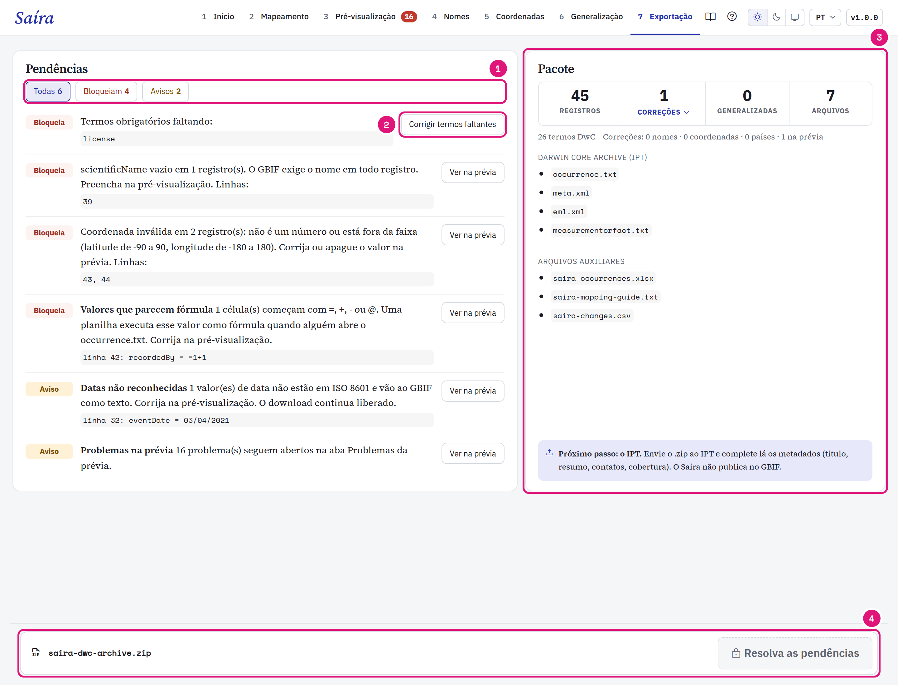
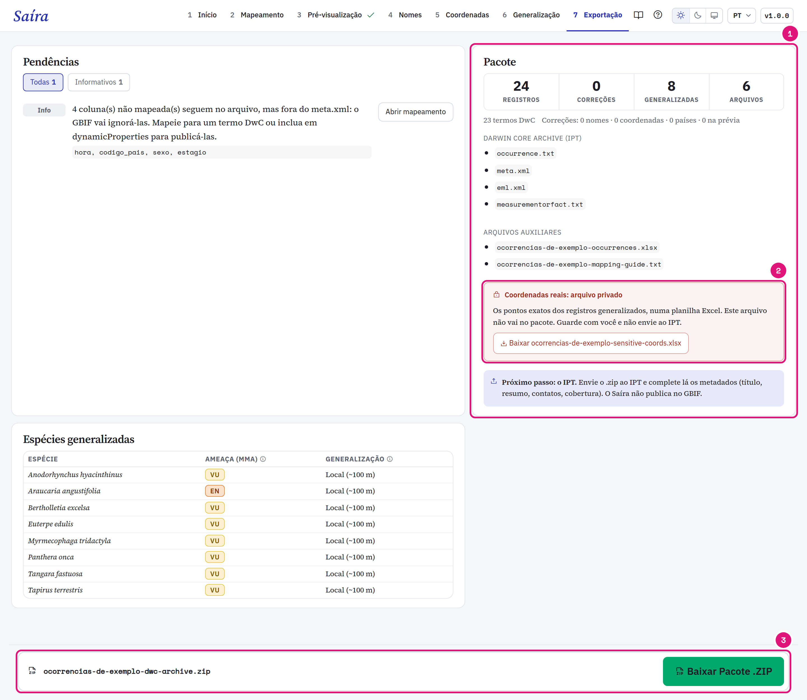

::: {.tut-standfirst}
Resolva as pendências e baixe o Darwin Core Archive na etapa **Exportação**. A conferência dos dados fica na [Pré-visualização](04-pre-visualizacao.qmd).
:::

## Resolva as pendências

```{=html}
<figure class="shot"></figure>
```

::: {.marks}
1. Os filtros contam as pendências por tipo: **Todas**, **Bloqueiam**, **Avisos** e **Informativos**. As que bloqueiam vêm primeiro. **Bloqueia** impede o download. **Aviso** deixa baixar. **Info** só informa.
2. Cada pendência tem um botão que leva à etapa que resolve.
3. O pacote: registros, correções, espécies generalizadas e arquivos.
4. O download fica desativado enquanto houver pendência que bloqueia.
:::

| Pendência | Tipo | Onde resolver |
|---|---|---|
| Termo obrigatório faltando, como <span class="term">eventDate</span> ou <span class="term">license</span> | Bloqueia | [Mapeamento](03-mapeamento-dwc.qmd#mapeie-os-termos-obrigatórios) |
| <span class="term">basisOfRecord</span> vazio ou sem termo DwC | Bloqueia | [Assistente basisOfRecord](03-mapeamento-dwc.qmd#defina-o-basisofrecord) |
| <span class="term">scientificName</span> vazio | Bloqueia | [Pré-visualização](04-pre-visualizacao.qmd#casos-comuns) |
| Célula que parece fórmula de planilha, mapeada ou não | Bloqueia | [Pré-visualização](04-pre-visualizacao.qmd#casos-comuns) |
| Coordenada inválida | Bloqueia | [Coordenadas](06-validacao-coordenadas.qmd) |
| Generalização sem justificativa | Bloqueia | [Generalização](07-generalizacao.qmd#trate-uma-espécie-à-parte) |
| Um campo de texto, um nome de coluna ou um <span class="term">occurrenceID</span> mostra o ponto de um registro protegido | Bloqueia | Pré-visualização, ou a planilha original para coluna não mapeada. |
| O GBIF não respondeu à consulta IUCN | Bloqueia | **Tentar de novo**, ou **Exportar sem a IUCN que falta**. |
| Decisão de uma etapa que o Saíra não conseguiu ler | Bloqueia | Abra de novo as etapas que a mensagem cita e confira. |
| Data não lida, ano fora do intervalo, contagem zero sem status | Aviso | [Pré-visualização](04-pre-visualizacao.qmd#casos-comuns) |
| Marcação de Coordenadas, problema aberto na Pré-visualização | Aviso | O botão da pendência leva à etapa. |
| Coluna não mapeada | Info | O GBIF ignora a coluna. Mapeie para um termo ou inclua em <span class="term">dynamicProperties</span>. |

## Confira o pacote

```{=html}
<figure class="shot"></figure>
```

::: {.marks}
1. Os arquivos que vão no `.zip`.
2. O arquivo privado, baixado à parte.
3. **Baixar Pacote .ZIP** libera quando nada bloqueia.
:::

Clique em **Correções** para ver um exemplo por tipo: Nomes, Coordenadas, Países e Na prévia. Cada tipo tem um link para a etapa. A lista completa vai no `<dataset>-changes.csv`. Valores de registros generalizados ficam escondidos.

## O que o Saíra ajusta

- **Datas** em ISO 8601: `AAAA-MM-DD`, `AAAA-MM` sem dia, `AAAA-MM-DDThh:mm` com hora. Um ano antes de 1600 ou depois do ano atual gera aviso, sem bloquear.
- **Coordenadas** com ponto decimal.
- **Licença** com o nome escolhido (`CC BY 4.0`) no `occurrence.txt` e a URL no `eml.xml`.
- **Título** do `eml.xml` a partir de <span class="term">datasetName</span>. Com uma coluna mapeada, vale o valor mais frequente.
- **Colunas** na ordem do Darwin Core. As colunas não mapeadas com dados ficam no fim, com o nome original. As colunas não mapeadas vazias saem do arquivo.

### Status de conservação no `dynamicProperties`

O Saíra grava o status de conservação conforme as bases da [validação de nomes](05-validacao-nomes.qmd):

- Flora BR ou Fauna BR → `mmaThreatStatus` e `mmaSource`;
- GBIF → `iucnRedListCategory`, consultado quando você abre a Exportação.

```json
{"mmaThreatStatus":"CR","mmaSource":"Portaria 1.704/2026","iucnRedListCategory":"NT"}
```

Enquanto a consulta IUCN roda, a lista de pendências mostra a consulta com a contagem. Se o GBIF não responde para alguns nomes, escolha **Tentar de novo** ou **Exportar sem a IUCN que falta**. Esses nomes saem sem a chave IUCN. As chaves MMA entram em registros do Brasil, pelo <span class="term">country</span> ou <span class="term">countryCode</span>, e em registros que o Saíra generalizou. Os demais registros ficam sem as chaves MMA.

## Arquivos do pacote

O `.zip` (`<dataset>-dwc-archive.zip`) tem o Darwin Core Archive e os arquivos auxiliares. `<dataset>` vem de <span class="term">datasetName</span>. Sem esse termo, o nome é `saira`.

| Arquivo | Uso |
|---|---|
| `occurrence.txt` | Os dados. Vai para o IPT. |
| `meta.xml` | Diz o termo de cada coluna. Vai para o IPT. |
| `eml.xml` | Metadados: título, extensão geográfica, período e licença. Vai para o IPT. |
| `measurementorfact.txt` | As [medidas](03-mapeamento-dwc.qmd#registre-medidas), uma por linha, ligadas à ocorrência. Só existe se você mapeou medidas. Vai para o IPT. |
| `<dataset>-occurrences.xlsx` | Cópia em Excel, com todas as células como texto. Fica de fora acima de 1.048.575 registros, o limite do Excel. |
| `<dataset>-mapping-guide.txt` | O mapeamento, para [reaproveitar](03-mapeamento-dwc.qmd#reaproveite-o-mapeamento). |
| `<dataset>-changes.csv` | Todas as correções, linha por linha. Só existe se há correções. |

## Baixe o arquivo privado

Se você generalizou registros, o cartão **Pacote** mostra um botão próprio para `<dataset>-sensitive-coords.xlsx`. Essa planilha tem as coordenadas originais e fica fora do `.zip`. Guarde, não publique.

## Confira o que o Rostrum aprendeu

Ao exportar, o Saíra guarda cada par de coluna e termo como alias. Numa próxima planilha com as mesmas colunas, o Rostrum sugere os mesmos termos. O cartão **Memória do Rostrum** tem **Ver os aliases** e **Desfazer aprendizado**. Desfazer não muda o `.zip` que você baixou.

## Publique pelo IPT

O Saíra não publica no GBIF. Envie o `.zip` ao IPT da sua instituição ou do SiBBr. No IPT, complete os metadados (resumo, contatos, cobertura) e publique.

## Confira a publicação pelo R

`check_publication()` é uma função do pacote R. O app não tem botão para ela. A função compara o `.zip` com o conjunto publicado e precisa de internet.

```r
saira::check_publication("neotropical-carnivores.zip", "dr1451")
```

O segundo argumento é a chave do conjunto no GBIF (UUID) ou o uid do SiBBr (`dr` e um número). A função devolve `portal`, `dataset`, `sent`, `published`, `missing` e `unexpected`.
